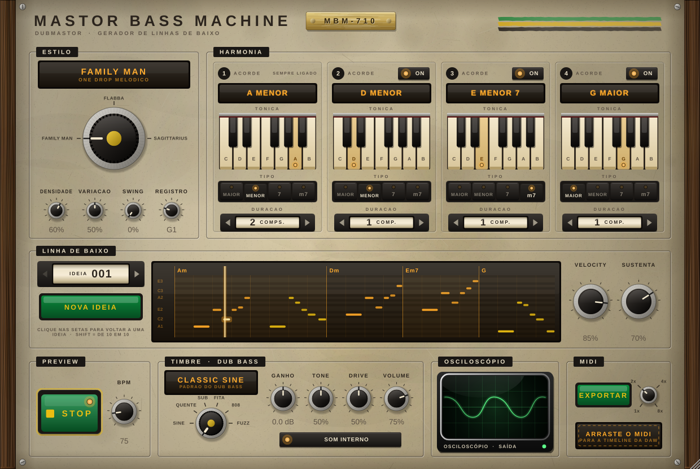

# Mastor Bass Machine MBM-710

← [Voltar para a página inicial do repositório](../README.md)

**[⬇️ Windows](https://github.com/dubmastor/DubMastor-DubStation-/releases/download/BassMachine-1.0/MastorBassMachine-Windows.zip)** · **[⬇️ macOS](https://github.com/dubmastor/DubMastor-DubStation-/releases/download/BassMachine-1.0/MastorBassMachine-macOS.zip)**

Gerador de **sugestões de linha de baixo** em MIDI para riddim de reggae, dub e dancehall. Você escolhe a
harmonia e o estilo de um dos três baixistas, ouve no som interno e arrasta o MIDI para a timeline para
editar à vontade. Mesma família do Dub Chords: sincroniza com o andamento da DAW e tem PLAY próprio.
Formatos: **VST3** (Windows/macOS), **AU** (macOS) e **Standalone**. É um **instrumento**: no Cubase,
carregue numa *Instrument Track*.

## ESTILO (chave seletora)
| Posição | Baixista | O que o gerador faz |
|---|---|---|
| **FAMILY MAN** | Aston "Family Man" Barrett (Bob Marley & The Wailers) | One drop: o tempo 1 fica vazio. Linha melódica (terça, quinta, sexta, oitava), colcheias com swing, tercinas "puxadas para trás" no fim da frase e respostas diferentes a cada dois compassos |
| **FLABBA** | Errol "Flabba" Holt (Roots Radics) | Rub-a-dub do começo dos anos 80: fundamental no 1, notas longas e graves, quinta e sétima abaixo da tônica. Um riff curto que se repete de forma hipnótica, quase sem variação |
| **SAGITTARIUS** | Derrick Barnett (Sagittarius Band) | Dancehall ao vivo dos anos 80/90: ataque curto, síncope 3-3-2, oitavas estaladas e corridas de semicolcheias nas viradas |

| Controle | O que faz |
|---|---|
| **DENSIDADE** | Quantas notas opcionais (ghost notes, repetições) entram na linha |
| **VARIAÇÃO** | Chance de virada no fim da frase e de cada acorde ganhar uma célula diferente |
| **SWING** | Atraso das colcheias e semicolcheias do contratempo (somado ao swing natural do estilo) |
| **REGISTRO** | Nota mais grave da fundamental (E1 a E2) |

## HARMONIA
Até 4 acordes, iguais aos do Dub Chords: **TÔNICA** (teclado mecânico), **TIPO** (maior, menor, 7, m7),
**DURAÇÃO** (1/2 a 8 compassos) e **ON** nos acordes 2 a 4. As notas de aproximação olham para o acorde
seguinte, então a linha sempre "chama" a próxima tônica.

## LINHA DE BAIXO
| Controle | O que faz |
|---|---|
| **IDEIA** | Número da sugestão. A mesma ideia gera sempre a mesma linha: clique nas setas para voltar a uma de que você gostou (Shift = de 10 em 10) |
| **NOVA IDEIA** | Sorteia outra linha com os mesmos acordes e o mesmo estilo |
| **Visor** | Rolo de piano âmbar com as notas, os acordes e o cursor de reprodução. Notas douradas são de virada |
| **VELOCITY / SUSTENTA** | Força das notas e quanto cada nota segura (staccato ↔ ligado) |

## PREVIEW e TIMBRE
| Controle | O que faz |
|---|---|
| **PLAY / STOP** | Toca o loop sem a DAW estar rodando, no **BPM** do knob. Com a DAW tocando, segue o andamento dela |
| **TIMBRE** | Os timbres do **Dub Bass**: CLASSIC SINE (o som padrão dele), SINE QUENTE, SUB PURO, FITA ROOTS, 808 e 808 FUZZ. O nível geral fica 5 dB abaixo do Dub Bass. O preview usa a mesma voz (senoide + harmônicos ou 808), o mesmo filtro, as saturações TUBE / TAPE / FUZZ e o maximizer do Dub Bass |
| **GANHO** | Ganho do sinal de entrada (−12 a +12 dB) antes da saturação e do maximizer: mais ganho, mais saturação e mais compressão. Duplo clique volta a 0 dB |
| **TONE / DRIVE / VOLUME** | Cutoff do filtro (±1,5 oitava sobre o timbre), quantidade de saturação (50% = como no Dub Bass) e volume |
| **SOM INTERNO** | Desligue quando mandar o MIDI para o seu próprio baixo (por exemplo, o Dub Bass completo, com EQ e reverb) |
| **OSCILOSCÓPIO** | Tubo verde com a onda que sai do som interno (o mesmo do Mastor Fone) |

## MIDI
- **ARRASTE O MIDI:** clique e arraste a área âmbar para a timeline. Vem uma faixa de baixo no BPM do projeto, pronta para editar.
- **EXPORTAR:** salva o `.mid` (padrão: Documentos/Bass Machine). **REPETIR** exporta o loop 1, 2, 4 ou 8 vezes.
- **MIDI ao vivo:** as notas também saem como MIDI do plugin (canal 1), onde a DAW permite rotear a saída MIDI de um instrumento.

## Para desenvolvedores
- `Source/BassEngine.h`: lógica das linhas (C++ puro). Cada estilo é um "livro" de células de um compasso (grooves e viradas) com graus (R, 3, 5, 7, oitava, quinta grave, aproximação...). Para criar um estilo novo, acrescente um livro em `book()`.
- `Source/DubBassTimbre.h`: preview com o sistema de timbres do Dub Bass. Inclui `DubBass/Source/BassVoice.h` e `Maximizer.h` direto da pasta do Dub Bass, então o som acompanha as mudanças dele. Cada timbre é uma linha da tabela `timbre()`.
- `Source/PluginProcessor.*`: parâmetros, sincronia com a DAW, PLAY, saída MIDI, exportação, buffer do osciloscópio.
- `Source/PluginEditor.*`: interface (LookAndFeel do Big Knob / Dub Chords, osciloscópio do Mastor Fone).
- `tests/engine_test.cpp`: teste do motor (registro, monofonia, one drop do Family Man, determinismo, notas presas).
- `tests/snapshot.cpp`: gera o PNG da interface sem DAW e, opcionalmente, um WAV do preview (`-DBASSMACHINE_SNAPSHOT=ON -DBASSMACHINE_PLUGIN=OFF`).
