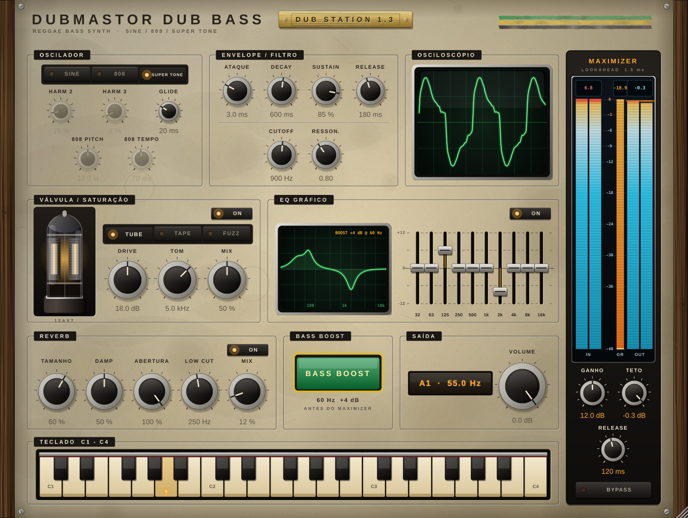

# Dub Bass - Dub Station 1.3

Instrumento de baixo de reggae (VST3 / AU / Standalone) da linha **DubMastor · Dub Station**, no mesmo visual do Dub Chords: painel creme envelhecido, laterais de madeira, plaqueta de latão com a versão, knobs de baquelite e lâmpadas âmbar.



## Cadeia de sinal

```
OSCILADOR (Classic Sine + harmônicos | 808 | Super Tone) → FILTRO → ENVELOPE → VÁLVULA / SATURAÇÃO (2x oversampling)
→ EQ GRÁFICO 10 bandas → REVERB (envio paralelo com low cut) → BASS BOOST 60 Hz +4 dB
→ MAXIMIZER (lookahead 1.5 ms, com BYPASS) → VOLUME
```

## Controles

| Seção | O que tem |
|---|---|
| **Oscilador** | Teclas SINE / 808 / SUPER TONE, Harm 2 e Harm 3 (no Sine e no 808), Glide, 808 Pitch e 808 Tempo (só no 808). O **Super Tone** é o baixo digital da era Super Power do King Jammy (Sleng Teng): quadrada sem aliasing com peso de senoide e o grão de 7 bits do teclado Casio dos anos 80 |
| **Envelope / Filtro** | Ataque, Decay, Sustain (desligado no 808), Release, Cutoff e Ressonância |
| **Osciloscópio** | Tela de fósforo verde com a onda da saída, parada no cruzamento por zero |
| **Válvula / Saturação** | ON (começa desligada), teclas TUBE / TAPE / FUZZ, Drive, Tom e Mix. A válvula 12AX7 esquenta com o DRIVE e com o sinal: vai do vermelho apagado ao laranja, âmbar e branco quente, com o brilho azul de válvula forçada no limite. Esquenta rápido e esfria devagar |
| **EQ gráfico** | ON, 10 faders ±12 dB (32 Hz a 16 kHz) e a curva em tela verde (mostra o Bass Boost também) |
| **Reverb** | ON (começa desligado), Tamanho, Damp, Abertura, Low Cut (o grave fica seco) e Mix |
| **Bass Boost** | Botão verde: +4 dB em 60 Hz, antes do maximizer |
| **Saída** | Display âmbar com a nota tocando (nome e Hz) e Volume |
| **Teclado** | C1 a C4 no padrão Dub Station (marfim, baquelite, barra cromada com feltro vermelho): toca clicando (mais embaixo na tecla = mais forte) e acende com lâmpada âmbar nas notas que chegam da DAW |
| **Maximizer** (lateral direita) | VU digital estilo Ozone: entrada L/R, redução de ganho e saída L/R, com leituras numéricas, pico retido e a marca do teto. Ganho, Teto, Release e BYPASS (com lâmpada vermelha; a latência continua a mesma) |

Mono/legato: no Classic Sine as notas ligadas deslizam com o glide; no 808 cada nota reataca o envelope e o drop de pitch. Pitch bend ±2 semitons. Duplo clique volta qualquer controle ao padrão. A janela é redimensionável.

## Versão

A versão fica em `CMakeLists.txt` (`project(DubBass VERSION x.y.z)`) e aparece sozinha na plaqueta de latão. A cada atualização: suba a versão, atualize `RELEASE_NOTES.md`, o README da raiz e o card do site. O push na `main` publica a release `DubBass-x.y` sozinho.

## Compilar

```bash
cmake -B build -DCMAKE_BUILD_TYPE=Release
cmake --build build --config Release
```

Teste offline (toca uma linha de baixo, confere o teto do maximizer, NaN, estado e salva a interface):

```bash
cmake -B build-test -DDUBBASS_TESTS=ON && cmake --build build-test --target DubBassTest
./build-test/DubBassTest_artefacts/Release/DubBassTest test-out
```

## Publicar

O workflow `.github/workflows/build-dubbass.yml` roda o teste, compila Windows e Mac (universal), valida com pluginval e auval e, a cada push na `main` que mexa no Dub Bass, cria (ou atualiza) a release `DubBass-x.y` da versão do `CMakeLists.txt` com `DubBass-Windows.zip` e `DubBass-macOS.zip`. A release do Dub Bass não vira a "latest", para não mexer nos links dos outros plugins.
