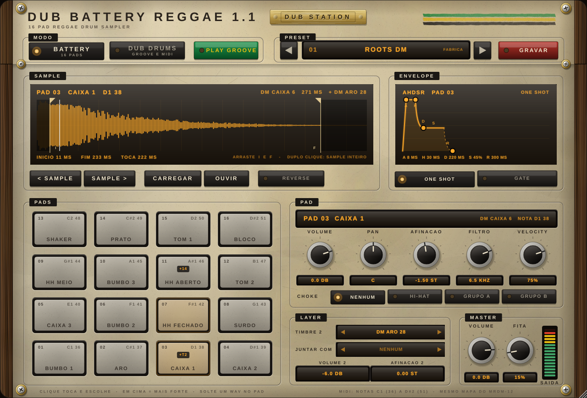

# DUB BATTERY REGGAE 1.1 — Dub Station

Sampler de bateria com **16 pads**, no espírito do Native Instruments Battery, com os pads de borracha de uma
**MPC** que acendem por dentro como na **Roland SP-404** e o visor âmbar de uma **Oberheim DMX**, no visual
Dub Station (painel creme, laterais de madeira, plaquetas pretas). Já vem com os timbres DM e presets de reggae.



**[⬇️ Windows (instalador .exe)](https://dubmastor.github.io/DubMastor-DubStation-/downloads/DubBatteryReggae-Windows-Instalador.exe)** ·
**[⬇️ macOS (instalador .pkg)](https://dubmastor.github.io/DubMastor-DubStation-/downloads/DubBatteryReggae-macOS-Instalador.pkg)** ·
**[▶ Tocar no navegador](https://dubmastor.github.io/DubMastor-DubStation-/battery/)**

Sem instalador: [zip Windows](https://dubmastor.github.io/DubMastor-DubStation-/downloads/DubBatteryReggae-Windows.zip) · [zip Mac](https://dubmastor.github.io/DubMastor-DubStation-/downloads/DubBatteryReggae-macOS.zip)

## Instalação
- **Mac:** abra o `.pkg` (se o macOS avisar que é de desenvolvedor não identificado, clique com o botão direito → **Abrir**).
  Ele instala o VST3 e o AU em `/Library/Audio/Plug-Ins` (Cubase, Ableton, Studio One, Reaper, Bitwig, FL Studio,
  Logic e GarageBand), o programa standalone em Aplicativos, tira a quarentena e faz o Mac reler os Audio Units.
- **Windows:** rode o `.exe`. O VST3 vai para `C:\Program Files\Common Files\VST3`.
- Depois, faça um novo scan de plugins na DAW, se ela não achar sozinha.

## Pads e notas MIDI
Pad 1 fica embaixo à esquerda, como na MPC. As notas seguem em sequência de **C1 (36) a D#2 (51)**, então todas as
peças do **Mastor Reggae Drum Machine MRDM-12** caem no pad certo sem remapear nada.

| | | | |
|---|---|---|---|
| **13** · 48 Shaker | **14** · 49 Prato (DM-PRATOS1) | **15** · 50 Tom 1 | **16** · 51 Bloco |
| **9** · 44 HH meio | **10** · 45 Bumbo 3 | **11** · 46 HH aberto | **12** · 47 Tom 2 |
| **5** · 40 Caixa 3 | **6** · 41 Bumbo 2 | **7** · 42 HH fechado | **8** · 43 Surdo |
| **1** · 36 Bumbo 1 | **2** · 37 Aro | **3** · 38 Caixa 1 | **4** · 39 Caixa 2 |

Samples DM de fábrica: DM-KICKS1 (bumbo 1), DM-SNARES28 (aro), DM-SNARES6 (caixa 1), DM-HATs6 (HH fechado),
DM-HATs39 (HH meio), DM-HATs17 (HH aberto) e DM-PRATOS1 (prato). Os outros pads usam timbres provisórios
sintetizados (SINT) até os kits definitivos chegarem. A biblioteca do **< SAMPLE >** e do TIMBRE 2 tem 34 timbres:
os 16 dos pads, DM-HATs 1, 4, 5 e 7 a 16, DM-PRATOS 2 a 5 e o prato sintetizado.

## Aba BATTERY
- **SAMPLE:** visor com a forma de onda do pad escolhido. Arraste os marcadores **I** (início) e **F** (fim);
  duplo clique volta para o sample inteiro. **< SAMPLE >** troca entre os timbres de fábrica, **CARREGAR** abre
  um WAV/AIFF/FLAC, **OUVIR** toca o pad e **REVERSE** toca de trás para frente.
- **ENVELOPE:** AHDSR gráfico. Arraste **A** (attack), **H** (hold), **D** (decay; para cima/baixo muda o sustain)
  e **R** (release). Duplo clique volta ao padrão. **ONE SHOT** toca até o fim do sample (o release só vale no
  choke); **GATE** solta no note-off.
- **PADS:** clique toca e seleciona (mais em cima = mais forte). Solte um arquivo de áudio em cima de um pad para
  carregar ali. Os pads acendem com o MIDI da DAW e com o groove.
- **PAD:** volume, pan, afinação (±24 semitons), filtro passa-baixa e sensibilidade ao velocity.
- **LAYER:** **TIMBRE 2** toca um segundo timbre junto no mesmo pad (mesmo envelope, filtro e pan; toca o sample
  inteiro), com **VOLUME 2** e **AFINACAO 2** próprios. **JUNTAR COM** faz o pad disparar outro pad junto (o outro
  toca com os ajustes dele). Os pads mostram **+T2** e **+nn** quando estão com layer ou juntos.
- **CHOKE:** HI-HAT (fechado, meio e aberto já vêm nele: o fechado corta o aberto), GRUPO A e GRUPO B.
- **MASTER:** volume, FITA (saturação suave) e VU.

## Presets
**< >** passa pelos presets; **GRAVAR** salva o kit inteiro (samples e ajustes dos 16 pads) em
`Documentos/Dub Battery Reggae/Presets`. De fábrica: ROOTS DM, STEPPERS, ONE DROP ARO, DIGITAL 85, DUB LAYER (caixa com aro, bumbo com sub e HH aberto
juntando o prato) e DUB PESADO.

## Aba DUB DRUMS
O **MRDM-12 inteiro**, com o mesmo código do plugin separado: estilos (Rockers, One Drop, Boom Bap), chave de
baterista (Style Scott, Santa Davis, Carlton Barrett, Sly Dunbar, DIGIKAL), hi-hat, dinâmica, aleatoriedade,
viradas, NOVA VARIAÇÃO e grade editável. O groove **toca nos pads do Battery** (o som interno do MRDM-12 fica
desligado). **PLAY GROOVE** no cabeçalho toca com a DAW parada; com a DAW tocando, o groove segue a timeline.
- **EXPORTAR** salva o .mid; **ARRASTE O MIDI** leva tudo para a timeline.
- Arraste a faixa **COMPASSO n** da grade para levar só aquele compasso.
- **MIDI COLORIDO:** cada compasso vai num canal (1 a 4, intro no 5) para a DAW pintar cada um de uma cor.
- **Notas iguais muito próximas:** quando a aleatoriedade joga uma ghost em cima da mesma peça, fica só a nota
  principal, no tempo certo. Colada (menos de 0,09 tempo), duplicada ou flam (também nas viradas): a fraca sai.
  Próxima (até 0,2 tempo) no bumbo, caixa e tons, a fraca cai para 35% da principal. Os rufos das viradas ficam.

## Versão no navegador
`site/battery/`: os mesmos 16 pads, visor, envelope, presets (salvos no navegador) e a aba DUB DRUMS com o gerador
do MRDM-12 (`site/drums/generator.js`), MIDI por compasso, teclado do computador (Z X C V = pads 1–4) e controlador
MIDI pelo Web MIDI.

## Compilar
```
cmake -B build -DCMAKE_BUILD_TYPE=Release
cmake --build build --config Release
```
Teste sem DAW (imagens das abas, áudio dos pads e do groove, choke, estado, presets e `daws`: 44,1 a 192 kHz,
estéreo e mono, blocos irregulares, salvar o projeto tocando e MIDI saindo):
```
cmake -B build-test -DDBR_FORMATS=VST3 -DDBR_RENDER_TEST=ON && cmake --build build-test --target dbr_render
```

## Trocar os timbres
Coloque os WAVs em `Samples/`, ajuste a lista em `tools/make_samples_header.py` e rode
`python3 tools/make_samples_header.py` (na pasta DubBattery). Os timbres SINT são gerados por
`tools/make_placeholder_samples.py`.

## Arquivos
- `Source/BatteryProcessor.*`: sampler (vozes, envelope, filtro, choke), samples, presets, estado e o MRDM-12 embutido.
- `Source/BatteryEditor.*`: interface (cabeçalho, visor, envelope, pads, knobs) e a aba DUB DRUMS.
- `Source/PadKit.h`: pads, notas, parâmetros e presets de fábrica.
- `Source/DrumsProcessorUnit.cpp`, `Source/DrumsEditorUnit.cpp`: compilam o código do `ReggaeDrumMachine/` sem copiar.
