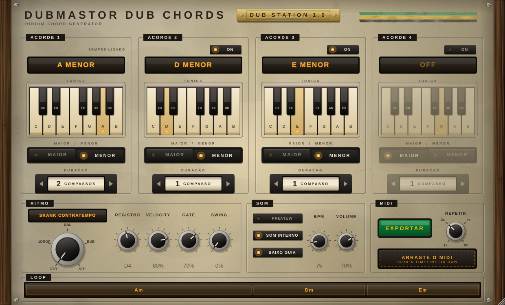

# DubMastor Dub Chords 1.0

← [Voltar para a página inicial do repositório](../README.md)

**[⬇️ Windows](https://github.com/dubmastor/DubMastor-DubStation-/releases/latest/download/DubMastorDubChords-Windows.zip)** · **[⬇️ macOS](https://github.com/dubmastor/DubMastor-DubStation-/releases/latest/download/DubMastorDubChords-macOS.zip)**

Gerador de harmonia para começar a programar um riddim de reggae. Você escolhe até 4 acordes e quanto
tempo cada um dura, e o plugin toca o skank no contratempo, sincronizado com o andamento da DAW.
Sai como MIDI (arrastar para a timeline, exportar ou MIDI ao vivo) e tem um som interno de referência.
Formatos: **VST3** (Windows/macOS), **AU** (macOS) e **Standalone**. É um **instrumento**: no Cubase,
carregue numa *Instrument Track*.

## ACORDE 1 a 4
| Controle | O que faz |
|---|---|
| **TÔNICA** | Teclado mecânico de uma oitava. Clique na nota: a tecla afunda e a lâmpada acende |
| **MAIOR / MENOR** | Dois botões de pressão intertravados |
| **DURAÇÃO** | Janela de contador: 1/2, 1, 2, 3, 4 ou 8 compassos. Clique à direita para aumentar, à esquerda para diminuir |
| **ON** (acordes 2, 3 e 4) | Liga/desliga o acorde no loop. O acorde 1 fica sempre ligado |

O display âmbar mostra o acorde (ex.: "A MENOR"). Os acordes ligados formam o loop, que se repete sozinho
e aparece no visor **LOOP** com o cursor de reprodução. O plugin escolhe a inversão mais próxima do acorde
anterior (condução de vozes), então a harmonia não fica pulando.

## RITMO
| Controle | O que faz |
|---|---|
| **Padrão** | CTR: skank em todo contratempo · 1DROP: tempos 2 e 4 (half-time) · DBL: double skank · BUB: bubble de órgão · STP: steppers |
| **REGISTRO** | Região do teclado dos acordes (centro de C3 a E5) |
| **VELOCITY / GATE / SWING** | Força das notas, duração do skank (staccato ↔ longo) e atraso das semicolcheias |

## SOM
| Controle | O que faz |
|---|---|
| **PREVIEW** | Toca o loop sem a DAW estar rodando, no **BPM** do knob |
| **SOM INTERNO / VOLUME** | Órgão/piano simples de referência. Desligue quando mandar o MIDI para o seu instrumento |
| **BAIXO GUIA** | Tônica no canal MIDI 2 (no 1 e no "e" do 3), como referência para a linha de baixo |

## MIDI
- **ARRASTE O MIDI:** clique e arraste a área âmbar para a timeline. Vem uma faixa de skank e uma de baixo guia, no BPM do projeto.
- **EXPORTAR:** salva o `.mid` (padrão: Documentos/Dub Chords). **REPETIR** exporta o loop 1, 2, 4 ou 8 vezes.
- **MIDI ao vivo:** as notas também saem como MIDI do plugin (canal 1 = skank, canal 2 = baixo) para outros instrumentos, onde a DAW permite rotear a saída MIDI de um instrumento.

## Para desenvolvedores
- `Source/DubEngine.h`: lógica da harmonia (C++ puro). É aqui que se adiciona padrão novo.
- `Source/PluginProcessor.*`: parâmetros, sincronia com a DAW, saída MIDI, exportação.
- `Source/PluginEditor.*`: interface (LookAndFeel do Big Knob + teclado, botões e contador clicáveis).
- `tests/engine_test.cpp`: teste do motor (roda no CI antes do build).
- `tests/snapshot.cpp`: gera o PNG da interface sem DAW (`-DDUBCHORDS_SNAPSHOT=ON`).
