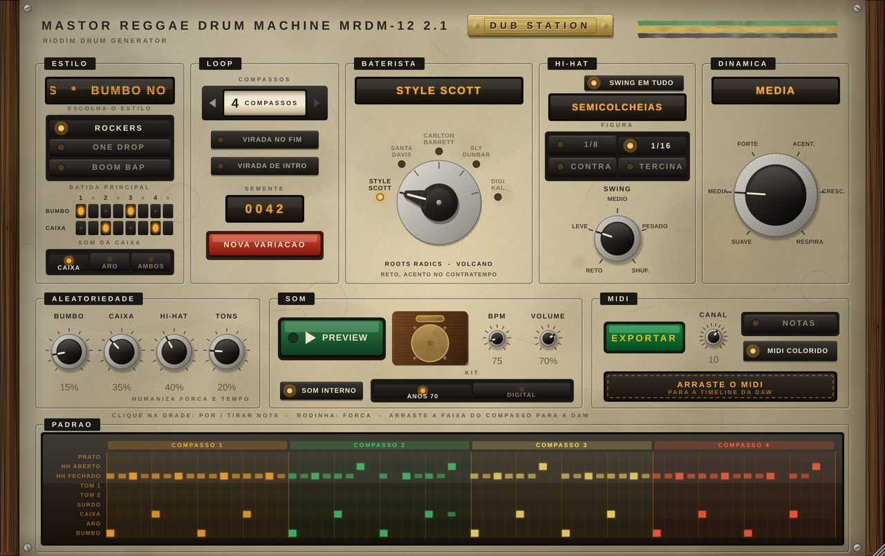

# Mastor Reggae Drum Machine MRDM-12 2.2

*(antigo Mastor Dub Drums Machine MDDM-12 e DubMastor Dub Drums)*

← [Voltar para a página inicial do repositório](../README.md)

**[⬇️ Windows](https://dubmastor.github.io/DubMastor-DubStation-/downloads/MastorReggaeDrumMachine-Windows.zip)** · **[⬇️ macOS](https://dubmastor.github.io/DubMastor-DubStation-/downloads/MastorReggaeDrumMachine-macOS.zip)** · **[📱 Abrir no celular / navegador](https://dubmastor.github.io/DubMastor-DubStation-/drums/)**



Gerador do esqueleto da bateria de reggae. Você escolhe o estilo (Rockers, One Drop ou Boom Bap), quantos
compassos, o baterista de referência e o balanço, e o plugin monta o groove com viradas, sincronizado com
o andamento da DAW. Sai como MIDI (arrastar para a timeline, exportar ou MIDI ao vivo) e tem uma bateria
interna de timbre reggae limpo para ouvir na hora.
Formatos: **VST3** (Windows/macOS), **AU** (macOS) e **Standalone**. É um **instrumento**: no Cubase,
carregue numa *Instrument Track*.

**📱 No celular:** a mesma máquina roda no navegador em
[dubmastor.github.io/DubMastor-DubStation-/drums](https://dubmastor.github.io/DubMastor-DubStation-/drums/),
sem instalar nada: mesmos grooves (o gerador é testado nota a nota contra o do plugin), PREVIEW com os samples,
grade editável e download do MIDI inteiro ou de um compasso só.

## Funciona em quais DAWs
A cada versão, antes de publicar, o GitHub compila e testa o plugin em Windows e macOS. Se algum teste falha,
a versão não sai:
- **Validador oficial da Steinberg** (conformidade VST3): o padrão que Cubase, Nuendo, Studio One, Reaper,
  Ableton Live, FL Studio, Bitwig e Cakewalk esperam;
- **pluginval no nível mais rigoroso (10)**, no VST3 (Windows e Mac) e no AU (Mac): abrir e fechar, estado
  salvo e recarregado, automação, várias taxas de amostragem e tamanhos de bloco, áudio em tempo real e interface;
- **auval** da Apple, o mesmo teste que o Logic Pro e o GarageBand rodam antes de aceitar um AU.

| DAW | Formato | Como usar |
|---|---|---|
| Cubase / Nuendo | VST3 | *Instrument Track*; a saída MIDI pode ir para outra faixa (MIDI Input = MRDM-12) |
| Studio One | VST3 | Instrumento; arraste o MIDI ou roteie a saída MIDI do instrumento |
| Ableton Live | VST3 / AU | Faixa MIDI com o plugin; em outra faixa, *MIDI From* = a faixa do MRDM-12 |
| FL Studio | VST3 | Canal do Channel Rack; para a saída MIDI, ajuste a porta de saída no wrapper |
| Reaper | VST3 / AU | Instrumento; a saída MIDI vai pelos *sends* MIDI da faixa |
| Bitwig | VST3 | Instrumento; a saída MIDI pode alimentar outra faixa |
| Logic Pro / GarageBand | AU | Instrumento de software. O Logic não roteia MIDI que sai de instrumentos: use **ARRASTE O MIDI**, a faixa do compasso ou **EXPORTAR** |

## ESTILO
Contagem em 4 tempos, sempre com a **caixa no 2 e no 4**.

| Botão | Groove |
|---|---|
| **ROCKERS** | Bumbo no 1 e no 3, caixa no 2 e no 4 (o rockers dos Roots Radics / Style Scott) |
| **ONE DROP** | Bumbo junto com a caixa no 2 e no 4; o 1 e o 3 ficam vazios |
| **BOOM BAP** | Hip-hop dos anos 90: bumbo no 1, no "e" do 2 e no "e" do 3, caixa no 2 e no 4, ghost notes de caixa |

**BATIDA PRINCIPAL:** grade com as 8 colcheias do compasso (1 e 2 e 3 e 4 e) para o **BUMBO** e a **CAIXA**.
Ao escolher um estilo, a grade carrega o padrão dele; depois é só clicar para pôr ou tirar (arrastando, marca ou
apaga várias de uma vez). O groove, o preview e o MIDI seguem a grade.

**SOM DA CAIXA:** **CAIXA** (padrão), **ARO** (cross-stick) ou **AMBOS** (aro e caixa juntos).

## LOOP
| Controle | O que faz |
|---|---|
| **COMPASSOS** | Contador de 1 a 4 compassos. Clique à direita para aumentar, à esquerda para diminuir |
| **VIRADA NO FIM** | Virada no último compasso e prato no "1" quando o loop volta (desligada por padrão) |
| **VIRADA DE INTRO** | Um compasso de introdução antes do compasso 1: contagem no hi-hat e a virada do baterista. Toca uma vez só; depois o loop se repete (desligada por padrão) |
| **SEMENTE** | A mesma semente sempre gera o mesmo groove. Arraste para cima/baixo ou use a rodinha |
| **NOVA VARIAÇÃO** (botão vermelho) | Sorteia outra semente |

## BATERISTA
Começa no **Style Scott** com o hi-hat em **1/16** (preset inicial). Chave seletora de cinco posições (knob "cabeça de galinha" com lâmpada e nome em cada posição): clique no nome,
arraste o knob ou use a rodinha. O display mostra o baterista e embaixo vêm a banda e a assinatura.

| | Hi-hat (assinatura) | Sensação | Viradas características |
|---|---|---|---|
| **STYLE SCOTT** (Roots Radics, Volcano) | Acento forte no contratempo, tempos leves, quase sem enfeite, "latido" curto do aberto no "e" do 4 | Reto e em cima do tempo | Estalos de caixa em semicolcheia, estalos sincopados, tons descendo |
| **SANTA DAVIS** (Soul Syndicate, Aggrovators) | **Flying cymbal**: hi-hat abre no contratempo de cada tempo e o pé fecha no tempo seguinte, com semicolcheias leves no meio | Balanço médio, muitas ghost notes | Rufo de fusas em crescendo, caixa e tons em semicolcheia, flams |
| **CARLTON BARRETT** (The Wailers) | **Tercina quebrada**: alguns tempos viram tercina (cheia ou só 1ª e 3ª nota); no one drop o hi-hat **cai do 1** junto com o bumbo; hi-hat aberto na última colcheia puxando o compasso seguinte | Atrás do tempo, balanço puxado para a tercina; bumbo econômico; ghost de caixa na última nota da tercina antes da batida | Rufo em tercina no 4 com flam, tercinas nos tons, entrada da caixa até o surdo |
| **SLY DUNBAR** (Sly & Robbie, Black Uhuru) | O **rockers** de 1976: semicolcheias andando com acento no contratempo, o "a" de cada tempo leve antecipando e um **swish** curto do aberto no "e" do 1 e do 3, entrando na caixa | Em cima do tempo (até um tiquinho na frente); **bumbo dobrado** no "a" do 2 empurrando o 3; arrasto de caixa e "chip" de aro; **syndrum** no fim de alguns compassos | Arrasto + syndrum no tom agudo, rufo com acento no aro, toques duplos "militantes" |
| **DIGIKAL** (dancehall digital) | Semente **ímpar = Casio MT-40**: o preset "Rock" do *Under Mi Sleng Teng* (1985), colcheias iguais, bumbo no 1, "e" do 2 e 3. Semente **par = Oberheim DMX**: semicolcheias com acento no contratempo, aberto no "e" do 4, caixa dobrada com o aro | **Tempo de máquina**: grade exata, sem swing e sem atraso humano | MT-40: o botão FILL (semicolcheias de caixa ou de bumbo); DMX: tons descendo em semicolcheia |

Os outros três também ganharam mais da assinatura de cada um: Style Scott com o estalo extra no "a" do 4 e o bumbo
de rub-a-dub no "e" do 4; Santa Davis com flam na caixa do 4 e o bumbo "funky" de Filadélfia.

## HI-HAT
| Controle | O que faz |
|---|---|
| **FIGURA** | 1/8 (colcheias), 1/16 (semicolcheias), CONTRA (contratempo) ou TERCINA. A assinatura do baterista entra por cima |
| **SWING** | Reto, leve, médio, pesado ou shuffle (tercina) |
| **SWING EM TUDO** | Aplica o balanço também no bumbo, caixa e tons |

O swing escolhido no knob é a base; cada baterista soma o seu jeito (Scott deixa mais reto, Santa um
pouco mais balançado, Carlton bem mais). Ele também atrasa ou adianta cada peça alguns milissegundos.

## DINÂMICA e ALEATORIEDADE
- **DINÂMICA:** suave, média, forte, acentuada, crescendo (sobe ao longo do loop) ou respirando (um compasso forte, outro fraco).
- **ALEATORIEDADE** (bumbo, caixa, hi-hat, tons): notas de passagem, ghost notes, hi-hats abertos, tons entrando no 3, variação das viradas e pequenas variações de força e de tempo em cada peça.

## SOM
| Controle | O que faz |
|---|---|
| **ALTO-FALANTE** | No meio do SOM, no estilo dos gabinetes de bateria eletrônica valvulada de 1959 (madeira, tweed dourado, aro de latão, tweeter em cima). O cone mexe com o som que sai do plugin |
| **PREVIEW** | Botão verde grande: toca o groove sem a DAW rodando, no **BPM** do knob, começando pela intro. Com o preview tocando, **NOVA VARIAÇÃO** para o som e o loop novo começa do início; trocar baterista, swing ou estilo entra na virada do próximo tempo, sem notas dobradas |
| **SOM INTERNO / VOLUME** | Bateria interna, toca junto com a DAW. Desligue quando mandar o MIDI para a sua bateria |
| **KIT: ANOS 70** | Os **samples DM**: bumbo (DM-KICKS1), caixa (DM-SNARES6), aro (DM-SNARES28), hi-hat fechado (DM-HATs6) e aberto (DM-HATs39). Tons e prato são sintetizados no timbre de estúdio jamaicano dos anos 70 |
| **KIT: DIGITAL** | Estilo King Jammy / **Sleng Teng** (1985): sons de teclado Casio dos anos 80, curtos e lo-fi (bumbo "bip", caixa de chiado, hi-hat em tique, tons em "blip"), em baixa resolução. Também muda o groove para **tempo de máquina**: grade exata, sem atraso humano e só dois níveis de força, no preview e no MIDI |

## MIDI
- **ARRASTE O MIDI:** clique e arraste a área âmbar para a timeline. O clipe vem com a intro (se ligada) e os compassos do loop, com marcadores "Intro", "Compasso 1", "Compasso 2"...
- **EXPORTAR:** salva o `.mid` (padrão: Documentos/Mastor Reggae Drum Machine).
- **CANAL:** canal MIDI da saída ao vivo (padrão 10) e do arquivo quando o MIDI COLORIDO está desligado.
- **MIDI COLORIDO:** cada compasso vai num canal MIDI no arquivo (compasso 1 no canal 1 ... compasso 4 no canal 4, intro no canal 5), como no Dub Chords. Na DAW, peça para colorir as notas por canal: no Cubase, no Key Editor, **Cores › Canal**; no REAPER, *Color notes by channel*. Desligue para mandar tudo no CANAL.
- **NOTAS (opção avançada):** abre o mapa de notas: qual nota MIDI cada peça envia (bumbo, aro, caixa, HH fechado, HH aberto, tom 1, tom 2, surdo, prato). Use as setas, arraste ou a rodinha. **PADRÃO GM** volta para o General MIDI (C1 = 36). Vale para a saída ao vivo, o arrastar e o exportar.
- **MIDI ao vivo:** as notas saem como MIDI do plugin acompanhando o play da DAW, para outros instrumentos onde a DAW permite rotear a saída MIDI.

## PADRÃO
A grade mostra o groove inteiro, com uma cor para cada compasso: **intro em azul**, **compasso 1 âmbar**,
**2 verde**, **3 dourado** e **4 vermelho**, e o cursor de reprodução.

- **Editável:** clique numa casa para pôr ou tirar a nota daquela peça, arraste para pintar (ou apagar) várias,
  use a **rodinha** sobre uma nota para mudar a força; botão direito sempre apaga. As edições ficam salvas no
  projeto e valem até você mexer num controle que gera o padrão (estilo, baterista, semente...);
  **DESFAZER EDIÇÃO** volta ao padrão gerado.
- **Arraste um compasso só:** clique na faixa **COMPASSO 1**, **2**... (ou **INTRO**) em cima da grade e arraste
  para a DAW: vem só aquele compasso, com 4 tempos, no canal dele (compasso 1 no canal 1, 2 no 2...) e com o nome
  "MRDM-12 Compasso N". Com o Cubase colorindo as notas por canal (Key Editor › Cores › Canal), cada compasso
  cai sempre na mesma cor. O arquivo MIDI não guarda a cor do clipe (cada DAW escolhe a sua), então a cor
  vem do canal.


## Para desenvolvedores
- `Source/PatternGenerator.*`: estilos, bateristas, viradas, intro, swing, dinâmica e aleatoriedade (C++ puro).
- `Source/DrumSynth.h`: bateria interna do preview (samples DM no kit ANOS 70, resto sintetizado; sem alocação no áudio).
- `Samples/` + `tools/make_samples_header.py`: os WAVs do kit ANOS 70, embutidos em `Source/DMSamples.h`.
- `../site/drums/`: a versão do celular/navegador (Web Audio). `generator.js` é o porte do gerador;
  `tests/dump_patterns.cpp` + `tests/web_generator_test.js` conferem no CI que ele toca igual ao C++.
- `Source/PluginProcessor.*`: parâmetros, linha do tempo intro + loop, saída MIDI, mapa de notas, exportação.
- `Source/PluginEditor.*`: interface no visual do Dub Chords.
- `tests/test_generator.cpp`: teste do gerador (roda no CI antes do build).
- `tests/render_preview.cpp`: gera os PNGs da interface e um WAV do preview sem DAW (`-DDD_RENDER_PREVIEW=ON`).

```bash
cmake -B build -DCMAKE_BUILD_TYPE=Release
cmake --build build --config Release
```
