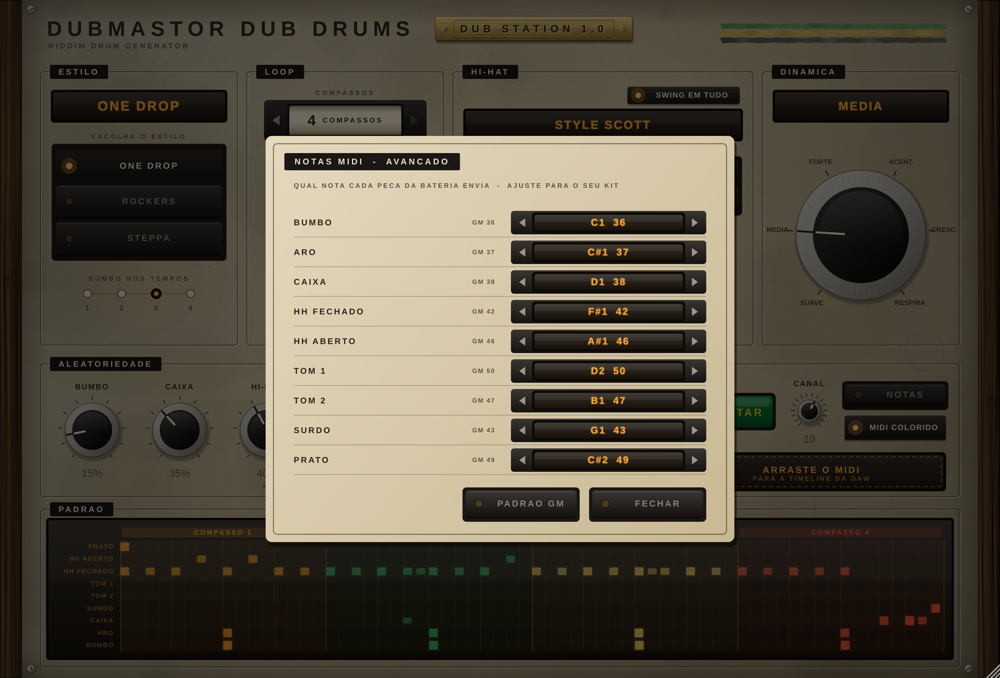

# DubMastor Dub Drums 1.0

← [Voltar para a página inicial do repositório](../README.md)

**[⬇️ Windows](https://github.com/dubmastor/DubMastor-DubStation-/releases/download/DubDrums-1.0/DubMastorDubDrums-Windows.zip)** · **[⬇️ macOS](https://github.com/dubmastor/DubMastor-DubStation-/releases/download/DubDrums-1.0/DubMastorDubDrums-macOS.zip)**


Gerador do esqueleto da bateria de reggae. Você escolhe o estilo (One Drop, Rockers ou Steppa), quantos
compassos, o baterista de referência e o balanço, e o plugin monta o groove com viradas, sincronizado com
o andamento da DAW. Sai como MIDI (arrastar para a timeline, exportar ou MIDI ao vivo) e tem uma bateria
interna de timbre reggae limpo para ouvir na hora.
Formatos: **VST3** (Windows/macOS), **AU** (macOS) e **Standalone**. É um **instrumento**: no Cubase,
carregue numa *Instrument Track*.

## ESTILO
| Botão | Groove |
|---|---|
| **ONE DROP** | Bumbo e aro só no 3, o "1" fica vazio |
| **ROCKERS** | Bumbo no 1 e no 3, aro no 3 |
| **STEPPA** | Bumbo nos quatro tempos, caixa no 3 |

As bolinhas **BUMBO NOS TEMPOS** mostram onde o bumbo cai no estilo escolhido.

## LOOP
| Controle | O que faz |
|---|---|
| **COMPASSOS** | Contador de 1 a 4 compassos. Clique à direita para aumentar, à esquerda para diminuir |
| **VIRADA NO FIM** | Virada no último compasso e prato no "1" quando o loop volta |
| **VIRADA DE INTRO** | Um compasso de introdução antes do compasso 1: contagem no hi-hat e a virada do baterista. Toca uma vez só; depois o loop se repete |
| **SEMENTE** | A mesma semente sempre gera o mesmo groove. Arraste para cima/baixo ou use a rodinha |
| **NOVA VARIAÇÃO** | Sorteia outra semente |

## HI-HAT
| Controle | O que faz |
|---|---|
| **FIGURA** | 1/8 (colcheias), 1/16 (semicolcheias), CONTRA (contratempo) ou TERCINA |
| **BATERISTA** | Chave seletora de 3 posições. Muda o balanço, o microtempo e as viradas (veja abaixo). O nome aparece no display |
| **SWING** | Reto, leve, médio, pesado ou shuffle (tercina) |
| **SWING EM TUDO** | Aplica o balanço também no bumbo, caixa e tons |

### Os bateristas
| | Sensação | Viradas características |
|---|---|---|
| **STYLE SCOTT** (Roots Radics) | Mais reto e em cima do tempo, aro seco, hi-hat aberto "latindo" no contratempo | Estalos de caixa em semicolcheia, estalos sincopados, tons descendo em semicolcheia |
| **SANTA DAVIS** (Soul Syndicate) | Balanço médio, muitos enfeites no hi-hat e ghost notes na caixa | Rufo de fusas em crescendo, semicolcheias misturando caixa e tons, flams em sequência |
| **CARLTON BARRETT** (Wailers) | Atrás do tempo, balanço puxado para a tercina, hi-hat econômico | Rufo em tercina no 4 com flam, tercinas nos tons, entrada do one drop da caixa até o surdo |

O swing escolhido no knob é a base; cada baterista soma o seu jeito (Scott deixa mais reto, Santa um
pouco mais balançado, Carlton bem mais). Ele também atrasa ou adianta cada peça alguns milissegundos.

## DINÂMICA e ALEATORIEDADE
- **DINÂMICA:** suave, média, forte, acentuada, crescendo (sobe ao longo do loop) ou respirando (um compasso forte, outro fraco).
- **ALEATORIEDADE** (bumbo, caixa, hi-hat, tons): notas de passagem, ghost notes, hi-hats abertos, tons entrando no 3, variação das viradas e pequenas variações de força e de tempo em cada peça.

## SOM
| Controle | O que faz |
|---|---|
| **PREVIEW** | Toca o groove sem a DAW rodando, no **BPM** do knob, começando pela intro |
| **SOM INTERNO / VOLUME** | Bateria interna de reggae limpo (bumbo redondo, aro seco, caixa afinada alta, hi-hats, tons e prato). Toca junto com a DAW. Desligue quando mandar o MIDI para a sua bateria |

## MIDI
- **ARRASTE O MIDI:** clique e arraste a área âmbar para a timeline. O clipe vem com a intro (se ligada) e os compassos do loop, com marcadores "Intro", "Compasso 1", "Compasso 2"...
- **EXPORTAR:** salva o `.mid` (padrão: Documentos/Dub Drums).
- **CANAL:** canal MIDI da saída ao vivo (padrão 10) e do arquivo quando o MIDI COLORIDO está desligado.
- **MIDI COLORIDO:** cada compasso vai num canal MIDI no arquivo (compasso 1 no canal 1 ... compasso 4 no canal 4, intro no canal 5), como no Dub Chords. Na DAW, peça para colorir as notas por canal: no Cubase, no Key Editor, **Cores › Canal**; no REAPER, *Color notes by channel*. Desligue para mandar tudo no CANAL.
- **NOTAS (opção avançada):** abre o mapa de notas: qual nota MIDI cada peça envia (bumbo, aro, caixa, HH fechado, HH aberto, tom 1, tom 2, surdo, prato). Use as setas, arraste ou a rodinha. **PADRÃO GM** volta para o General MIDI (C1 = 36). Vale para a saída ao vivo, o arrastar e o exportar.
- **MIDI ao vivo:** as notas saem como MIDI do plugin acompanhando o play da DAW, para outros instrumentos onde a DAW permite rotear a saída MIDI.

## PADRÃO
A grade mostra o groove inteiro, com uma cor para cada compasso: **intro em azul**, **compasso 1 âmbar**,
**2 verde**, **3 dourado** e **4 vermelho**, e o cursor de reprodução. Na DAW, as cores aparecem com o
**MIDI COLORIDO** ligado (um canal por compasso, colorir por canal).



## Para desenvolvedores
- `Source/PatternGenerator.*`: estilos, bateristas, viradas, intro, swing, dinâmica e aleatoriedade (C++ puro).
- `Source/DrumSynth.h`: bateria interna do preview (sintetizada, sem samples, sem alocação no áudio).
- `Source/PluginProcessor.*`: parâmetros, linha do tempo intro + loop, saída MIDI, mapa de notas, exportação.
- `Source/PluginEditor.*`: interface no visual do Dub Chords.
- `tests/test_generator.cpp`: teste do gerador (roda no CI antes do build).
- `tests/render_preview.cpp`: gera os PNGs da interface e um WAV do preview sem DAW (`-DDD_RENDER_PREVIEW=ON`).

```bash
cmake -B build -DCMAKE_BUILD_TYPE=Release
cmake --build build --config Release
```
