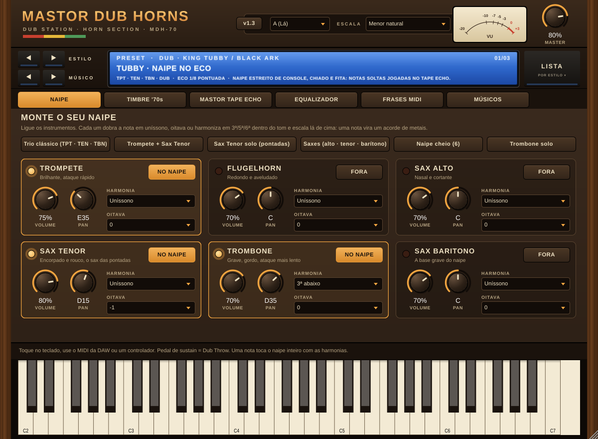
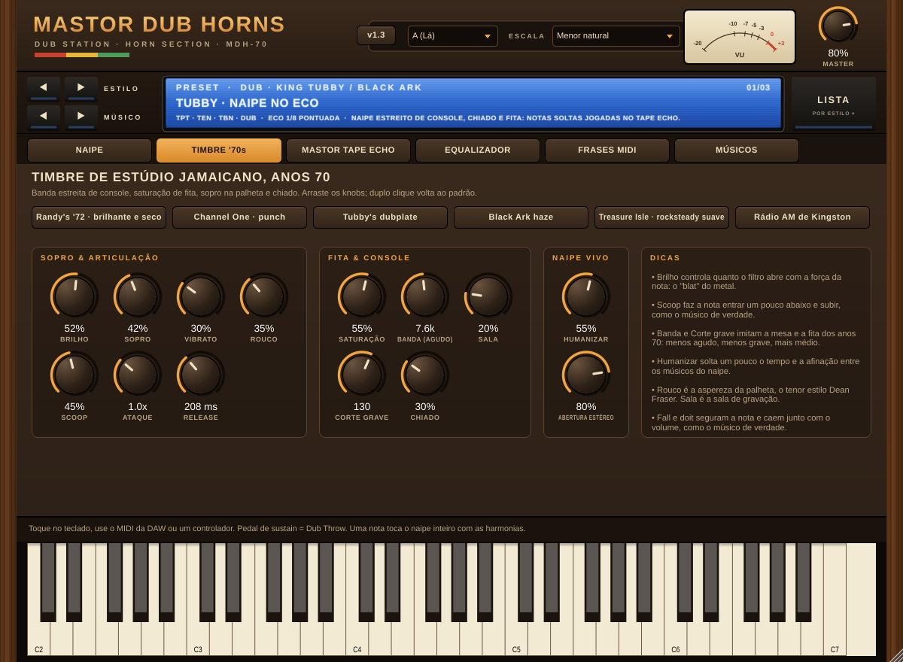
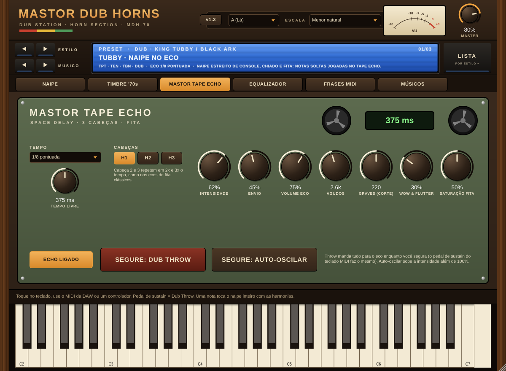
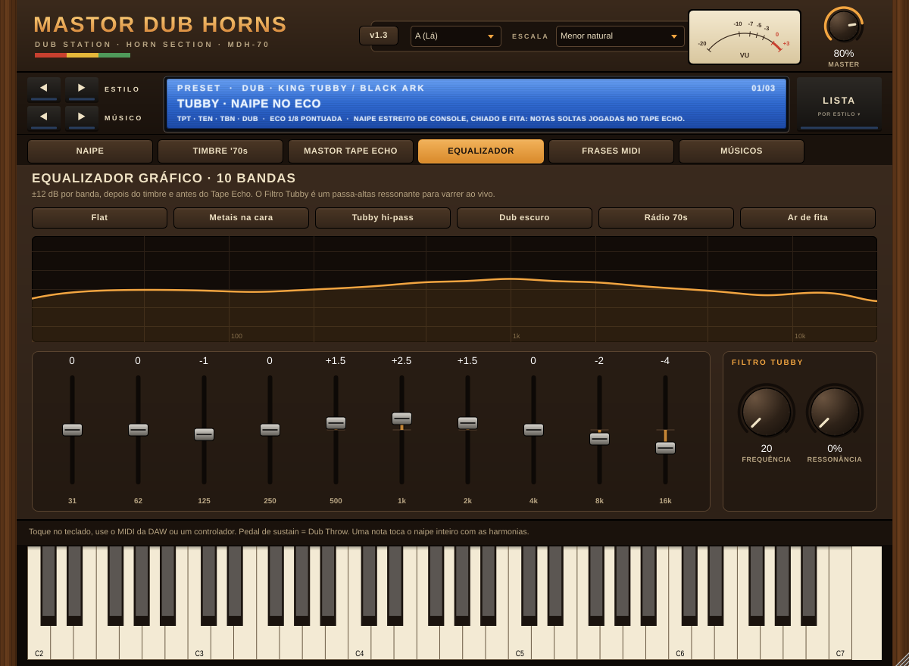
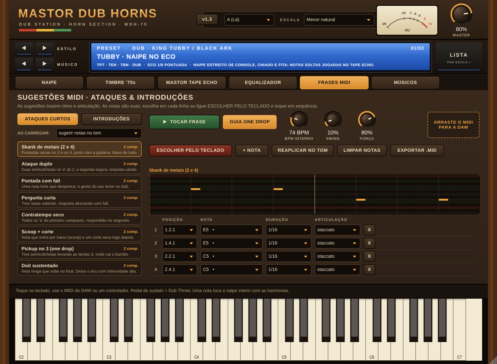
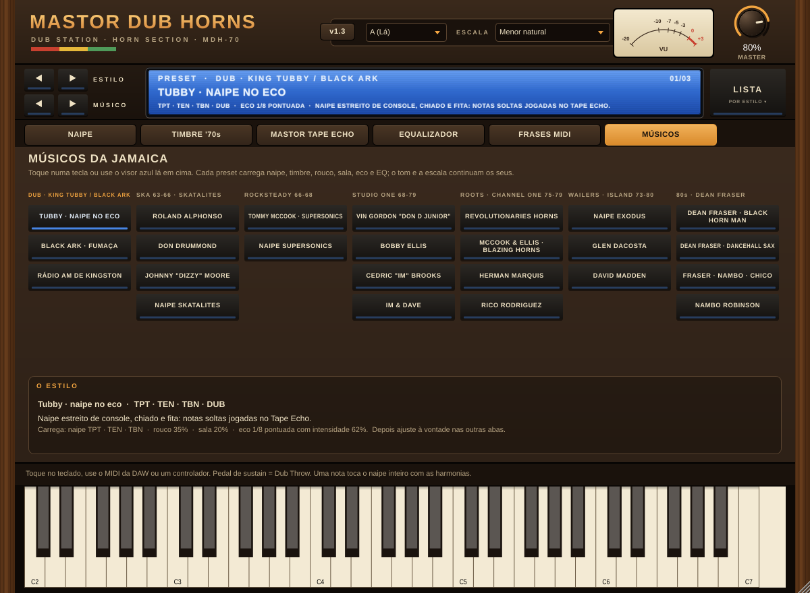

# Mastor Dub Horns 🎺 — Dub Station

**Mastor Dub Horns MDH-70 1.3.** Naipe de metais anos 70 para sessão de dub, em **VST3** (Windows e Mac), **AU** (Mac) e app standalone. Também toca no navegador: <https://dubmastor.github.io/DubMastor-DubStation-/web/dubhorns/>



## O que tem

| Aba | O que faz |
|---|---|
| **Naipe** | Liga/desliga trompete, flugelhorn, sax alto, sax tenor, trombone e sax barítono. Cada um tem volume, pan, oitava e harmonia diatônica (uníssono, 3ª, 4ª, 5ª, 6ª) no **tom e escala** do topo. Uma nota tocada vira um acorde de metais. 6 combinações prontas. |
| **Timbre '70s** | Presets de estúdio (Randy's, Channel One, Tubby's, Black Ark, Treasure Isle, rádio AM) e knobs de brilho, sopro, vibrato, **rouco**, scoop, ataque, release, saturação de fita, banda, **sala**, corte grave, chiado, humanizar e abertura estéreo. Fall e doit seguram a nota e caem junto com o volume, como um músico. |
| **Mastor Tape Echo** | Eco de fita com 3 cabeças (1×, 2×, 3×), sync com a DAW ou tempo livre, intensidade, envio, volume, agudos, graves, wow & flutter, saturação, **Dub Throw** (segure o botão ou o pedal de sustain) e auto-oscilação. |
| **Equalizador** | EQ gráfico de 10 bandas (±12 dB) com curva e **Filtro Tubby** (passa-altas ressonante). |
| **Frases MIDI** | 8 ataques curtos estilo Dean Fraser e 6 frases de introdução. A sugestão traz o ritmo e a articulação (staccato, fall, scoop, doit); **as notas são escolhidas por você**, na lista ou tocando no teclado com *Escolher pelo teclado*. A frase toca junto com a DAW (ou no clock interno) e dá para arrastar/exportar o `.mid`, com uma trilha por instrumento já harmonizada. |
| **Músicos** | Presets no padrão da Riddim Machine (visor azul **sempre à vista** acima das abas, ESTILO ◀ ▶, MÚSICO ◀ ▶, LISTA; abre no "Tubby · naipe no eco", com o Tape Echo na frente): 24 estilos de músicos e naipes jamaicanos (Dean Fraser, Vin Gordon, Tommy McCook, Bobby Ellis, Roland Alphonso, Rico Rodriguez…). Carrega naipe, timbre, eco e EQ; o tom e a escala continuam os seus. |

| Timbre | Tape Echo |
|---|---|
|  |  |
| **Equalizador** | **Frases MIDI** |
|  |  |
| **Músicos** | |
|  | |

## Versão

A versão fica em [`Source/Version.h`](Source/Version.h). **Toda alteração sobe o número** (1.0 → 1.1 → 1.2 …) e ganha uma linha em [`RELEASE_NOTES.md`](RELEASE_NOTES.md) e no histórico dentro do plugin (botão da versão, no topo).

A cada push no `main` que mexe nesta pasta, o workflow `build-dubhorns.yml` testa o motor, compila Windows e Mac, valida com o **pluginval** e o **auval** e publica a release `MastorDubHorns-<versão>`. Essa release não vira a "latest", para não mudar os links dos outros plugins.

## Compilar

```
cmake -B build -DCMAKE_BUILD_TYPE=Release
cmake --build build --config Release
```

Teste do motor (sem JUCE):
```
g++ -std=c++17 -O2 -Wall -Wextra tests/engine_test.cpp -o engine_test && ./engine_test
```

Imagens da interface (uma por aba) e um WAV de teste:
```
cmake -B build-snap -DHORNS_SNAPSHOT=ON -DHORNS_SNAPSHOT_ONLY=ON && cmake --build build-snap --target HornsSnapshot
./build-snap/HornsSnapshot_artefacts/Release/HornsSnapshot docs/
./build-snap/HornsSnapshot_artefacts/Release/HornsSnapshot teste.wav
```

## Código

```
Source/Music.h           escalas, harmonia diatônica, instrumentos do naipe, divisões do sync
Source/Phrases.h         sugestões de ataques e introduções
Source/Musicians.h       presets da aba Músicos (gerado por tools/musicos.py, mesma tabela da versão web)
Source/HornEngine.h      motor de som (vozes de metal, barramento anos 70, EQ, Filtro Tubby, Mastor Tape Echo) — C++ puro
Source/PluginProcessor.* parâmetros, MIDI, frase sincronizada com a DAW, exportação .mid, estado
Source/PluginEditor.*    interface com as 6 abas e teclado
```
