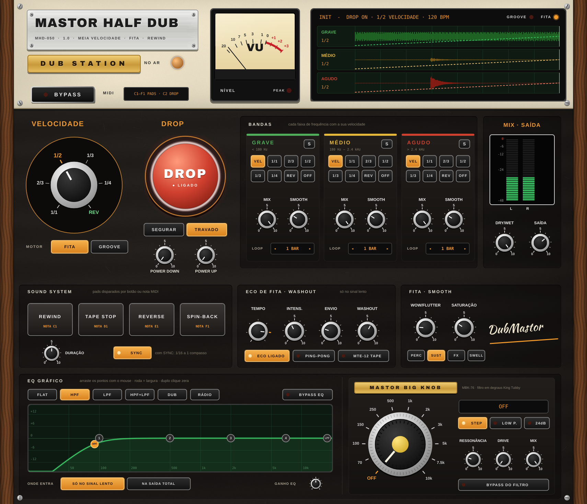

# Mastor Half Dub MHD-050 1.0 — meia velocidade de fita 🐢

*Linha Dub Station*

← [Voltar para a página inicial do repositório](../README.md)

**Downloads:** [Windows](https://github.com/dubmastor/DubMastor-DubStation-/releases/download/MHD-050-1.0/MHD-050-Windows-Instalador.exe) · [Mac](https://github.com/dubmastor/DubMastor-DubStation-/releases/download/MHD-050-1.0/MHD-050-macOS-Instalador.pkg) · 📱 [Testar no navegador](https://dubmastor.github.io/DubMastor-DubStation-/web/halfdub/)

Efeito de **meia velocidade** (evolução do half-time) com cara de equipamento de estúdio dos anos 70.
Formatos: **VST3** (Windows/macOS), **AU** (macOS), **AAX** (Pro Tools, depois da assinatura PACE) e **Standalone**.



Cadeia: entrada → 3 bandas → cada banda na sua velocidade → DROP → fita (wow/flutter, saturação) → EQ (se "só no sinal lento")
→ seco + lento (DRY/WET) + eco de fita → pads de sound system → EQ (se "na saída total") → Mastor Big Knob → saída.

**Preset INIT:** o plugin abre com o **DROP travado e ligado**, VELOCIDADE **1/2**, motor **FITA**, eco com envio de 25 % e EQ no preset **HPF**. É só colocar no canal.

## Como funciona a meia velocidade
A velocidade é presa ao compasso da DAW em **loops** (LOOP de cada banda, de 1/16 a 8 compassos). Em cada loop a banda toca
o começo do loop mais devagar: em **1/2** a primeira metade do loop é esticada no loop inteiro; em **1/4**, o primeiro quarto.
**REV** toca o loop anterior de trás para frente. Sem a DAW tocando (ou no standalone) o relógio roda sozinho no BPM da DAW.

| Controle | O que faz |
|---|---|
| **VELOCIDADE** | 1/1 (normal), 2/3 (tercinas e swing, uma 5ª abaixo), 1/2 (oitava abaixo), 1/3, 1/4 e REV |
| **MOTOR** | **FITA**: reamostragem, o tom desce como fita mais lenta. **GROOVE**: grãos de 45 ms, a meia velocidade mantém o tom (bom para baixo e voz) |
| **DROP** | Liga o efeito. **TRAVADO**: um toque liga, outro desliga. **SEGURAR**: só enquanto o botão está apertado. Nota **C2** (MIDI) segura o DROP |
| **POWER DOWN / UP** | Quanto tempo (0 a 4 tempos) a fita leva para entrar e sair. No motor FITA ela perde e ganha velocidade de verdade (tape stop / tape start); no GROOVE é um fade |
| **SMOOTH (modo)** | Como a virada do loop é feita: **PERC** curta (bateria), **SUST** média (pads, acordes), **FX** seca (glitch), **SWELL** longa (inchada) |

## BANDAS
Grave (< 180 Hz), médio (180 Hz – 2,4 kHz) e agudo (> 2,4 kHz), separados por Linkwitz-Riley de 4ª ordem (somados dão o som original).

| Controle | O que faz |
|---|---|
| **VEL · 1/1 · 2/3 · 1/2 · 1/3 · 1/4 · REV · OFF** | Velocidade da banda. **VEL** segue o seletor VELOCIDADE; **OFF** cala a banda |
| **MIX** | Mistura da banda lenta com a mesma banda normal |
| **SMOOTH** | Tamanho da transição na virada do loop |
| **LOOP** | Tamanho do loop da banda (◂ ▸ ou rodinha do mouse) |
| **S** | Solo da banda (ouve só as bandas em solo) |

Exemplo de dub: GRAVE em 1/1 (o baixo segue no tempo), MÉDIO em 1/2 (o skank arrasta) e AGUDO em REV.

## SOUND SYSTEM
Pads que valem enquanto estão apertados (botão ou nota MIDI). **DURAÇÃO** com **SYNC**: de 1/16 a 1 compasso; sem SYNC: 0,1 a 3,2 s.

| Pad | Nota | Som |
|---|---|---|
| **REWIND** | C1 | Puxa a fita para trás acelerando, como o rewind do selector |
| **TAPE STOP** | D1 | A fita para (o tom cai até o silêncio) |
| **REVERSE** | E1 | Toca para trás a partir do momento do toque |
| **SPIN-BACK** | F1 | Giro de vinil para trás e some |

## ECO DE FITA · WASHOUT
O eco do Big Knob, recebendo **só o sinal lento**. **TEMPO** em divisões do andamento (1/16 a 1/2), **INTENS.**, **ENVIO**,
**WASHOUT** (quando o DROP solta, joga o som lento no eco por cerca de um compasso), **ECO LIGADO**, **PING-PONG** e **MTE-12 TAPE** (repetições mais escuras, dois cabeçotes e mais wow).

## FITA · SMOOTH
**WOW/FLUTTER** e **SATURAÇÃO** de fita no sinal lento (entram junto com o DROP) e os modos de SMOOTH.

## EQ GRÁFICO
Pontos **HPF**, **1–4** (sinos) e **LPF**: arraste com o mouse, **rodinha** muda a largura (Q) dos sinos, **duplo clique** zera o ponto.
Presets **FLAT, HPF, LPF, HPF+LPF, DUB, RÁDIO**, **BYPASS EQ**, **ONDE ENTRA** (só no sinal lento ou na saída total) e **GANHO EQ**.

## MASTOR BIG KNOB
O filtro do MBK-76: degraus de mesa OFF · 70 · 100 · 150 · 250 · 500 · 1k · 2k · 3k · 5k · 7.5k · 10k (**STEP**) ou contínuo,
**LOW P.** (passa-baixas), **24dB**, **RESSONÂNCIA**, **DRIVE**, **MIX** e **BYPASS DO FILTRO**. Começa em OFF.

## Compilar
```
cmake -B build -DCMAKE_BUILD_TYPE=Release            # baixa o JUCE 8.0.4 (ou -DJUCE_DIR=/caminho/JUCE)
cmake --build build --config Release
```
Teste do DSP sem JUCE: `g++ -std=c++17 -O2 tests/render_test.cpp -o render_test && ./render_test`
(meia velocidade, FITA/GROOVE, REV, bandas, POWER DOWN, TAPE STOP, estabilidade e WAVs de demonstração).
Imagem da interface: `cmake -B build-snap -DHD_SNAPSHOT=ON -DHD_FORMATS=VST3 && cmake --build build-snap --target HalfDubSnapshot`.
