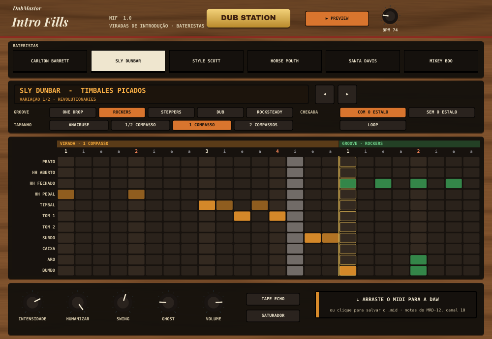

# Mastor Intro Fills MIF 1.0

Viradas de introdução de bateria de reggae, do estudo dos bateristas jamaicanos, na contagem da Dub Station (caixa no 2 e no 4).
Escolha o baterista e a virada, o tamanho (anacruse, meio, 1 ou 2 compassos), se chega com o estalo no 1 e o groove de chegada;
ouça no PREVIEW ou com o play da DAW e arraste o MIDI (notas do Mastor Reggae Drums MRD-12, canal 10) para a timeline.



- **Código:** `Source/FillEngine.h` (viradas, grooves e o feel, sem JUCE), `Source/FillSampler.h` (o kit com a dinâmica por nota,
  Tape Echo e saturador), `Source/PluginProcessor.*` e `Source/PluginEditor.*`.
- **Samples:** `Samples/` (DM do MRD-12 e os tons, surdo e timbal da versão para celular).
- **Versão para celular:** `site/web/introfills/` — o mesmo conteúdo em JavaScript (`buildSequence` e `perform`): ao mudar um, mude o outro.
- **Testes:** `tests/render_test.cpp` (sem JUCE: todas as viradas, estilos, tamanhos e chegadas, caixa no 2 e no 4, som e .mid) e
  `tests/snapshot.cpp` (plugin inteiro: PREVIEW, estado do projeto com a grade editada, .mid, automação e as imagens de `docs/`).

```
g++ -std=c++17 -O2 -Wall -Wextra -I Source tests/render_test.cpp -o render_test && ./render_test Samples
cmake -B build-snap -DMIF_SNAPSHOT=ON -DMIF_FORMATS=VST3 && cmake --build build-snap --target IntroFillsSnapshot
```
