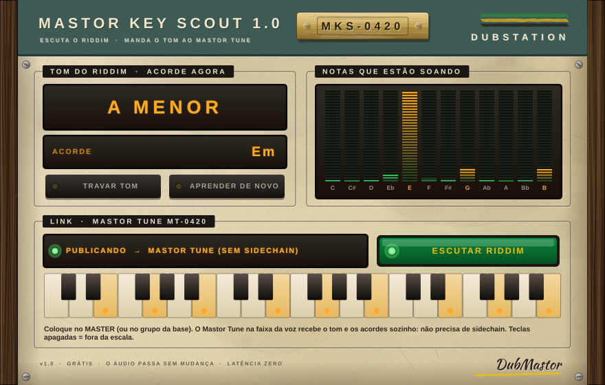

# Mastor Key Scout MKS-0420 1.0 — o olheiro do tom 🔎

*Linha DubStation*

← [Voltar para a página inicial do repositório](../README.md)

**Downloads:** [Windows](https://github.com/dubmastor/DubMastor-DubStation-/releases/download/MKS-0420-1.0/MKS-0420-Windows-Instalador.exe) · [Mac](https://github.com/dubmastor/DubMastor-DubStation-/releases/download/MKS-0420-1.0/MKS-0420-macOS-Instalador.pkg) · [📱 Versão celular / navegador](https://dubmastor.github.io/DubMastor-DubStation-/web/keyscout/)

Coloque no **master** (ou no grupo da base). Ele escuta o riddim, acha o **tom**, a **escala** e o **acorde de cada momento**, e manda tudo para o
**[Mastor Tune MT-0420](../Tune/)** na faixa da voz — **sem sidechain e sem roteamento**. O áudio passa sem mudança e sem latência.
Formatos: **VST3** (Windows/macOS), **AU** (macOS), **AAX** (Pro Tools) e **Standalone**.



| Parte | O que faz |
|---|---|
| **TOM DO RIDDIM** | O tom aprendido (ex.: A MENOR). Usa os acordes tocados e as notas que soam, então maior e menor não se confundem com o baixo forte |
| **ACORDE** | O acorde de agora |
| **TRAVAR TOM** | Segura o tom achado |
| **APRENDER DE NOVO** | Esquece o tom e escuta de novo (troca de música) |
| **NOTAS QUE ESTÃO SOANDO** | Barras das 12 notas; em âmbar as do acorde |
| **LINK** | Lâmpada verde = publicando para o Mastor Tune |
| **ESCUTAR RIDDIM** | Liga/desliga a escuta (o áudio continua passando) |
| **TECLADO** | Acende as notas do acorde e apaga as que estão fora da escala |

Como funciona o link: o Key Scout escreve o tom e o acorde num arquivo pequeno mapeado em memória na pasta temporária do sistema
(`KeyScout/Source/ScoutLink.h`) e o Mastor Tune lê o mesmo arquivo. A prioridade no Mastor Tune é: MRM-0420 → MIDI → **Key Scout** → sidechain → manual.

## Para compilar

```
cmake -B build -DCMAKE_BUILD_TYPE=Release
cmake --build build --config Release
```

Teste do DSP (sem JUCE): `g++ -std=c++17 -O2 tests/render_test.cpp -o render_test && ./render_test`
Teste com JUCE (áudio igual, link e imagem): `cmake -B build -DMKS_RENDER_TEST=ON && cmake --build build --target mks_render`
