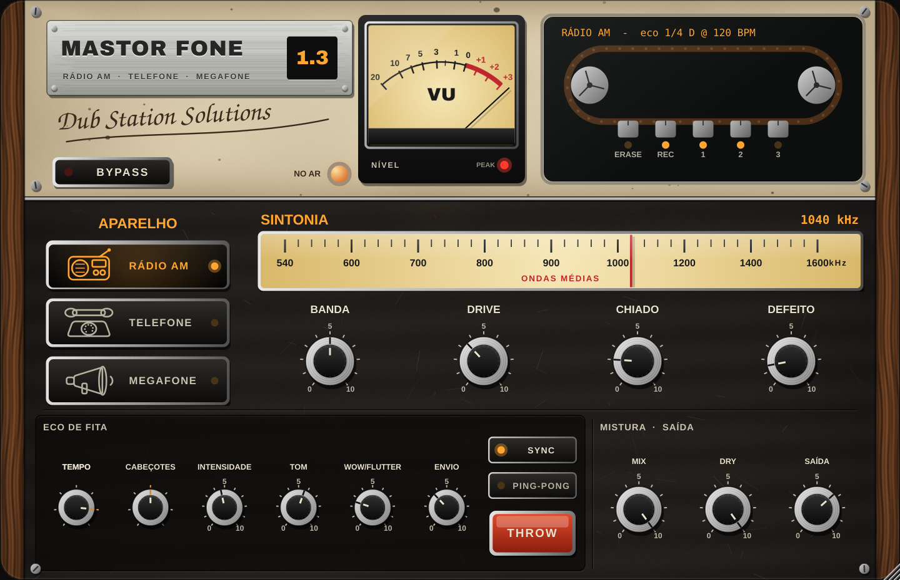
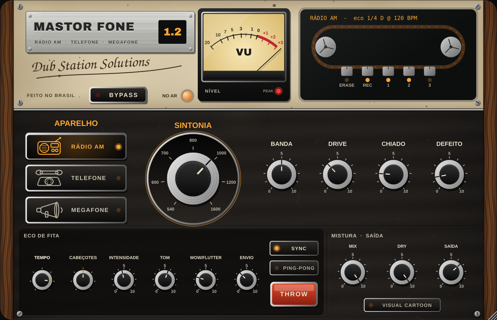

# Mastor Fone 1.2 — voz de aparelho antigo 📻☎️📣

*Dub Station Solutions*

← [Voltar para a página inicial do repositório](../README.md)

**[⬇️ Baixar a versão mais nova](https://github.com/dubmastor/DubMastor-DubStation-/releases/latest)**

Efeito para voz que imita três aparelhos: **RÁDIO AM**, **TELEFONE antigo** e **MEGAFONE**, com o mesmo **eco de fita** do Big Knob.
Formatos: **VST3** (Windows/macOS, para o Cubase), **AU** (macOS) e **Standalone**.

## Dois visuais
O botão **VISUAL** troca a aparência na hora, e a escolha fica salva no projeto do Cubase:
- **Cartoon** (padrão): gabinete de rádio de madeira, estilo desenho animado antigo
- **Dub Station**: o mesmo acabamento do Dub Station 2.1, com esmalte creme, plaqueta de alumínio, VU, janela da fita e botões de alumínio. Os aparelhos são teclas com o desenho de cada um (clique para escolher), a SINTONIA é um dial de rádio antigo (540 a 1600 kHz) e o **BYPASS** fica em destaque no painel de cima, acendendo vermelho quando o efeito está desligado





Cadeia: entrada (somada em mono) → aparelho → seco + eco de fita (estéreo) → saída.

## APARELHO
Clique no desenho para trocar. A troca é suave (25 ms), dá para automatizar sem estalo.

| Aparelho | Som |
|---|---|
| **RÁDIO AM** | Faixa de ~150 Hz a 4,5 kHz, falante de gabinete de madeira, válvula saturando macio. Chiado de ondas médias com estalos |
| **TELEFONE** | Faixa fechada de 300 a 3.400 Hz, cápsula de carvão cortante, reamostragem de central antiga e compressão mu-law de 8 bits. Zumbido de 60 Hz na linha |
| **MEGAFONE** | Corneta com ressonâncias fortes, amplificador clipando duro e reflexo metálico dentro do cone |

| Controle | O que faz |
|---|---|
| **SINTONIA** | Desloca a faixa do aparelho (até 1 oitava para cima ou para baixo). A agulha do dial acompanha |
| **BANDA** | Faixa mais estreita (bem "lata") ou mais larga |
| **DRIVE** | Quanto o aparelho satura. O volume é compensado sozinho |
| **CHIADO** | Ruído do aparelho: chiado e estalos no rádio, estalos e zumbido no telefone, zumbido no megafone. Respira junto com a voz |
| **DEFEITO** | Rádio: o sinal vai e volta (fading) com assobio de heterodino. Telefone: a linha falha. Megafone: amplificador vagabundo ondulando e corneta mais ressonante |
| **MIX** | Mistura com a voz original |

## ECO DE FITA
O mesmo eco do Big Knob: **SYNC** (divisões do andamento do Cubase), **TEMPO** livre de 40 a 1500 ms quando o SYNC está desligado, **CABEÇOTES** (1, 2, 3, 1+2, 2+3, 1+3, 1+2+3), **INTENSIDADE** (acima de 100% autooscila), **TOM**, **WOW**, **ENVIO**, **PING-PONG** e **THROW** (segure para jogar a voz no eco).
O eco recebe a voz já processada, então as repetições também soam de rádio, telefone ou megafone.

## MASTER
**DRY** (zere para usar num FX Channel), **SAÍDA** e **BYPASS** (o mesmo bypass do Cubase, com transição suave).
No painel: VU de ponteiro (0 VU = -18 dBFS) e a lâmpada **NO AR**, que acende quando passa som.

A janela é redimensionável: arraste o canto inferior direito (50% a 150%). Duplo clique num botão volta ao valor padrão.

## Instalação
Igual aos outros plugins: veja a [página inicial](../README.md#instalação-no-cubase). No Mac, libere com:
```
xattr -dr com.apple.quarantine ~/Library/Audio/Plug-Ins/VST3/"Mastor Fone.vst3"
```
No Cubase ele aparece como **Mastor Fone**, do fabricante **DubMastor**.

## Estrutura
- `Source/LoFiVoice.h` — os três aparelhos (filtros SVF, saturações, ruídos, defeitos)
- `Source/TapeEcho.h` — eco de fita (o mesmo DSP do Big Knob)
- `Source/PluginProcessor.*` — parâmetros e processamento
- `Source/PluginEditor.*` — interface cartoon
- `tests/render_test.cpp` — teste de resposta em frequência, nível e estabilidade, e demos em WAV

Fontes embutidas: Archivo Black e Comic Relief (licença OFL, em `Resources/licenses`).
Feito com JUCE 8 (licença AGPLv3 para projetos de código aberto).
