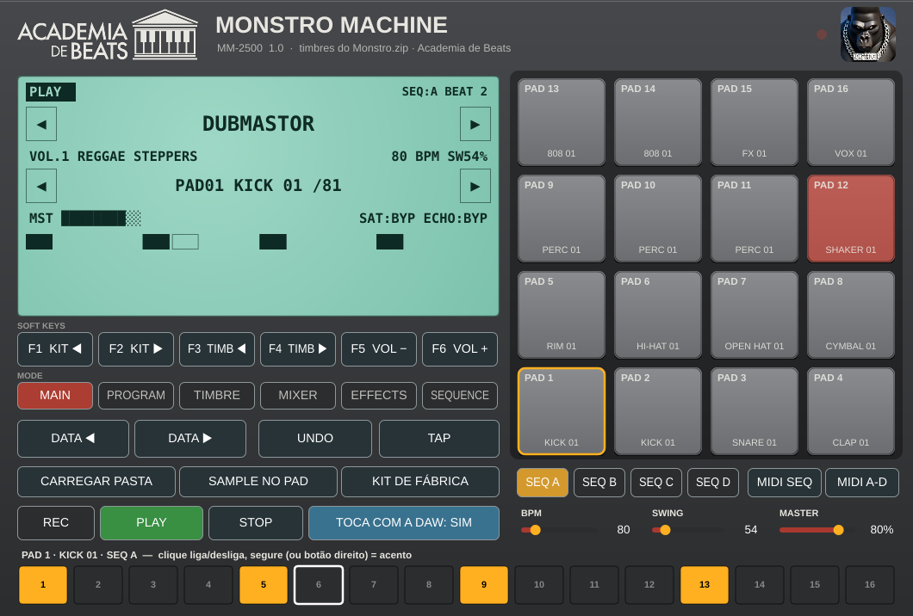

# Monstro Machine MM-2500 1.0

Drum machine no estilo da MPC2500 com os kits do **Monstro.zip**, o pack da **Academia de Beats**.
É um produto **à parte**: não faz parte do Dub Station (fica fora do `plugins.json`, das páginas do Dub Station e do instalador completo).

- Site: https://dubmastor.github.io/DubMastor-DubStation-/monstro/ (pasta `site/monstro/`)
- Versão para celular / navegador: https://dubmastor.github.io/DubMastor-DubStation-/monstro/app/ (pasta `site/monstro/app/`)
- Release: `MM-2500-1.0` (`MM-2500-Windows-Instalador.exe`, `MM-2500-macOS-Instalador.pkg`, `MM-2500-Windows.zip`, `MM-2500-macOS.zip`)



## Identificação (não mudar)
- Nome na DAW: `Monstro Machine MM-2500` · alvo/pasta `MonstroMachine`
- `PLUGIN_CODE Mm25`, `PLUGIN_MANUFACTURER_CODE Dblb`, `BUNDLE_ID com.dubmastor.monstromachine`, estado `MM2500`

## Código
- `Source/MonstroEngine.h` — motor sem JUCE: kits, famílias, caráter de cada kit, variações dos timbres, grooves, síntese dos 16 pads, saturador e eco.
  A versão para celular (`site/monstro/app/index.html`) tem a mesma síntese em JavaScript (`play`, `charOf`, `vpar`, `PATTERNS`):
  **ao mudar um, mude o outro** (mesmo hash e mesmo aleatório: o mesmo kit e o mesmo timbre soam iguais).
- `Source/PluginProcessor.*` — parâmetros, 4 SEQs, transporte da DAW, MIDI que chega, samples do usuário, MIDI para a DAW.
- `Source/PluginEditor.*` — interface da MPC (tela clicável, soft keys, modos, pads, passos).
- `installer/` — instaladores próprios (pasta `Monstro` no Windows e `/Applications/Monstro` no Mac; link para o site da Monstro).

## Testes
```
g++ -std=c++17 -O2 -I Source tests/render_test.cpp -o mm_render && ./mm_render
cmake -B build-snap -DMM_SNAPSHOT=ON -DMM_FORMATS=VST3 -DJUCE_DIR=/caminho/JUCE && cmake --build build-snap --target MonstroSnapshot
./build-snap/MonstroSnapshot_artefacts/Release/MonstroSnapshot docs/interface.png
```

## Build e release
Workflow `.github/workflows/build-monstromachine.yml`: teste do motor, build Windows e Mac (binário universal, runtime embutido),
pluginval, auval (`aumu Mm25 Dblb`), instaladores e a release `MM-2500-<versão>`. Toda alteração sobe a versão no `CMakeLists.txt`,
neste README, no `RELEASE_NOTES.md`, nos links de `site/monstro/index.html` e no `VERSION` de `site/monstro/app/index.html`.

Padrão de fábrica: saturador e Tape Echo em bypass. Reggae na contagem com a caixa/aro no 2 e no 4.
