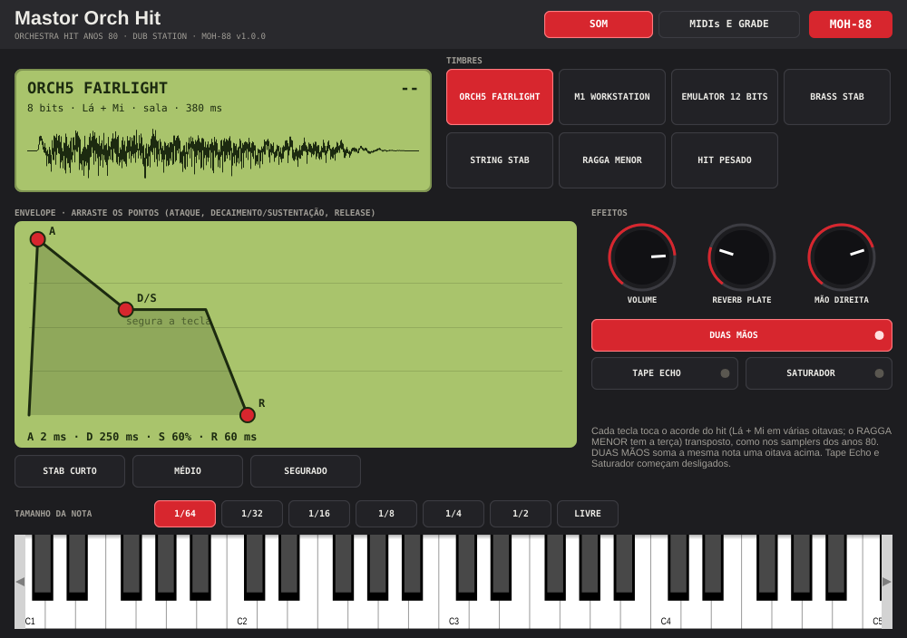
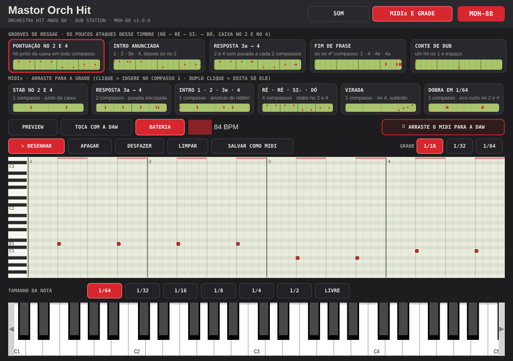

# Mastor Orch Hit MOH-88 1.0 — o orchestra hit dos anos 80 🎺

*Linha Dub Station*

← [Voltar para a página inicial do repositório](../README.md)

**Downloads:** [Windows](https://github.com/dubmastor/DubMastor-DubStation-/releases/download/MOH-88-1.0/MOH-88-Windows-Instalador.exe) · [Mac](https://github.com/dubmastor/DubMastor-DubStation-/releases/download/MOH-88-1.0/MOH-88-macOS-Instalador.pkg) · 📱 [Testar no navegador](https://dubmastor.github.io/DubMastor-DubStation-/web/orchhit/)

O orchestra hit dos samplers dos anos 80 (Fairlight CMI, Emulator, Korg M1) do jeito que o reggae e o dancehall digital usavam.
Formatos: **VST3** (Windows/macOS), **AU** (macOS), **AAX** (Pro Tools, depois da assinatura PACE) e **Standalone**.



## Uma nota, o acorde inteiro
Fiel ao uso dos anos 80: cada tecla toca **uma nota só**, mas o som já é o acorde do hit — **Lá + Mi** espalhados em várias oitavas,
sem terça (como o ORCH5 do Fairlight). Quando você toca Ré, sai Ré + Lá; em Si♭, Si♭ + Fá: o bloco inteiro anda junto.
O sample é transposto pela velocidade, como num sampler antigo: o grave fica longo e pesado, o agudo fica curto e fino.
**DUAS MÃOS** soma a mesma nota uma oitava acima, como o tecladista com as duas mãos. O **RAGGA MENOR** é o único com a terça (menor).

## A contagem
Tudo é na contagem da Dub Station: **caixa no 2 e no 4**. Na grade, um compasso tem 64 ticks de 1/64: o 2 é o tick 16 e o 4 é o tick 48.
O hit é pontuação: cai junto da caixa, puxa no "3 a", fecha a frase no 4 — curto (o **TAMANHO DA NOTA** começa em **1/64**).

## Timbres
| Timbre | O que é |
|---|---|
| **ORCH5 FAIRLIGHT** (inicial) | 8 bits, 24 kHz, Lá + Mi com a sala — o hit mais conhecido |
| **M1 WORKSTATION** | 16 bits, limpo e brilhante, do fim dos anos 80 |
| **EMULATOR 12 BITS** | 12 bits, mais corpo e um pouco mais longo |
| **BRASS STAB** | só metais + tímpano |
| **STRING STAB** | naipe de cordas |
| **RAGGA MENOR** | acorde menor, 12 bits, mais escuro |
| **HIT PESADO** | tímpano e bumbo na frente |

O hit é sintetizado no plugin: cordas (naipe de 8 por nota com corpo e arco), metais (entram um pouco abaixo e sobem, com o brilho
do fortíssimo), madeiras, contrabaixos, tímpano, bumbo e prato numa sala, depois o "sampler dos anos 80" (bits e taxa reduzidos).
É a mesma receita da versão para celular.

## Aba MIDIs E GRADE


- **GROOVES**: PONTUAÇÃO NO 2 E 4, INTRO ANUNCIADA, RESPOSTA 3a → 4, FIM DE FRASE e CORTE DE DUB, sobre Ré – Ré – Si♭ – Dó.
  O selecionado já vem desenhado na grade. Inspirados no uso do hit no reggae e no dancehall digital, não são transcrições.
- **MIDIs**: arraste para a grade (o compasso e a linha onde soltar viram o início e a nota base), clique para inserir no compasso 1,
  duplo clique para editar só ele. SALVAR COMO MIDI guarda a grade como um MIDI seu (botão direito apaga).
- **Grade** de 4 compassos: clique cria (com o tamanho da nota), arraste move, puxe a borda direita para o tamanho; APAGAR, DESFAZER, LIMPAR; grade de 1/16, 1/32 ou 1/64.
- **PREVIEW** (com BATERIA e BPM próprio), **TOCA COM A DAW** e **ARRASTE O MIDI PARA A DAW**.

## Padrão de fábrica
Timbre ORCH5 FAIRLIGHT · nota 1/64 · DUAS MÃOS ligado · groove PONTUAÇÃO NO 2 E 4 na grade · **Tape Echo e Saturador desligados**.

## Compilar e testar
```
g++ -std=c++17 -O2 -Wall -Wextra -I Source tests/render_test.cpp -o render_test && ./render_test   # motor, sem JUCE
cmake -B build-snap -DMOH_SNAPSHOT=ON -DMOH_FORMATS=VST3 && cmake --build build-snap --target OrchHitSnapshot
./build-snap/OrchHitSnapshot_artefacts/Release/OrchHitSnapshot docs/interface.png                  # plugin inteiro + imagens
cmake -B build -DCMAKE_BUILD_TYPE=Release && cmake --build build --config Release                   # VST3, AU, standalone
```
