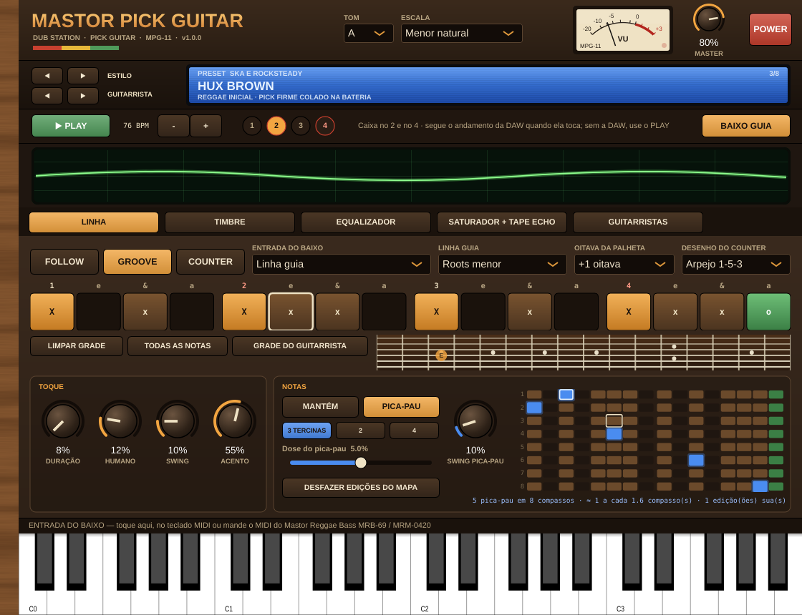
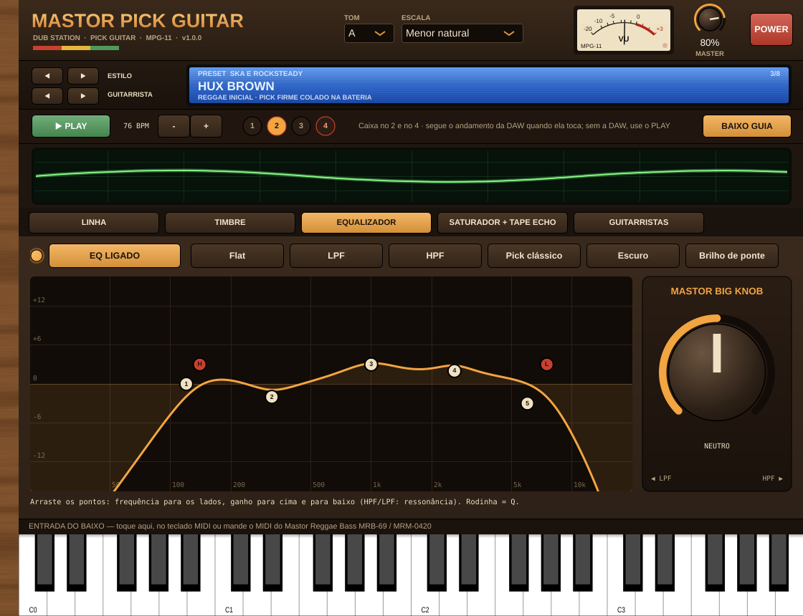

# Mastor Pick Guitar MPG-11 1.0 — a pick guitar do reggae 🎸

*Linha Dub Station*

← [Voltar para a página inicial do repositório](../README.md)

**Downloads:** [Windows](https://github.com/dubmastor/DubMastor-DubStation-/releases/download/MPG-11-1.0/MPG-11-Windows-Instalador.exe) · [Mac](https://github.com/dubmastor/DubMastor-DubStation-/releases/download/MPG-11-1.0/MPG-11-macOS-Instalador.pkg) · 📱 [Testar no navegador](https://dubmastor.github.io/DubMastor-DubStation-/web/pickguitar/)

Instrumento que toca **a guitarra abafada do reggae** — a pick guitar que dobra o baixo ou faz a contra-linha — no andamento
da DAW. A corda é sintetizada (Karplus-Strong com a mão na ponte) e a linha nasce do baixo que chega pelo MIDI.
Formatos: **VST3** (Windows/macOS), **AU** (macOS), **AAX** (Pro Tools, depois da assinatura PACE) e **Standalone**.

## A contagem
Tudo no MPG-11 é na contagem da Dub Station: **caixa no 2 e no 4**. A grade tem as **16 semicolcheias** do compasso
(1 e & a) e a duração da nota é uma porcentagem da semicolcheia. O pica-pau repete dentro da semicolcheia
(3 tercinas, 2 ou 4).

## Como ligar na DAW
1. Ponha o MPG-11 numa faixa de instrumento.
2. Mande para ele o MIDI do baixo: a mesma parte do **Mastor Reggae Bass MRB-69**, o MIDI do baixo da **Riddim Machine MRM-0420**
   (arraste para a faixa ou roteie a saída MIDI) ou toque no teclado.
3. Dê play na DAW: o MPG-11 segue o andamento e a posição dela. Sem a DAW (standalone), use **PLAY** e **BPM**.

## De onde a linha nasce
| Modo | O que faz |
|---|---|
| **FOLLOW** | Cada nota do baixo vira uma palhetada, na oitava escolhida. Com a LINHA GUIA, a grade só decide quais notas abrem |
| **GROOVE** | O ritmo sai da grade; a nota é a do baixo que estiver soando |
| **COUNTER** | Contra-linha: cada palhetada da grade anda pelo desenho escolhido (arpejo 1-5-3, subida 1-3-5-6, oitava e quinta, vizinha 1-2-3, larga 1-5-8-5-3) a partir da nota do baixo, dentro do tom e da escala |

**ENTRADA DO BAIXO**: MIDI (MRB-69, MRM-0420 ou teclado) ou **LINHA GUIA** (3 linhas de 2 compassos para testar, com o
**BAIXO GUIA** soando junto). **OITAVA DA PALHETA**: uníssono, +1 ou +2 oitavas.

## Grade, toque e pica-pau
- **GRADE**: toque numa semicolcheia para trocar entre pausa → abafada (x) → acento (X) → aberta (o) → pica-pau só nela (⋮⋮)
- **DURAÇÃO** começa em 8% (perto do mínimo), **SWING** em 10%, **HUMANO** e **ACENTO**
- **MANTÉM** ou **PICA-PAU**; repetições **3 tercinas** (padrão), 2 ou 4; **SWING PICA-PAU** começa em 10%
- **DOSE** de 0 a 10% (passos de 0,5): quantas palhetadas abafadas viram pica-pau num ciclo de 8 compassos, espalhadas por igual e mudando de lugar no compasso
- **MAPA** de 8 compassos: azul = pica-pau; toque numa nota para pôr ou tirar (borda branca = edição sua, salva no projeto e válida também no MANTÉM); **DESFAZER EDIÇÕES DO MAPA** volta ao que a dose gerou

## Guitarristas
Cada preset carrega modo, grade, linha guia, desenho do counter, timbre e eco. São padrões **originais** no espírito de cada
guitarrista, não transcrições nem gravações.

| Guitarrista | Época | O que o preset faz |
|---|---|---|
| **Ernest Ranglin** | Ska | Follow solto, abafado leve, captador do meio |
| **Lynn Taitt** | Rocksteady | Follow curto e brilhante (ponte), pica-pau em tercinas |
| **Hux Brown** | Reggae inicial | Groove com acento no começo dos tempos, pica-pau (preset inicial) |
| **Eric Frater** | Studio One | Groove em pares com eco de fita presente |
| **Earl "Chinna" Smith** | Roots anos 70 | Counter largo, ponte brilhante, síncopas |
| **Dwight Pinkney** | Roots anos 70 | Counter cantado, misturando notas abertas |
| **Bingy Bunny & Tony Chin** | Roots Radics | Groove reto, muito abafado e escuro (braço), pica-pau |
| **Mikey Chung** | Black Uhuru | Counter de oitava e quinta, brilhante, com eco |

## Som
- **Timbre de fábrica**: captador ponte, abafado 100%, palheta na ponte (7%), ataque 100%, drive 0%, tom 62%, corpo 96%. Duplo clique num knob volta a ele
- **TIMBRE**: captador braço / meio / ponte, abafado, posição da palheta, ataque, drive, tom e corpo
- **EQUALIZADOR**: arraste os pontos com o mouse (frequência para os lados, ganho para cima e para baixo; no HPF e no LPF, a ressonância), rodinha muda o Q, duplo clique volta o ponto; bypass e presets **Flat, LPF, HPF**, Pick clássico, Escuro e Brilho de ponte
- **MASTOR BIG KNOB** na área do EQ: para a esquerda fecha um LPF (até 300 Hz), para a direita abre um HPF (até 3 kHz)
- **SATURADOR** (fita, válvula, transistor; drive, mix e saída) e **MASTOR TAPE ECHO** (slapback 110 ms, 1/16, 1/8, 1/8 pontuada ou 1/4; repetições, mix, mola e DUB THROW): **os dois começam em bypass**
- Cadeia: palheta → amp → EQ → Big Knob → saturador → seco + eco + mola → master. **OSCILOSCÓPIO**, VU e POWER

## Arquivos
- `Source/PickEngine.h` — motor e sequenciador (sem JUCE): corda abafada, amp, EQ, Big Knob, saturador, eco, mola, modos, pica-pau
- `Source/PluginProcessor.*`, `Source/PluginEditor.*` — plugin e interface (usa `HalfDub/Source/TapeEcho.h` e o VU e a madeira de `ReggaeKeys/Source`)
- `tests/render_test.cpp` — teste offline: padrão de fábrica, contagem, pica-pau (dose, edições, tercinas), MIDI, os três modos e um WAV por guitarrista
- `tests/snapshot.cpp` — captura das telas (`docs/`) e teste de estado (salvar e abrir o projeto)
- Versão para navegador: `site/web/pickguitar/index.html`
