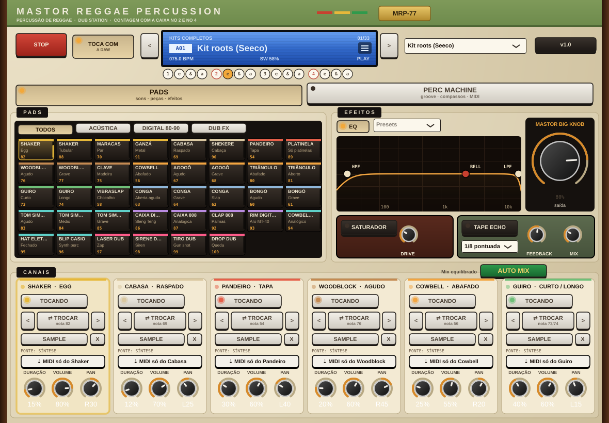
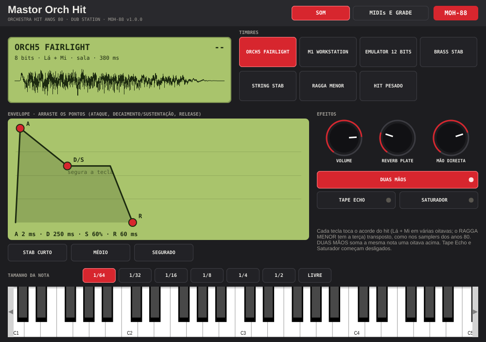
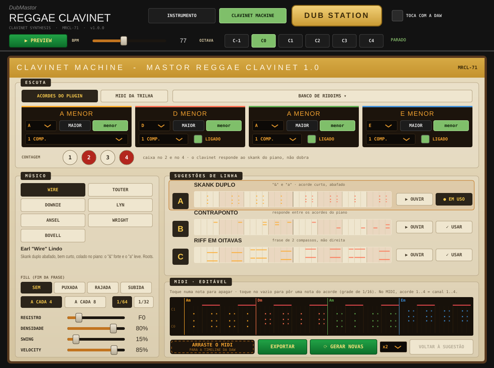
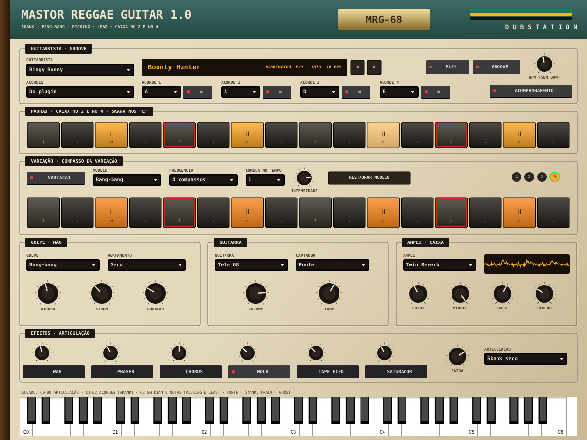
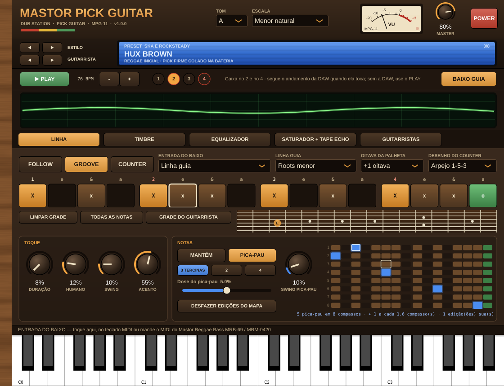
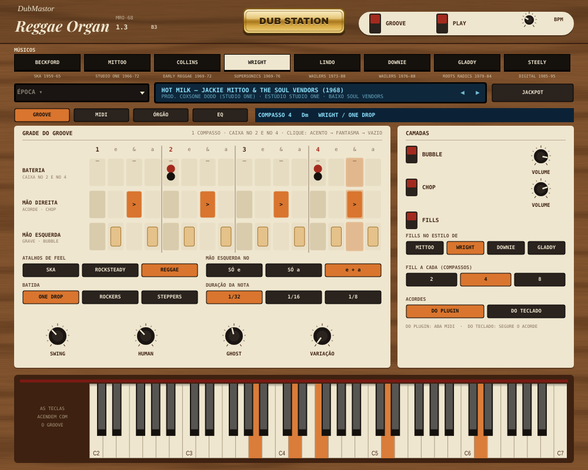
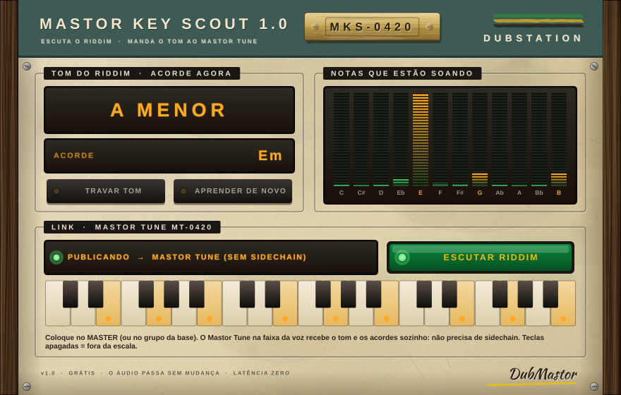
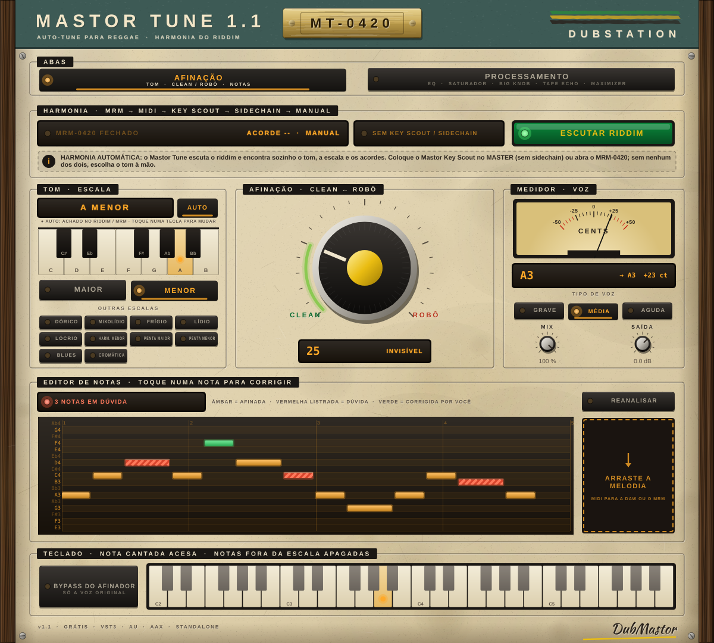
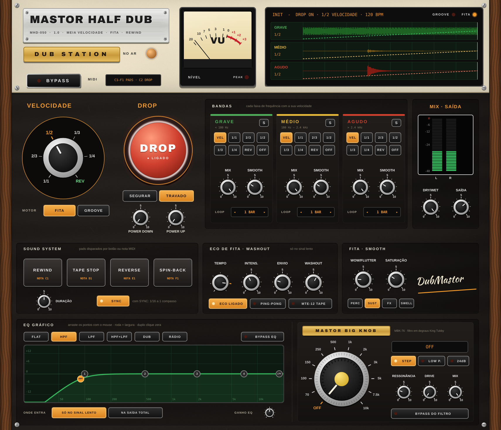
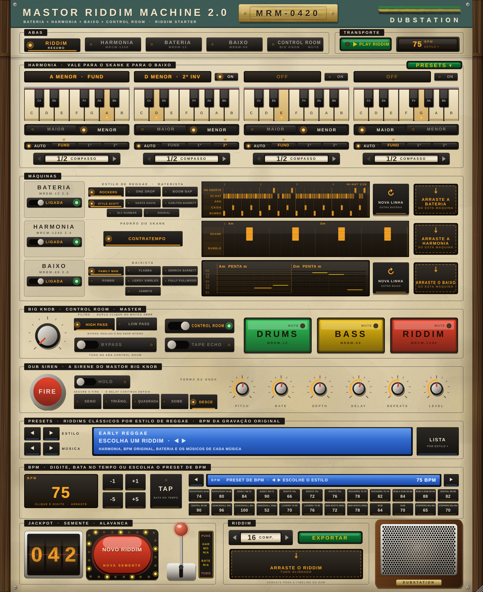

# DubMastor — Dub Station 🟢🟡⚫

🌐 **Site de downloads:** https://dubmastor.github.io/DubMastor-DubStation-/

Plugins de dub por **DubMastor**, em VST3 (Windows e Mac) e AU (Mac). Feitos e testados para o **Cubase**.

## 🪇 Novo: Mastor Reggae Percussion MRP-77 1.0 — percussão de reggae com a PERC MACHINE

[](ReggaePercussion/)

**Shaker, cabasa, pandeiro, woodblock, cowbell, guiro, congas e mais**, com os grooves do estudo dos percussionistas jamaicanos
(Seeco Patterson, Sticky Thompson, Scully Simms), na contagem da Dub Station (caixa no 2 e no 4). Duas abas: **PADS** (38 pads com AUTO MIX,
efeitos e os 6 canais que piscam no ritmo) e **PERC MACHINE** (grade de até 8 compassos com uma cor cada, MIDI colorido e arraste
para a DAW). Tem percussão digital 80-90 (toms Simmons, caixa Sleng Teng, 808) e Dub FX. As notas ficam fora da faixa do Mastor Reggae Drums MRD-12 (36–51): os dois tocam juntos sem conflito.

**[⬇️ Windows](https://github.com/dubmastor/DubMastor-DubStation-/releases/download/MRP-77-1.0/MRP-77-Windows-Instalador.exe)** · **[⬇️ macOS](https://github.com/dubmastor/DubMastor-DubStation-/releases/download/MRP-77-1.0/MRP-77-macOS-Instalador.pkg)** · **📱 [Testar no navegador](https://dubmastor.github.io/DubMastor-DubStation-/web/reggaepercussion/)** · [Detalhes](ReggaePercussion/)

## 🎺 Novo: Mastor Orch Hit MOH-88 1.0 — o orchestra hit dos anos 80

[](OrchHit/)

**O orchestra hit dos samplers dos anos 80** (Fairlight, Emulator, Korg M1) do jeito que o reggae e o dancehall digital usavam:
cada tecla toca o acorde do hit transposto, com **DUAS MÃOS** (a mesma nota uma oitava acima), na contagem da Dub Station
(caixa no 2 e no 4). 7 timbres (ORCH5 Fairlight é o inicial), envelope de arrastar, **TAMANHO DA NOTA** com 1/64 de padrão,
**GROOVES** com os poucos ataques do hit no reggae já desenhados na grade, MIDIs para arrastar e arraste do MIDI para a DAW.

**[⬇️ Windows](https://github.com/dubmastor/DubMastor-DubStation-/releases/download/MOH-88-1.0/MOH-88-Windows-Instalador.exe)** · **[⬇️ macOS](https://github.com/dubmastor/DubMastor-DubStation-/releases/download/MOH-88-1.0/MOH-88-macOS-Instalador.pkg)** · **📱 [Testar no navegador](https://dubmastor.github.io/DubMastor-DubStation-/web/orchhit/)** · [Detalhes](OrchHit/)

## 🎹 Novo: Mastor Reggae Clavinet MRCL-71 1.0 — o clavinet que segue o riddim

[](ReggaeClavinet/)

**Clavinet de reggae com a CLAVINET MACHINE**: segue a harmonia (banco de riddims, acordes do plugin ou o MIDI que chega na trilha,
como o do MRP-80 ou do MRM-0420) e sugere três linhas no estilo dos clavinetistas jamaicanos, na contagem da Dub Station
(caixa no 2 e no 4). Som de corda por modelo físico, timbre inicial **M1**, chave de **OITAVA**, fills a cada 4 ou 8 compassos,
visor MIDI editável e arraste para a timeline.

**[⬇️ Windows](https://github.com/dubmastor/DubMastor-DubStation-/releases/download/MRCL-71-1.0/MRCL-71-Windows-Instalador.exe)** · **[⬇️ macOS](https://github.com/dubmastor/DubMastor-DubStation-/releases/download/MRCL-71-1.0/MRCL-71-macOS-Instalador.pkg)** · **📱 [Testar no navegador](https://dubmastor.github.io/DubMastor-DubStation-/web/reggaeclavinet/)** · [Detalhes](ReggaeClavinet/)

## 🎸 Novo: Mastor Reggae Guitar MRG-68 1.0 — a guitarra dos guitarristas jamaicanos

[](ReggaeGuitar/)

**Skank, bang-bang, chop, picking e lead no andamento da DAW**, na contagem da Dub Station (caixa no 2 e no 4, skank nos "e").
Escolha o **GUITARRISTA** (Ernest Ranglin, Lynn Taitt, Hux Brown, Peter Tosh, Bob Marley, Chinna Smith, Tony Chin, Bingy Bunny,
Dwight Pinkney, Mikey Chung, Al Anderson, Junior Marvin) e ajuste a **GRADE** de 16 semicolcheias, o golpe (simples, **bang-bang**,
shuffle), o abafamento e a **VARIAÇÃO** do fim da frase (Lick, Scratch, Bang-bang, Flyer, Pausa, editável). Toque no teclado MIDI:
articulações no grave, acordes no meio, picking e lead no agudo. Som em modelagem física: Tele 68, LP Special ou Strat no Fender Twin ou no JC-120.

**[⬇️ Windows](https://github.com/dubmastor/DubMastor-DubStation-/releases/download/MRG-68-1.0/MRG-68-Windows-Instalador.exe)** · **[⬇️ macOS](https://github.com/dubmastor/DubMastor-DubStation-/releases/download/MRG-68-1.0/MRG-68-macOS-Instalador.pkg)** · **📱 [Testar no navegador](https://dubmastor.github.io/DubMastor-DubStation-/web/reggaeguitar/)** · [Detalhes](ReggaeGuitar/)

## 🎸 Novo: Mastor Pick Guitar MPG-11 1.0 — a pick guitar do reggae

[](PickGuitar/)

**A guitarra abafada que dobra o baixo**, sintetizada (corda Karplus-Strong) e pronta no andamento da DAW, na contagem da
Dub Station (caixa no 2 e no 4). Mande o MIDI do **Mastor Reggae Bass MRB-69** ou da **Riddim Machine MRM-0420** e escolha:
**FOLLOW** (dobra nota a nota), **GROOVE** (ritmo da grade, nota do baixo) ou **COUNTER** (contra-linha). Grade de 16
semicolcheias, **PICA-PAU** com dose e mapa editável, 8 guitarristas jamaicanos, EQ no mouse, Mastor Big Knob, saturador e Tape Echo.

**[⬇️ Windows](https://github.com/dubmastor/DubMastor-DubStation-/releases/download/MPG-11-1.0/MPG-11-Windows-Instalador.exe)** · **[⬇️ macOS](https://github.com/dubmastor/DubMastor-DubStation-/releases/download/MPG-11-1.0/MPG-11-macOS-Instalador.pkg)** · **📱 [Testar no navegador](https://dubmastor.github.io/DubMastor-DubStation-/web/pickguitar/)** · [Detalhes](PickGuitar/)

## 🎹 Novo: Mastor Reggae Organ MRO-68 1.3 — o órgão dos organistas jamaicanos

[](ReggaeOrgan/)

**Bubble, chop e fills no andamento da DAW**, na contagem da Dub Station (caixa no 2 e no 4), com o Hammond do Reggae Keys MRK-80.
Escolha o groove pelo **MÚSICO** (Beckford, Jackie Mittoo, Ansel Collins, Winston Wright, Wire Lindo, Tyrone Downie, Gladdy
Anderson, Steely), pela **ÉPOCA** (os 10 estilos do banco) ou pelo **RIDDIM** (as 356 músicas do banco único). Ajuste na
**GRADE** de 16 semicolcheias (mão direita e mão esquerda, acento ou fantasma), com feel, batida, duração da nota, swing, ghost
e JACKPOT; edite o **MIDI** no visor e arraste para a timeline (tudo ou uma camada).

**[⬇️ Windows](https://github.com/dubmastor/DubMastor-DubStation-/releases/download/MRO-68-1.3/MRO-68-Windows-Instalador.exe)** · **[⬇️ macOS](https://github.com/dubmastor/DubMastor-DubStation-/releases/download/MRO-68-1.3/MRO-68-macOS-Instalador.pkg)** · **📱 [Testar no navegador](https://dubmastor.github.io/DubMastor-DubStation-/web/reggaeorgan/)** · [Detalhes](ReggaeOrgan/)

## 🔎 Novo: Mastor Key Scout MKS-0420 1.0 — o olheiro do tom

[](KeyScout/)

Vai no **master**: escuta o riddim, acha o **tom**, a **escala** e o **acorde de cada momento** e manda tudo para o
**Mastor Tune** na faixa da voz, **sem sidechain e sem roteamento**. O áudio passa sem mudança e sem latência. Grátis.

**[⬇️ Windows](https://github.com/dubmastor/DubMastor-DubStation-/releases/download/MKS-0420-1.0/MKS-0420-Windows-Instalador.exe)** · **[⬇️ macOS](https://github.com/dubmastor/DubMastor-DubStation-/releases/download/MKS-0420-1.0/MKS-0420-macOS-Instalador.pkg)** · **📱 [Versão para celular](https://dubmastor.github.io/DubMastor-DubStation-/web/keyscout/)** · [Detalhes](KeyScout/)

## 🎤 Novo: Mastor Tune MT-0420 1.1 — auto-tune para reggae

[](Tune/)

**Afina a voz sem mudar o timbre**, do clean (invisível) ao robô (hard-tune), num knob só. O botão **ESCUTAR RIDDIM**
acha sozinho o tom, a escala e os acordes; com o **MRM-0420** aberto ele lê a harmonia direto. Editor de notas preso à
timeline (as notas em dúvida piscam em vermelho: toque e escolha a certa), MIDI da melodia para arrastar e aba
**PROCESSAMENTO** com EQ gráfico, saturador, Big Knob, Tape Echo e Maximizer. Grátis.

**[⬇️ Windows](https://github.com/dubmastor/DubMastor-DubStation-/releases/download/MT-0420-1.1/MT-0420-Windows-Instalador.exe)** · **[⬇️ macOS](https://github.com/dubmastor/DubMastor-DubStation-/releases/download/MT-0420-1.1/MT-0420-macOS-Instalador.pkg)** · **📱 [Versão para celular](https://dubmastor.github.io/DubMastor-DubStation-/web/tune/)** · [Detalhes](Tune/)

## 🐢 Novo efeito: Mastor Half Dub MHD-050 1.0 — meia velocidade de fita

[](HalfDub/)

**Evolução do half-time no visual Dub Station.** Coloque no canal e ele já abre com o efeito ligado (preset INIT,
meia velocidade). Seletor **VELOCIDADE** (1/1, 2/3, 1/2, 1/3, 1/4 e REV) preso ao compasso, motor **FITA** (o tom desce)
ou **GROOVE** (o tom fica), **três bandas** com velocidade própria, botão **DROP** para tocar ao vivo com POWER DOWN/UP
de fita, pads de **sound system** (REWIND, TAPE STOP, REVERSE, SPIN-BACK, também por MIDI), eco de fita com **WASHOUT**,
**EQ gráfico** editável com presets e bypass, e o **Mastor Big Knob**.

**[⬇️ Windows](https://github.com/dubmastor/DubMastor-DubStation-/releases/download/MHD-050-1.0/MHD-050-Windows-Instalador.exe)** · **[⬇️ macOS](https://github.com/dubmastor/DubMastor-DubStation-/releases/download/MHD-050-1.0/MHD-050-macOS-Instalador.pkg)** · **📱 [Testar no navegador](https://dubmastor.github.io/DubMastor-DubStation-/web/halfdub/)** · [Detalhes](HalfDub/)

## 🎛️ Mastor Riddim Machine MRM-0420 2.6 — DubStation

[](RiddimMachine/)

**Bateria (MRDM-12), harmonia (MRCM-1240), baixo (MRBM-69) e o Mastor Big Knob num instrumento só.** A aba
**RIDDIM** resume tudo: os 4 acordes (que valem para o skank e para o baixo), uma chave para ligar e desligar
cada máquina, os músicos de cada uma num clique, o MIDI de cada máquina na tela (editável) e arrastável
separadamente, o **JACKPOT** com o botão **NOVO RIDDIM** e o alto-falante antigo com grade de metal. Um BPM
só para tudo, e a aba **CONTROL ROOM** com o Big Knob no master, o mute de cada máquina e o TAPE ECHO.

**[⬇️ Windows](https://github.com/dubmastor/DubMastor-DubStation-/releases/download/MRM-0420-2.6/MRM-0420-Windows-Instalador.exe)** · **[⬇️ macOS](https://github.com/dubmastor/DubMastor-DubStation-/releases/download/MRM-0420-2.6/MRM-0420-macOS-Instalador.pkg)** · **📱 [Versão para celular](https://dubmastor.github.io/DubMastor-DubStation-/riddim/)** · [Detalhes](RiddimMachine/)

| Plugin | O que é | Mac | Windows | Detalhes |
|---|---|---|---|---|
| **Mastor Reggae Drums MRD-12 2.0** | Instrumento: sampler de bateria com 16 pads estilo MPC / SP-404 (notas 36–51, mapa do MRDM-12), visor do sample com início e fim, envelope AHDSR gráfico, LAYER (timbre 2 e juntar pads), 34 timbres DM, choke, presets de fábrica e GRAVAR; aba **DUB DRUMS** com o MRDM-12 inteiro (bateristas, GROOVES de 118 músicas no visor azul, groove nos pads, MIDI colorido por compasso). [▶ Tocar no navegador](https://dubmastor.github.io/DubMastor-DubStation-/battery/) | [⬇️ macOS (.pkg)](https://github.com/dubmastor/DubMastor-DubStation-/releases/download/MRD-12-2.0/MRD-12-macOS-Instalador.pkg) | [⬇️ Windows (.exe)](https://github.com/dubmastor/DubMastor-DubStation-/releases/download/MRD-12-2.0/MRD-12-Windows-Instalador.exe) | [ReggaeDrums/](ReggaeDrums/) |
| **Mastor Riddim Machine MRM-0420 2.6** | Instrumento / gerador MIDI da DubStation: MRDM-12 + MRCM-1240 + MRBM-69 + Mastor Big Knob num só. Aba RIDDIM com a harmonia única (skank e baixo), chave e músicos de cada máquina, MIDI editável e arrastável por máquina, JACKPOT (NOVO RIDDIM e ALAVANCA de riddim 100% aleatório), PRESETS de harmonia e alto-falante; abas de cada máquina completas e CONTROL ROOM (Big Knob no master, mute DRUMS / BASS / RIDDIM e TAPE ECHO) | [⬇️ macOS](https://github.com/dubmastor/DubMastor-DubStation-/releases/download/MRM-0420-2.6/MRM-0420-macOS-Instalador.pkg) | [⬇️ Windows](https://github.com/dubmastor/DubMastor-DubStation-/releases/download/MRM-0420-2.6/MRM-0420-Windows-Instalador.exe) | [RiddimMachine/](RiddimMachine/) |
| **Mastor Reggae Organ MRO-68 1.3** | Instrumento / gerador de grooves: o órgão de reggae (bubble, chop e fills) na contagem com a caixa no 2 e no 4, com o Hammond (Leslie animada de dois rotores com presets) ou 4 pianos elétricos; grooves por MÚSICO (8 organistas jamaicanos), ÉPOCA (10 estilos) ou RIDDIM (banco único, 356 músicas); GRADE de 16 semicolcheias editável, feel, batida, duração da nota, swing, ghost, JACKPOT, fills Mittoo/Wright/Downie/Gladdy, visor MIDI editável e arraste por camada; aba EQ (4 faixas, curva editável no mouse, presets) e TIMBRES MIDNITE (Ron Benjamin: original, ABAFADO, CORPO e AO VIVO). [▶ Tocar no navegador](https://dubmastor.github.io/DubMastor-DubStation-/web/reggaeorgan/) | [⬇️ macOS](https://github.com/dubmastor/DubMastor-DubStation-/releases/download/MRO-68-1.3/MRO-68-macOS-Instalador.pkg) | [⬇️ Windows](https://github.com/dubmastor/DubMastor-DubStation-/releases/download/MRO-68-1.3/MRO-68-Windows-Instalador.exe) | [ReggaeOrgan/](ReggaeOrgan/) |
| **Mastor Reggae Clavinet MRCL-71 1.0** | Instrumento / gerador de linhas: clavinet de reggae por modelo físico (timbres M1, D6, MUTE, WAH, PHASER e DUB) com a CLAVINET MACHINE, que segue a harmonia (banco, acordes ou MIDI da trilha) e sugere linhas de 7 clavinetistas jamaicanos (skank duplo, contraponto, riff em oitavas), na contagem com a caixa no 2 e no 4; chave de oitava, fills, visor MIDI editável e arraste para a DAW. [▶ Tocar no navegador](https://dubmastor.github.io/DubMastor-DubStation-/web/reggaeclavinet/) | [⬇️ macOS](https://github.com/dubmastor/DubMastor-DubStation-/releases/download/MRCL-71-1.0/MRCL-71-macOS-Instalador.pkg) | [⬇️ Windows](https://github.com/dubmastor/DubMastor-DubStation-/releases/download/MRCL-71-1.0/MRCL-71-Windows-Instalador.exe) | [ReggaeClavinet/](ReggaeClavinet/) |
| **Mastor Orch Hit MOH-88 1.0** | Instrumento / sampler: o orchestra hit dos anos 80 (ORCH5 Fairlight, M1, Emulator, Brass, String, Ragga Menor e Hit Pesado) tocado como um tecladista com as duas mãos, na contagem com a caixa no 2 e no 4; envelope de arrastar, tamanho da nota (1/64 de padrão), reverb, Tape Echo e Saturador (desligados de fábrica), grooves de reggae já desenhados, grade de 4 compassos com MIDIs para arrastar e arraste para a DAW. [▶ Tocar no navegador](https://dubmastor.github.io/DubMastor-DubStation-/web/orchhit/) | [⬇️ macOS](https://github.com/dubmastor/DubMastor-DubStation-/releases/download/MOH-88-1.0/MOH-88-macOS-Instalador.pkg) | [⬇️ Windows](https://github.com/dubmastor/DubMastor-DubStation-/releases/download/MOH-88-1.0/MOH-88-Windows-Instalador.exe) | [OrchHit/](OrchHit/) |
| **Mastor Reggae Percussion MRP-77 1.0** | Instrumento / gerador de grooves: percussão de reggae com 37 sons sintetizados (acústicos, digitais 80-90 e Dub FX, ou samples seus) e a PERC MACHINE, com 33 presets (estudo dos percussionistas jamaicanos, kits digitais, Simmons e Dub FX) na contagem com a caixa no 2 e no 4; 38 pads, AUTO MIX, 6 canais que piscam no ritmo, grade de até 8 compassos com uma cor cada, MIDI colorido e arraste para a DAW; notas fora da faixa do MRD-12 (36–51). [▶ Tocar no navegador](https://dubmastor.github.io/DubMastor-DubStation-/web/reggaepercussion/) | [⬇️ macOS](https://github.com/dubmastor/DubMastor-DubStation-/releases/download/MRP-77-1.0/MRP-77-macOS-Instalador.pkg) | [⬇️ Windows](https://github.com/dubmastor/DubMastor-DubStation-/releases/download/MRP-77-1.0/MRP-77-Windows-Instalador.exe) | [ReggaePercussion/](ReggaePercussion/) |
| **Mastor Reggae Guitar MRG-68 1.0** | Instrumento / gerador de grooves: a guitarra de reggae dos 12 guitarristas jamaicanos do estudo (skank, bang-bang, chop, picking e lead) na contagem com a caixa no 2 e no 4; grade de 16 semicolcheias, golpe, abafamento, variação do fim da frase editável, teclado MIDI com articulações, Tele 68 / LP Special / Strat no Fender Twin ou JC-120, wah, phaser, chorus, mola, Tape Echo e saturador. [▶ Tocar no navegador](https://dubmastor.github.io/DubMastor-DubStation-/web/reggaeguitar/) | [⬇️ macOS](https://github.com/dubmastor/DubMastor-DubStation-/releases/download/MRG-68-1.0/MRG-68-macOS-Instalador.pkg) | [⬇️ Windows](https://github.com/dubmastor/DubMastor-DubStation-/releases/download/MRG-68-1.0/MRG-68-Windows-Instalador.exe) | [ReggaeGuitar/](ReggaeGuitar/) |
| **Mastor Pick Guitar MPG-11 1.0** | Instrumento / gerador de linhas: pick guitar de reggae sintetizada (corda abafada) que nasce do baixo pelo MIDI (MRB-69, MRM-0420 ou teclado), na contagem com a caixa no 2 e no 4; FOLLOW, GROOVE e COUNTER; grade de 16 semicolcheias (abafada, acento, aberta, pica-pau); PICA-PAU em tercinas, semicolcheias ou fusas com dose de 0 a 10% e mapa editável de 8 compassos; 8 guitarristas jamaicanos; EQ editável no mouse, Mastor Big Knob, saturador, Tape Echo com mola e osciloscópio. [▶ Tocar no navegador](https://dubmastor.github.io/DubMastor-DubStation-/web/pickguitar/) | [⬇️ macOS](https://github.com/dubmastor/DubMastor-DubStation-/releases/download/MPG-11-1.0/MPG-11-macOS-Instalador.pkg) | [⬇️ Windows](https://github.com/dubmastor/DubMastor-DubStation-/releases/download/MPG-11-1.0/MPG-11-Windows-Instalador.exe) | [PickGuitar/](PickGuitar/) |
| **Mastor Intro Fills MIF 1.0** | Instrumento / gerador de viradas: viradas de introdução de bateria de reggae dos bateristas jamaicanos (Carlton Barrett, Sly Dunbar, Style Scott, Horsemouth, Santa Davis e Mikey Boo) na contagem com a caixa no 2 e no 4, chegando no groove (One drop, Rockers, Steppers, Dub ou Rocksteady); anacruse, meio, 1 ou 2 compassos, grade editável, feel do estudo e MIDI nas notas do MRD-12 | [⬇️ macOS](https://github.com/dubmastor/DubMastor-DubStation-/releases/download/MIF-1.0/MIF-macOS-Instalador.pkg) | [⬇️ Windows](https://github.com/dubmastor/DubMastor-DubStation-/releases/download/MIF-1.0/MIF-Windows-Instalador.exe) | [IntroFills/](IntroFills/) |
| **Mastor Big Knob MBK-76 3.2** | Estação de dub: filtro big knob estilo King Tubby (com bypass), eco de fita com cabeçotes, presets de EQ e liga/desliga, sirene de dub, VUs e maximizer | [⬇️ macOS](https://github.com/dubmastor/DubMastor-DubStation-/releases/download/MBK-76-3.2/MBK-76-macOS-Instalador.pkg) | [⬇️ Windows](https://github.com/dubmastor/DubMastor-DubStation-/releases/download/MBK-76-3.2/MBK-76-Windows-Instalador.exe) | [BigKnob/](BigKnob/) |
| **Mastor Reggae Keys MRK-80 3.3** | Instrumento (antigo Roots Keys) com a aba **CHORD MACHINE** (o MRCM-1240 inteiro, só maior e menor, skank no CONTRATEMPO ou BANG BANG, com os presets no padrão do mega banco: estilos, riddims A–Z, músicas A–Z e favoritos, só riddims com harmonia, tocando neste piano), PREVIEW na aba do instrumento, PAN do piano e do GUITAR SKANK; piano com 13 timbres (M1 comprimido, M1, M1 Grand Piano, Grand, Honky Tonk, Yamaha CP-80, Yamaha C7, FM EP, Casio CZ-101, MT-40, Rhodes Stage, Rhodes Suitcase e Wurlitzer; o órgão foi para o MRO-68), eco de fita, flanger dub, maximizer, VUs e teclado que acende com o MIDI. [▶ Tocar no navegador](https://dubmastor.github.io/DubMastor-DubStation-/keys/) | [⬇️ macOS](https://github.com/dubmastor/DubMastor-DubStation-/releases/download/MRK-80-3.3/MRK-80-macOS-Instalador.pkg) | [⬇️ Windows](https://github.com/dubmastor/DubMastor-DubStation-/releases/download/MRK-80-3.3/MRK-80-Windows-Instalador.exe) | [ReggaeKeys/](ReggaeKeys/) |
| **Mastor Reggae Bass MRB-69 2.1** | Instrumento (antigo Dub Bass / MRDBI-07) com a aba **BASS MACHINE** (o MRBM-69 inteiro tocando por este som): baixo de reggae Bass (senoide), Super Tone (digital King Jammy) ou 808, envelope gráfico, saturação com válvula animada ou fita de rolo, EQ editável na tela, reverb, bass boost em 60 Hz, teclado C1–C4 e maximizer com VU digital estilo Ozone | [⬇️ macOS](https://github.com/dubmastor/DubMastor-DubStation-/releases/download/MRB-69-2.1/MRB-69-macOS-Instalador.pkg) | [⬇️ Windows](https://github.com/dubmastor/DubMastor-DubStation-/releases/download/MRB-69-2.1/MRB-69-Windows-Instalador.exe) | [ReggaeBass/](ReggaeBass/) |
| **Mastor Reggae Drum Machine MRDM-12 2.7** (legado) | Virou a aba **DUB DRUMS** do Mastor Reggae Drums MRD-12. A última versão separada fica para abrir projetos antigos | [⬇️ macOS](https://github.com/dubmastor/DubMastor-DubStation-/releases/download/MRDM-12-2.7/MRDM-12-macOS-Instalador.pkg) | [⬇️ Windows](https://github.com/dubmastor/DubMastor-DubStation-/releases/download/MRDM-12-2.7/MRDM-12-Windows-Instalador.exe) | [ReggaeDrumMachine/](ReggaeDrumMachine/) |
| **Mastor Reggae Bass Machine MRBM-69 3.0** (legado) | Virou a aba **BASS MACHINE** do Mastor Reggae Bass MRB-69. A última versão separada fica para abrir projetos antigos | [⬇️ macOS](https://github.com/dubmastor/DubMastor-DubStation-/releases/download/MRBM-69-3.0/MRBM-69-macOS-Instalador.pkg) | [⬇️ Windows](https://github.com/dubmastor/DubMastor-DubStation-/releases/download/MRBM-69-3.0/MRBM-69-Windows-Instalador.exe) | [ReggaeBassMachine/](ReggaeBassMachine/) |
| **Mastor Reggae Chord Machine MRCM-1240 2.4** (legado) | Virou a aba **CHORD MACHINE** do Mastor Reggae Keys MRK-80. A última versão separada fica para abrir projetos antigos | [⬇️ macOS](https://github.com/dubmastor/DubMastor-DubStation-/releases/download/MRCM-1240-2.4/MRCM-1240-macOS-Instalador.pkg) | [⬇️ Windows](https://github.com/dubmastor/DubMastor-DubStation-/releases/download/MRCM-1240-2.4/MRCM-1240-Windows-Instalador.exe) | [ReggaeChordMachine/](ReggaeChordMachine/) |
| **Mastor Dub Horns MDH-70 1.6** | Instrumento: naipe de metais anos 70 (trompete, flugel, saxes e trombone) com harmonia no tom, timbre de metal com espectro dinâmico (o brilho cresce com a força), vozes do naipe jamaicano (uníssono, oitavas, 3ªs, 6ªs, tríades e pad), Mastor Tape Echo, EQ gráfico de 10 bandas com Filtro Tubby e frases MIDI originais por década e estilo (com temas e skank de ska), transcrição de MP3/WAV para MIDI; final de nota natural e aba Músicos com 24 presets (Dean Fraser, Vin Gordon, Tommy McCook, Bobby Ellis…) | [⬇️ macOS](https://github.com/dubmastor/DubMastor-DubStation-/releases/download/MDH-70-1.6/MDH-70-macOS-Instalador.pkg) | [⬇️ Windows](https://github.com/dubmastor/DubMastor-DubStation-/releases/download/MDH-70-1.6/MDH-70-Windows-Instalador.exe) | [DubHorns/](DubHorns/) |
| **Mastor Key Scout MKS-0420 1.0** | Efeito de master: escuta o riddim e acha o tom, a escala e o acorde de cada momento, e manda para o Mastor Tune sem sidechain; áudio passa sem mudança e sem latência; TRAVAR TOM e APRENDER DE NOVO. [▶ Tocar no navegador](https://dubmastor.github.io/DubMastor-DubStation-/web/keyscout/) | [⬇️ macOS](https://github.com/dubmastor/DubMastor-DubStation-/releases/download/MKS-0420-1.0/MKS-0420-macOS-Instalador.pkg) | [⬇️ Windows](https://github.com/dubmastor/DubMastor-DubStation-/releases/download/MKS-0420-1.0/MKS-0420-Windows-Instalador.exe) | [KeyScout/](KeyScout/) |
| **Mastor Tune MT-0420 1.1** | Efeito de voz: auto-tune para reggae que afina sem mudar o timbre, knob CLEAN ↔ ROBÔ, ESCUTAR RIDDIM (acha tom e acordes sozinho), link com o Mastor Key Scout e o MRM-0420, teclado que apaga as notas fora da escala, bypass do afinador, editor de notas na timeline com as dúvidas destacadas, MIDI da melodia e aba PROCESSAMENTO (EQ gráfico, saturador, Big Knob, Tape Echo, Maximizer). [▶ Tocar no navegador](https://dubmastor.github.io/DubMastor-DubStation-/web/tune/) | [⬇️ macOS](https://github.com/dubmastor/DubMastor-DubStation-/releases/download/MT-0420-1.1/MT-0420-macOS-Instalador.pkg) | [⬇️ Windows](https://github.com/dubmastor/DubMastor-DubStation-/releases/download/MT-0420-1.1/MT-0420-Windows-Instalador.exe) | [Tune/](Tune/) |
| **Mastor Half Dub MHD-050 1.0** | Efeito novo: meia velocidade de fita (evolução do half-time). VELOCIDADE 1/1, 2/3, 1/2, 1/3, 1/4 e REV presa ao compasso, motor FITA ou GROOVE, três bandas com velocidade própria, botão DROP com POWER DOWN/UP, pads REWIND / TAPE STOP / REVERSE / SPIN-BACK (também por MIDI), eco de fita com WASHOUT, EQ gráfico editável e Mastor Big Knob. Abre com o efeito ligado. [▶ Tocar no navegador](https://dubmastor.github.io/DubMastor-DubStation-/web/halfdub/) | [⬇️ macOS](https://github.com/dubmastor/DubMastor-DubStation-/releases/download/MHD-050-1.0/MHD-050-macOS-Instalador.pkg) | [⬇️ Windows](https://github.com/dubmastor/DubMastor-DubStation-/releases/download/MHD-050-1.0/MHD-050-Windows-Instalador.exe) | [HalfDub/](HalfDub/) |
| **Mastor Phone Vox MPV-01 1.6** | Efeito de voz (antigo Mastor Fone): rádio AM, telefone antigo e megafone, com o eco de fita e o maximizer do Big Knob, no visual Dub Station | [⬇️ macOS](https://github.com/dubmastor/DubMastor-DubStation-/releases/download/MPV-01-1.6/MPV-01-macOS-Instalador.pkg) | [⬇️ Windows](https://github.com/dubmastor/DubMastor-DubStation-/releases/download/MPV-01-1.6/MPV-01-Windows-Instalador.exe) | [PhoneVox/](PhoneVox/) |
| **Mastor Tape Echo MTE-12 2.6** | Eco de fita de 3 cabeças + reverb de mola, com EQ gráfico | [⬇️ macOS](https://github.com/dubmastor/DubMastor-DubStation-/releases/download/MTE-12-2.6/MTE-12-macOS-Instalador.pkg) | [⬇️ Windows](https://github.com/dubmastor/DubMastor-DubStation-/releases/download/MTE-12-2.6/MTE-12-Windows-Instalador.exe) | [TapeEcho/](TapeEcho/) |

Todos os downloads ficam na página de **[Releases](https://github.com/dubmastor/DubMastor-DubStation-/releases/latest)**. Não precisa de conta no GitHub para baixar.

## Instalador completo (todos os plugins)

Um instalador só com a coleção inteira — na instalação dá para desmarcar os que não quiser.

Versão **4.0**, com os 18 plugins (11 instrumentos, 6 efeitos e a Riddim Machine):

- **Windows:** [⬇️ DubStation-Windows-Instalador.exe](https://github.com/dubmastor/DubMastor-DubStation-/releases/download/DubStation-4.0/DubStation-Windows-Instalador.exe) — VST3 em `C:\Program Files\Common Files\VST3` (Cubase, Ableton Live, FL Studio, Reaper, Studio One, Bitwig) e os programas standalone no menu Iniciar.
- **Mac:** [⬇️ DubStation-macOS-Instalador.pkg](https://github.com/dubmastor/DubMastor-DubStation-/releases/download/DubStation-4.0/DubStation-macOS-Instalador.pkg) — VST3 e AU em `/Library/Audio/Plug-Ins` (Logic, GarageBand, Cubase, Ableton Live, FL Studio…), Intel e Apple Silicon.

- **Pro Tools (AAX):** em preparação — veja [PROTOOLS.md](PROTOOLS.md).

## Instalação no Cubase

**Mac**
1. Baixe o zip do plugin. O Mac descompacta sozinho.
2. Feche o Cubase.
3. No Finder, aperte **Cmd+Shift+G**, cole `~/Library/Audio/Plug-Ins/VST3/` e copie para lá o arquivo **`.vst3`** do plugin.
4. No **Terminal**, libere o plugin (troque pelo nome do arquivo que você copiou):
   ```
   xattr -dr com.apple.quarantine ~/Library/Audio/Plug-Ins/VST3/"Mastor Big Knob MBK-76.vst3"
   xattr -dr com.apple.quarantine ~/Library/Audio/Plug-Ins/VST3/"Mastor Tape Echo MTE-12.vst3"
   xattr -dr com.apple.quarantine ~/Library/Audio/Plug-Ins/VST3/"Mastor Reggae Keys MRK-80.vst3"
   xattr -dr com.apple.quarantine ~/Library/Audio/Plug-Ins/VST3/"Mastor Phone Vox MPV-01.vst3"
   xattr -dr com.apple.quarantine ~/Library/Audio/Plug-Ins/VST3/"Mastor Reggae Bass MRB-69.vst3"
   xattr -dr com.apple.quarantine ~/Library/Audio/Plug-Ins/VST3/"Mastor Reggae Drum Machine MRDM-12.vst3"
   xattr -dr com.apple.quarantine ~/Library/Audio/Plug-Ins/VST3/"Mastor Reggae Bass Machine MRBM-69.vst3"
   xattr -dr com.apple.quarantine ~/Library/Audio/Plug-Ins/VST3/"Mastor Dub Horns MDH-70.vst3"
   xattr -dr com.apple.quarantine ~/Library/Audio/Plug-Ins/VST3/"Mastor Riddim Machine MRM-0420.vst3"
   xattr -dr com.apple.quarantine ~/Library/Audio/Plug-Ins/VST3/"Mastor Reggae Drums MRD-12.vst3"
   ```
5. Abra o Cubase.

**Windows**
1. Descompacte o zip (botão direito → *Extrair tudo*).
2. Copie a pasta **`.vst3`** do plugin para `C:\Program Files\Common Files\VST3\`.
3. Abra o Cubase.

**Se o plugin não aparecer:** em **Studio → VST Plug-in Manager**, faça um novo scan. Se ele estiver na lista de bloqueados, clique em **Reactivate**.

O formato é **VST3** (`.vst3`). O formato antigo `.vst` (VST2) não é suportado pelo Cubase atual em Mac com Apple Silicon.

## Estrutura do repositório

Padrão de nomes: **`Mastor <Nome> <SIGLA>`** no Cubase (fabricante **DubMastor**), release **`SIGLA-versão`** com **`SIGLA-Windows-Instalador.exe`**, **`SIGLA-macOS-Instalador.pkg`** e os zips. \"Dub Station\" é o nome da coleção.

| Pasta | Plugin (nome no Cubase) | Sigla | Workflow |
|---|---|---|---|
| `ReggaeOrgan/` | Mastor Reggae Organ MRO-68 (usa o órgão e o visual de `ReggaeKeys/Source` e o banco `RiddimBank/`) | MRO-68 | `build-reggaeorgan.yml` |
| `ReggaeClavinet/` | Mastor Reggae Clavinet MRCL-71 (usa o banco `RiddimBank/`) | MRCL-71 | `build-reggaeclavinet.yml` |
| `OrchHit/` | Mastor Orch Hit MOH-88 | MOH-88 | `build-orchhit.yml` |
| `ReggaePercussion/` | Mastor Reggae Percussion MRP-77 | MRP-77 | `build-reggaepercussion.yml` |
| `PickGuitar/` | Mastor Pick Guitar MPG-11 (usa o eco de fita de `HalfDub/Source` e o VU e a madeira de `ReggaeKeys/Source`) | MPG-11 | `build-pickguitar.yml` |
| `IntroFills/` | Mastor Intro Fills MIF (samples DM do MRD-12 em `Samples/`; o visual e as fontes de `ReggaeKeys/`) | MIF | `build-introfills.yml` |
| `ReggaeGuitar/` | Mastor Reggae Guitar MRG-68 (usa o visual de `ReggaeKeys/Source`) | MRG-68 | `build-reggaeguitar.yml` |
| `BigKnob/` | Mastor Big Knob MBK-76 (antigo DubMastor Big Knob) | MBK-76 | `build-bigknob.yml` |
| `TapeEcho/` | Mastor Tape Echo MTE-12 (antigo Dub Station 2.6 / FitaEco TE-12) | MTE-12 | `build-tapeecho.yml` |
| `ReggaeKeys/` | Mastor Reggae Keys MRK-80 (antigo Roots Keys; absorveu o MRCM-1240) | MRK-80 | `build-reggaekeys.yml` |
| `DubHorns/` | Mastor Dub Horns MDH-70 | MDH-70 | `build-dubhorns.yml` |
| `PhoneVox/` | Mastor Phone Vox MPV-01 (antigo Mastor Fone) | MPV-01 | `build-phonevox.yml` |
| `HalfDub/` | Mastor Half Dub MHD-050 | MHD-050 | `build-halfdub.yml` |
| `Tune/` | Mastor Tune MT-0420 | MT-0420 | `build-tune.yml` |
| `KeyScout/` | Mastor Key Scout MKS-0420 | MKS-0420 | `build-keyscout.yml` |
| `ReggaeChordMachine/` | Mastor Reggae Chord Machine MRCM-1240 (legado: aba CHORD MACHINE do MRK-80) | MRCM-1240 | `build-reggaechordmachine.yml` |
| `ReggaeBass/` | Mastor Reggae Bass MRB-69 (antigo Dub Bass / MRDBI-07; absorveu o MRBM-69) | MRB-69 | `build-reggaebass.yml` |
| `ReggaeDrumMachine/` | Mastor Reggae Drum Machine MRDM-12 (antigo Mastor Dub Drums Machine MDDM-12) | MRDM-12 | `build-reggaedrummachine.yml` |
| `ReggaeBassMachine/` | Mastor Reggae Bass Machine MRBM-69 | MRBM-69 | `build-reggaebassmachine.yml` |
| `RiddimMachine/` | Mastor Riddim Machine MRM-0420 | MRM-0420 | `build-riddimmachine.yml` |
| `ReggaeDrums/` | Mastor Reggae Drums MRD-12 (antigo Mastor Dub Battery Reggae DBR; absorveu o MRDM-12) | MRD-12 | `build-reggaedrums.yml` |

O **instalador completo** (todos os plugins) é feito pelo `build-pacote.yml`; o Pro Tools (AAX) está explicado em [PROTOOLS.md](PROTOOLS.md).

Todos em C++ / JUCE 8. Os códigos internos (`PLUGIN_CODE`, fabricante `Dblb` e `BUNDLE_ID`) não mudaram com os nomes novos, então projetos antigos do Cubase continuam abrindo os plugins.

Cada plugin é compilado e validado sozinho quando a pasta dele muda. A validação usa o **pluginval** (carrega o plugin, processa áudio, testa estado e interface) e, no Mac, o **auval** da Apple. A cada push na `main` que mexa num plugin, o build dele publica (ou atualiza) a release `SIGLA-versão`, sem virar a "latest".
