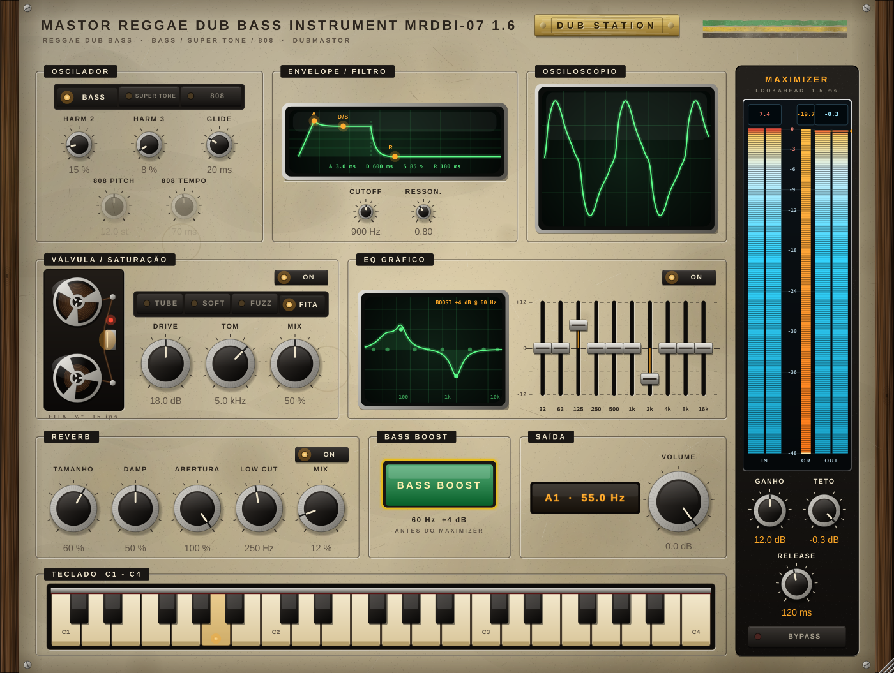
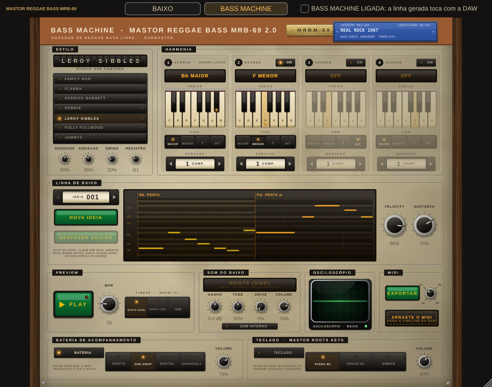

# Mastor Reggae Bass MRB-69 2.2

O antigo **Dub Bass** (Mastor Reggae Dub Bass Instrument MRDBI-07), agora com o **Mastor Reggae Bass Machine MRBM-69** inteiro na aba **BASS MACHINE**: a linha gerada toca por este som (válvula, EQ, reverb e maximizer), com bateria e teclado de acompanhamento. Ligue **BASS MACHINE LIGADA** para a linha tocar com a DAW.

Novidades da 2.2 na BASS MACHINE: o teclado da TÔNICA funciona como o da CHORD MACHINE do Mastor Reggae Keys MRK-80 (toca a tônica no baixo enquanto o mouse estiver apertado, acende em verde as notas da linha no play) e destaca as **próximas harmonias** que combinam, conforme as cadências do reggae.

Instrumento de baixo de reggae (VST3 / AU / Standalone) da linha **DubMastor · Dub Station**, no mesmo visual do Dub Chords: painel creme envelhecido, laterais de madeira, nome e versão no título (MASTOR REGGAE BASS MRB-69 x.y), plaqueta de latão DUB STATION, knobs de baquelite e lâmpadas âmbar.





## Cadeia de sinal

```
OSCILADOR (Bass + harmônicos | Super Tone | 808) → FILTRO → ENVELOPE → VÁLVULA / SATURAÇÃO (2x oversampling)
→ EQ GRÁFICO 10 bandas → REVERB (envio paralelo com low cut) → BASS BOOST 60 Hz +4 dB
→ MAXIMIZER (lookahead 1.5 ms, com BYPASS) → VOLUME
```

## Controles

| Seção | O que tem |
|---|---|
| **Oscilador** | Teclas BASS / SUPER TONE / 808. **Bass** é a senoide clássica com Harm 2 e Harm 3. **Super Tone** é o baixo digital da era Super Power do King Jammy (Sleng Teng): quadrada sem aliasing, peso de senoide e grão de 7 bits. **808** tem drop de pitch (808 Pitch / 808 Tempo), "knock" no ataque, clique de bumbo e saturação assimétrica que deixa o grave gordo e audível até em caixa pequena. Glide |
| **Envelope / Filtro** | Envelope gráfico em tela verde: arraste o ponto **A** (ataque), **D/S** (decay na horizontal, sustain na vertical) e **R** (release); duplo clique volta ao padrão. No 808 o som decai até zero e aparecem 3 presets de envelope: **CURTO** (punch seco), **MÉDIO** (808 clássico) e **LONGO** (boom que segura o compasso). Abaixo, Cutoff e Ressonância |
| **Osciloscópio** | Tela de fósforo verde com a onda da saída, parada no cruzamento por zero |
| **Válvula / Saturação** | ON (começa desligada), teclas TUBE / SOFT / FUZZ / FITA, Drive, Tom e Mix. A válvula 12AX7 esquenta com o DRIVE e com o sinal: vai do vermelho apagado ao laranja, âmbar e branco quente, com o brilho azul de válvula forçada no limite. Esquenta rápido e esfria devagar. Na **FITA** o berço vira um gravador de rolo em pé: os rolos giram, o de cima esvazia e o de baixo enche, a fenda da cabeça acende com a saturação; o som é o joelho macio da fita com o "head bump" de grave em 90 Hz |
| **EQ gráfico** | ON, 10 faders ±12 dB (32 Hz a 16 kHz) e a curva em tela verde, **editável com o mouse**: arraste perto de uma banda para subir ou baixar, duplo clique zera (mostra o Bass Boost também) |
| **Reverb** | ON (começa desligado), Tamanho, Damp, Abertura, Low Cut (o grave fica seco) e Mix |
| **Bass Boost** | Botão verde: +4 dB em 60 Hz, antes do maximizer |
| **Saída** | Display âmbar com a nota tocando (nome e Hz) e Volume |
| **Teclado** | C1 a C4 no padrão Dub Station (marfim, baquelite, barra cromada com feltro vermelho): toca clicando (mais embaixo na tecla = mais forte) e acende com lâmpada âmbar nas notas que chegam da DAW |
| **Maximizer** (lateral direita) | VU digital estilo Ozone: entrada L/R, redução de ganho e saída L/R, com leituras numéricas, pico retido e a marca do teto. Ganho, Teto, Release e BYPASS (com lâmpada vermelha; a latência continua a mesma) |

Mono/legato: no Classic Sine as notas ligadas deslizam com o glide; no 808 cada nota reataca o envelope e o drop de pitch. Pitch bend ±2 semitons. Duplo clique volta qualquer controle ao padrão. A janela é redimensionável.

## Versão

A versão fica em `CMakeLists.txt` (`project(DubBass VERSION x.y.z)`) e aparece sozinha no título da interface. A cada atualização: suba a versão, atualize `RELEASE_NOTES.md`, o README da raiz e o card do site. O push na `main` publica a release `MRB-69-x.y` sozinho.

## Instalar

- **Windows:** `MastorReggaeDubBassInstrument-Windows-Instalador.exe` coloca o VST3 em `C:\Program Files\Common Files\VST3`, a pasta que Cubase, FL Studio, Ableton Live, Reaper, Studio One, Bitwig e as outras DAWs VST3 leem. O programa standalone é opcional. Ele também apaga a cópia antiga "Dub Bass - Dub Station.vst3", para não duplicar.
- **Mac:** `MastorReggaeDubBassInstrument-macOS-Instalador.pkg` instala o VST3 e o AU em `/Library/Audio/Plug-Ins` (o AU é o que Logic e GarageBand usam) e o app em `/Applications`; tira a quarentena e faz o macOS reler os Audio Units. Como o instalador não é assinado pela Apple, abra com **botão direito → Abrir** na primeira vez.
- **Navegador:** `site/bass/` (no site, "Tocar no navegador") toca o instrumento direto no navegador, sem instalar nada.

Pro Tools usa AAX, formato que precisa do kit e da assinatura da Avid; não está incluído.

## Compilar

```bash
cmake -B build -DCMAKE_BUILD_TYPE=Release
cmake --build build --config Release
```

Teste offline (toca uma linha de baixo, confere o teto do maximizer, NaN, estado e salva a interface):

```bash
cmake -B build-test -DDUBBASS_TESTS=ON && cmake --build build-test --target DubBassTest
./build-test/DubBassTest_artefacts/Release/DubBassTest test-out
```

## Publicar

O workflow `.github/workflows/build-reggaedubbassinstrument.yml` roda o teste, compila Windows e Mac (universal), valida com pluginval e auval e, a cada push na `main` que mexa no Dub Bass, cria (ou atualiza) a release `MRDBI-07-x.y` da versão do `CMakeLists.txt` com `MRDBI-07-Windows.zip` e `MRDBI-07-macOS.zip`. A release não vira a "latest", para não mexer nos links dos outros plugins.
