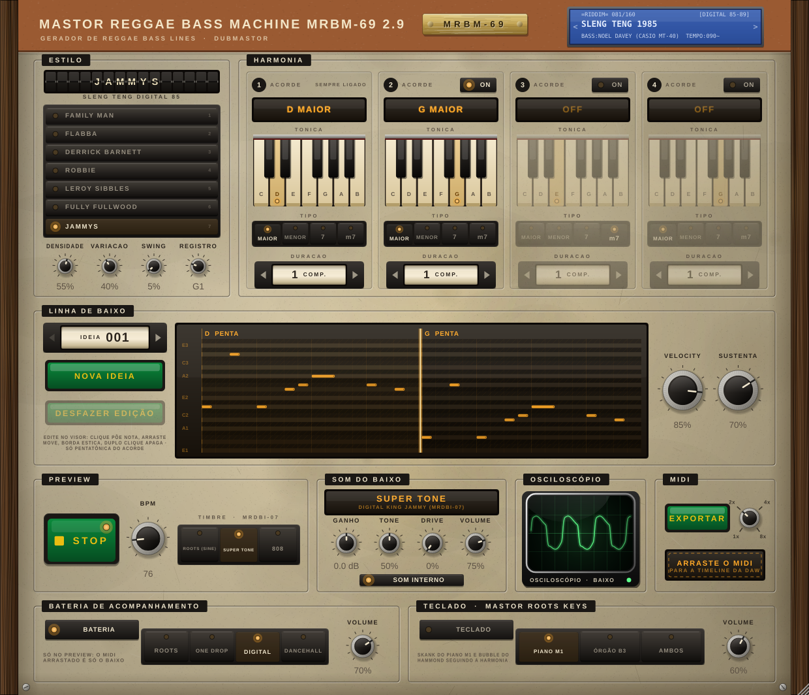

# Mastor Reggae Bass Machine MRBM-69 2.9 — Gerador de Reggae Bass Lines

← [Voltar para a página inicial do repositório](../README.md)

**[⬇️ Windows](https://github.com/dubmastor/DubMastor-DubStation-/releases/download/MRBM-69-2.9/MRBM-69-Windows.zip)** · **[⬇️ macOS](https://github.com/dubmastor/DubMastor-DubStation-/releases/download/MRBM-69-2.9/MRBM-69-macOS.zip)**

Gerador de **sugestões de linha de baixo** em MIDI para reggae, dub e dancehall, da linha **Dub Station**.
Você escolhe a harmonia e o baixista, ouve com o som do **Dub Bass**, liga a **bateria** e o **teclado do
Roots Keys** para ouvir no contexto, e arrasta o MIDI do baixo para a timeline para editar à vontade.
Formatos: **VST3** (Windows/macOS), **AU** (macOS) e **Standalone**. É um **instrumento**: no Cubase,
carregue numa *Instrument Track*.

## Riddims clássicos (2.8)

O visor âmbar no alto do painel carrega **160 riddims clássicos, 20 por estilo de reggae** (Rocksteady, Early Reggae e Roots,
Roots e Rockers, Rub a Dub, Digital King Jammys, Ragga, Dancehall 1995-2001 e 2002-07). Clique para escolher por estilo, por
baixista ou por década; as setas passam para o anterior / próximo. Cada preset traz a gravação de origem, o ano, o produtor e
quem tocou o baixo, e ajusta harmonia, BPM, bateria, timbre e o estilo do gerador. O baixo é gerado no estilo do baixista,
não é transcrição. Lista completa: [docs/RIDDIMS.md](docs/RIDDIMS.md) (gerada por `tools/riddims.py`).

## ESTILO (botoeira de 7 teclas)
Teclas intertravadas como as de um rádio valvulado: apertar uma solta a outra. O nome do baixista aparece num **letreiro de palhetas** (split-flap, como os painéis de estação): ao trocar, as palhetas giram passando pelo alfabeto até parar no nome novo.

| Tecla | Baixista | O que o gerador faz |
|---|---|---|
| **FAMILY MAN** | Aston "Family Man" Barrett (Wailers) | One drop: o tempo 1 fica vazio. Linha melódica (terça, quinta, sexta, oitava), colcheias com swing e tercinas "puxadas para trás" no fim da frase |
| **FLABBA** | Errol "Flabba" Holt (Roots Radics) | Rub-a-dub: fundamental no 1, notas longas e graves, quinta e sétima abaixo. Um riff curto repetido de forma hipnótica |
| **DERRICK BARNETT** | Derrick Barnett (Sagittarius Band) | Dancehall ao vivo dos anos 80/90: ataque curto, síncope 3-3-2, oitavas estaladas, corridas de semicolcheias nas viradas |
| **ROBBIE** | Robbie Shakespeare (Sly & Robbie) | Rockers da Channel One: sincopado, firme, quase mecânico, com o balanço do funk e do soul; oitavas e subidas cromáticas até o próximo acorde |
| **LEROY SIBBLES** | Leroy Sibbles (Heptones, Studio One) | Linhas cantadas: notas esticadas, frases que descem pela escala, espaço, e cada nota um pouco atrás do tempo |
| **FULLY FULLWOOD** | George "Fully" Fullwood (Soul Syndicate) | Riff de riddim dos anos 70: gancho melódico com anacruse de semicolcheia e salto de oitava, repetido como assinatura |
| **JAMMYS** | King Jammy, *Sleng Teng* (1985) | O primeiro riddim digital: riff de teclado em semicolcheias, curto e staccato, em volta da tônica (combina com o timbre **SUPER TONE** e a bateria **DIGITAL**) |

| Controle | O que faz |
|---|---|
| **DENSIDADE** | Quantas notas opcionais (ghost notes, repetições) entram na linha |
| **VARIAÇÃO** | Chance de virada no fim da frase e de cada acorde ganhar uma célula diferente |
| **SWING** | Atraso das colcheias e semicolcheias do contratempo (somado ao balanço do estilo; vale também para a bateria e o teclado) |
| **REGISTRO** | Nota mais grave da fundamental (E1 a E2) |

## HARMONIA
Até 4 acordes: **TÔNICA** (teclado mecânico), **TIPO** (maior, menor, 7, m7), **DURAÇÃO** (1/2 a 8 compassos)
e **ON** nos acordes 2 a 4. O plugin abre com **dois acordes ligados, Am e Dm, de 1/2 compasso cada**. As notas de aproximação caem meio tom (ou um tom) da tônica que vem a seguir.

## LINHA DE BAIXO
| Controle | O que faz |
|---|---|
| **IDEIA** | Número da sugestão. A mesma ideia gera sempre a mesma linha: clique nas setas para voltar a uma de que você gostou (Shift = de 10 em 10) |
| **NOVA IDEIA** | Sorteia outra linha com os mesmos acordes e o mesmo estilo |
| **Visor (MIDI editável)** | Rolo de piano âmbar com as notas, os acordes e o cursor. **Clique num espaço vazio** põe nota, **arraste a nota** para mover (tempo e altura), **arraste a borda direita** para esticar, **duplo clique** (ou botão direito) apaga. Grade de 1/16 (Shift = 1/32). Só entram notas da **pentatônica do acorde** daquele trecho (menor em acordes menor e m7, maior em maior e 7): as outras linhas ficam escuras e desabilitadas, e a nota encaixa na permitida mais próxima. Notas douradas são de virada |
| **DESFAZER EDIÇÃO** | Volta para a linha que o gerador sugeriu. A linha editada fica salva no projeto e vale até um controle do gerador (estilo, ideia, harmonia, densidade...) ser mexido, como no MRDM-12. O MIDI arrastado/exportado sai com as edições |
| **VELOCITY / SUSTENTA** | Força das notas e quanto cada nota segura |

## PREVIEW e SOM DO BAIXO (MRDBI-07)
| Controle | O que faz |
|---|---|
| **PLAY / STOP** | Toca o loop sem a DAW, no **BPM** do knob. Com a DAW tocando, segue o andamento dela. A lâmpada do botão fica acesa enquanto toca e apagada quando para |
| **TIMBRE** (no PREVIEW) | Três teclas com os timbres do **Mastor Reggae Dub Bass Instrument MRDBI-07**: **ROOTS (SINE)** (Bass / Classic Sine), **SUPER TONE** (o baixo digital da era King Jammy) e **808** (base do preset MÉDIO do MRDBI-07 com cauda longa: ataque 1 ms, decay 1,6 s, release 1,2 s, drop de 12 semitons em 70 ms). Mesma voz, filtro e maximizer do MRDBI-07 com os valores de fábrica dele: cutoff 900 Hz, ressonância 0,8, sem saturação e sem reverb |
| **GANHO** | Ganho de entrada (−12 a +12 dB) antes da saturação e do maximizer. Duplo clique volta a 0 dB |
| **TONE / DRIVE / VOLUME** | Cutoff (±1,5 oitava; 50 % = 900 Hz, como no Dub Bass), saturação da válvula TUBE do Dub Bass (começa em 0 = desligada, como nele) e volume geral do preview |
| **SOM INTERNO** | Desligue quando mandar o MIDI para o seu próprio baixo |
| **OSCILOSCÓPIO** | Tubo verde com a onda do baixo |

## ACOMPANHAMENTO (só no preview)
| Controle | O que faz |
|---|---|
| **BATERIA** | Liga a bateria. Em todos os estilos a **caixa cai no 2 e no 4**. **ROOTS** (rockers da Channel One) e **ONE DROP** usam o kit acústico do Dub Drums; **DIGITAL** (caixa de ritmos de 1985, caixa e palmas no 2 e no 4) e **DANCEHALL** (bumbo nos quatro, timbales) usam um kit eletrônico anos 80. Uma virada no último compasso do loop |
| **TECLADO** | Liga o teclado do **Mastor Roots Keys**: skank do **PIANO M1** no contratempo, bubble do **ÓRGÃO B3** ou **AMBOS**, seguindo os acordes da HARMONIA |
| **VOLUME** | Volume de cada um |

O MIDI arrastado/exportado continua sendo **só o baixo**. O nível do baixo fica 5 dB abaixo do Dub Bass, e um limitador suave segura os picos da mistura.

## Versão para navegador
**[▶ Tocar no navegador](https://dubmastor.github.io/DubMastor-DubStation-/bassmachine/)**, sem instalar nada, também no celular: os 7 baixistas com o letreiro de palhetas, a harmonia, IDEIA / NOVA IDEIA, o visor editável (mouse e toque: toque longo apaga), PLAY no tempo, os timbres Roots (Sine), Super Tone e 808, a bateria de acompanhamento, osciloscópio e download do `.mid`. O gerador do navegador (`site/bassmachine/engine.js`) é o mesmo do plugin: o CI compara os dois nota a nota. O teclado do Roots Keys fica só no plugin.

## MIDI
- **ARRASTE O MIDI:** clique e arraste a área âmbar para a timeline. Vem a faixa de baixo no BPM do projeto.
- **EXPORTAR:** salva o `.mid` (padrão: Documentos/Reggae Bass Machine). **REPETIR** exporta o loop 1, 2, 4 ou 8 vezes.
- **MIDI ao vivo:** as notas do baixo também saem como MIDI do plugin (canal 1).

## Para desenvolvedores
- `Source/BassEngine.h`: lógica das linhas (C++ puro). Cada estilo é um "livro" de células de um compasso (grooves e viradas) com graus (R, 3, 5, 7, oitava, quinta grave, aproximação...), swing e microtempo próprios.
- `Source/AccompEngine.h`: padrões da bateria e do teclado e o kit eletrônico (C++ puro).
- `Source/DubBassTimbre.h`: preview com o sistema de timbres do Dub Bass (inclui `ReggaeDubBassInstrument/Source/BassVoice.h` e `Maximizer.h`).
- Bateria acústica: `ReggaeDrumMachine/Source/DrumSynth.h`. Teclado: `ReggaeChordMachine/Source/DubSynth.h` + `RootsKeys/Source/RootsKeysEngine.h`.
- `Source/PluginProcessor.*`: parâmetros, sincronia com a DAW, PLAY, MIDI, mixagem do preview.
- `Source/PluginEditor.*`: interface (LookAndFeel do Big Knob / Dub Chords, osciloscópio do Mastor Fone, botoeira intertravada).
- `tests/engine_test.cpp`: teste dos 7 estilos e do acompanhamento.
- `tests/dump_engine.cpp` + `tests/web_engine_test.js`: exportam o motor em JSON e conferem que `site/bassmachine/engine.js` gera as mesmas linhas e a mesma bateria (9.450 linhas, mais de 300 mil notas).
- `tests/snapshot.cpp`: gera o PNG da interface e um WAV do preview, sem DAW; `--edit-test` confere a edição de MIDI (salvar/reabrir/exportar) (`-DBASSMACHINE_SNAPSHOT=ON -DBASSMACHINE_PLUGIN=OFF`).
