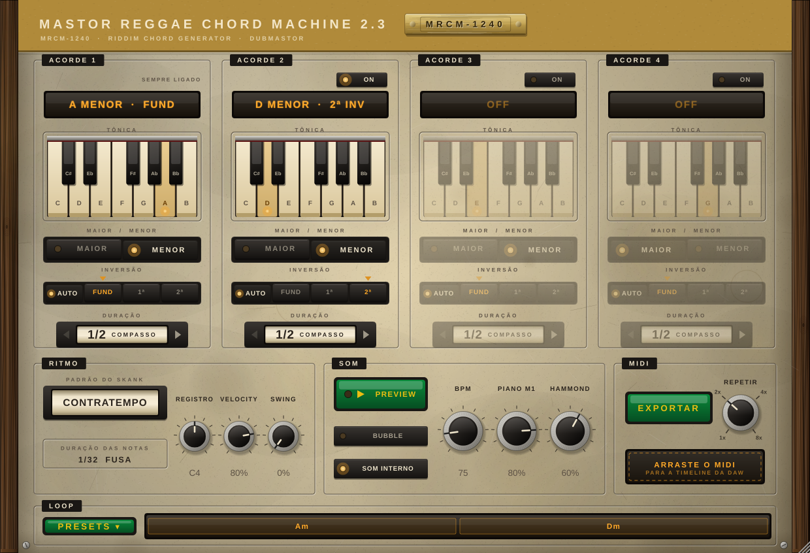

# Mastor Reggae Chord Machine MRCM-1240 2.4 (legado)

> O MRCM-1240 virou a aba **CHORD MACHINE** do **Mastor Reggae Keys MRK-80** (pasta `ReggaePiano/`). Esta pasta continua: o MRK-80 e o MRM-0420 compilam o código dela. A versão 2.4 fica para download só para abrir projetos antigos.

← [Voltar para a página inicial do repositório](../README.md)

**[⬇️ Windows](https://github.com/dubmastor/DubMastor-DubStation-/releases/download/MRCM-1240-2.4/MastorReggaeChordMachine-Windows.zip)** · **[⬇️ macOS](https://github.com/dubmastor/DubMastor-DubStation-/releases/download/MRCM-1240-2.4/MastorReggaeChordMachine-macOS.zip)**

**📱 [Versão para celular](https://dubmastor.github.io/DubMastor-DubStation-/keys/)** (dentro do MRK-80): monte os acordes, ouça e baixe o MIDI direto no navegador (mesmo motor de acordes do plugin).

(Antes se chamava **DubMastor Dub Chords** e, na 1.4, **Mastor Dub Chords Machine MRCM-1240**; a partir da 1.5 é o **Mastor Reggae Chord Machine MRCM-1240**.)

Gerador de harmonia para começar a programar um riddim de reggae. Você escolhe até 4 acordes e quanto
tempo cada um dura, e o plugin toca o skank de piano **com as duas mãos** (o acorde em duas oitavas) e o
**bubble de Hammond com as duas mãos**, sincronizados com o andamento da DAW. Sai como MIDI (arrastar para a
timeline, exportar ou MIDI ao vivo) e tem som interno tocado pelo próprio motor do **Roots Keys**: o piano
**Korg M1** com o timbre inicial do Roots Keys e o Hammond **Roots Percussion**.
Formatos: **VST3** (Windows/macOS), **AU** (macOS) e **Standalone**. É um **instrumento**: no Cubase,
carregue numa *Instrument Track*.

## ACORDE 1 a 4
| Controle | O que faz |
|---|---|
| **TÔNICA** | Teclado mecânico de uma oitava. Clique na nota: a tecla afunda e a lâmpada acende |
| **MAIOR / MENOR** | Dois botões de pressão intertravados |
| **INVERSÃO** | **AUTO** (padrão) escolhe sozinho a inversão com as notas mais próximas do acorde anterior; **FUND**, **1ª** e **2ª** fixam a inversão. A **seta âmbar** sempre marca a inversão sugerida, mesmo quando você escolhe outra |
| **DURAÇÃO** | Janela de contador: **1/2 compasso**, 1, 2, 3, 4 ou 8 compassos. Clique à direita para aumentar, à esquerda para diminuir |
| **ON** (acordes 2, 3 e 4) | Liga/desliga o acorde no loop. O acorde 1 fica sempre ligado. Ao abrir, só os acordes 1 e 2 vêm ligados (Am e Dm), com **1/2 compasso** cada |

O display âmbar mostra o acorde e a inversão que está tocando (ex.: "D MENOR · 2ª INV"). Os acordes ligados formam o loop, que se repete sozinho
e aparece no visor **LOOP** com o cursor de reprodução. O plugin escolhe a inversão mais próxima do acorde
anterior (condução de vozes), inclusive do último acorde para o primeiro, para o loop fechar sem salto.

## RITMO
| Controle | O que faz |
|---|---|
| **PADRÃO DO SKANK** | Sempre **contratempo**: o skank nos "e" de cada tempo, o jeito clássico do reggae (os padrões One drop, Double skank e Steppers saíram na 1.7) |
| **DURAÇÃO DAS NOTAS** | Sempre **1/32 (fusa)**, no skank e nas duas mãos do bubble |
| **REGISTRO** | Onde fica a mão esquerda do skank (C3 a C5). A direita fica uma oitava acima, o bubble uma abaixo |
| **VELOCITY / SWING** | Força das notas e atraso das semicolcheias |

## SOM
| Controle | O que faz |
|---|---|
| **PREVIEW** | Botão grande: toca o loop sem a DAW rodando, no **BPM** do knob. Aperte de novo para parar |
| **BUBBLE** | Liga o bubble de órgão Hammond **com as duas mãos**, como os organistas de reggae tocam: em cada tempo, **mão esquerda** no "e" e no "a" (grave) e **mão direita** no contratempo ("&", com o acorde, junto do skank). A mão direita fica uma oitava abaixo da mão direita do skank e a esquerda uma oitava abaixo dela. Vem desligado. No som interno, usa o timbre **Roots Percussion** do Roots Keys (com percussão) |
| **SOM INTERNO** | Liga/desliga o som. Desligue quando mandar o MIDI para os seus instrumentos |
| **PIANO M1 / HAMMOND** | Volume de cada timbre (com rampa: girar o knob com o preview tocando não estala) |

Mexer em qualquer controle com o **PREVIEW** tocando é seguro: o loop novo é montado fora da thread de áudio e, na troca, as notas do loop antigo são soltas (nada fica soando por cima).

## MIDI
- **ARRASTE O MIDI:** clique e arraste a área âmbar para a timeline. Vêm duas faixas (skank e bubble), no BPM do projeto, com o nome de cada acorde como marcador.
- **Cada acorde em uma cor:** no arquivo, as notas do acorde 1 vão no canal MIDI 1, as do acorde 2 no canal 2, e assim por diante. Na DAW, peça para colorir as notas por canal: no Cubase, no Key Editor, **Cores › Canal**; no REAPER, *Color notes by channel*; no FL Studio as cores já vêm separadas.
- **EXPORTAR:** salva o `.mid` (padrão: Documentos/Mastor Reggae Chord Machine). **REPETIR** exporta o loop 1, 2, 4 ou 8 vezes.
- **MIDI ao vivo:** o plugin também manda as notas como MIDI para outros instrumentos: canal 1 = skank, canal 3 = bubble.

## PRESETS (banco de riddims clássicos)
O botão verde **PRESETS ▾** (na faixa do LOOP) abre o banco de **riddims clássicos do reggae**: 180 músicas em 8 estilos,
do early reggae ao new roots. As pastas são só por **estilo de reggae** (passe o mouse ou clique no
estilo e escolha a música, em ordem alfabética). O BPM de 99 músicas é o **original da gravação** (SongBPM, GetSongBPM, Tunebat,
contado com a caixa no 2 e no 4); o resto fica com o andamento típico do estilo. No MRCM-1240 o preset ajusta os acordes, a duração de cada um e
quais ficam ligados (inversão em AUTO). No **MRM-0420** ele monta o riddim inteiro: harmonia, **BPM sugerido**, estilo da
bateria e os **músicos das máquinas mais próximos de quem gravou** (baterista do MRDM-12 e baixista do MRBM-69).
Cada preset está no tom da gravação original; sétimas viram tríades e, quando a música tem várias partes, fica o groove
principal. As cifras foram conferidas em nov/2026 em sites de cifra feitos por pessoas (Ultimate Guitar, E-Chords,
GuitarTabs.cc, GuitarTabsExplorer, Ukulele-Tabs, Recifra); as marcadas **[auto]** no nome vêm de detecção automática
(ChordU/ChordIntel) e vale conferir de ouvido. 

| Estilo | Músicas | BPM |
|---|---|---|
| **EARLY REGGAE** (20) | 007 Shanty Town (Desmond Dekker 1967), 54-46 That's My Number (Toots 1968), Duppy Conqueror (Wailers 1970), I Can See Clearly Now (Johnny Nash 1972), Israelites (Desmond Dekker 1968), It Mek (Desmond Dekker 1969), It Pays (Desmond Dekker 1969), Johnny Too Bad (Slickers 1971), Let Your Yeah Be Yeah (Pioneers 1971), Long Shot Kick de Bucket (Pioneers 1969), Monkey Man (Toots 1969), Rivers of Babylon (Melodians 1970), Sitting in Limbo (Jimmy Cliff 1971), Small Axe (Wailers 1970), The Harder They Come (Jimmy Cliff 1972), The Tide Is High (Paragons 1967), Vietnam (Jimmy Cliff 1969), Wonderful World (Jimmy Cliff 1969), You Can Get It (Jimmy Cliff 1970), Young Gifted and Black (Bob & Marcia 1969) | 61-107 |
| **ROOTS** (21) | Babylon Too Rough (Gregory Isaacs), Chase the Devil (Max Romeo 1976), Concrete Jungle (Bob Marley 1973), Exodus (Bob Marley 1977), Get Up Stand Up (Bob Marley 1973), I Shot the Sheriff (Bob Marley 1973), Jamming (Bob Marley 1977), Kinky Reggae (Bob Marley 1973), Lively Up Yourself (Bob Marley 1973), Marcus Garvey (Burning Spear 1975), Natural Mystic (Bob Marley 1977), One Love (Bob Marley 1977), One Step Forward (Max Romeo 1976), Police and Thieves (Junior Murvin 1976), Pressure Drop (Toots 1969), Roots (Bob Marley 1977), Satta Massagana (Abyssinians 1969), Smile Jamaica (Bob Marley 1976), Stir It Up (Bob Marley 1973), Them Belly Full (Bob Marley 1974), War (Bob Marley 1976) | 62-97 |
| **ROCKERS** (20) | Bad Man (Steel Pulse 1978), Buffalo Soldier (Bob Marley 1983), Burial (Peter Tosh 1976), Could You Be Loved (Bob Marley 1980), Downpressor Man (Peter Tosh 1977), Equal Rights (Heptones 1977), Equal Rights (Peter Tosh 1977), Handsworth Revolution (Steel Pulse 1978), Jah Guide (Peter Tosh 1977), Ku Klux Klan (Steel Pulse 1978), Legalize It (Peter Tosh 1976), Money in My Pocket (Dennis Brown 1979), Now That We Found Love (Third World 1978), One Drop (Bob Marley 1979), Prediction (Steel Pulse 1978), Prodigal Son (Steel Pulse 1978), Soldiers (Steel Pulse 1978), Steppin' Razor (Peter Tosh 1977), Three Little Birds (Bob Marley 1977), Uptown Top Ranking (Althea & Donna 1977) | 61-119 |
| **LOVERS ROCK** (26) | Breakfast in Bed (UB40 1988), Can't Help Falling in Love (UB40 1993), Close to You (Maxi Priest 1990), Everything I Own (Ken Boothe 1974), Freedom (Gregory Isaacs), Good Thing Going (Sugar Minott 1981), Help Me Make It Through the Night (John Holt 1974), Here I Am (UB40 1990), Hopelessly in Love (Carroll Thompson 1981), I Wanna Wake Up With You (Boris Gardiner 1986), I'm Still in Love (Alton Ellis 1967), Is This Love (Bob Marley 1978), Kingston Town (UB40 1989), Love Has Found Its Way (Dennis Brown 1982), Many Rivers to Cross (Jimmy Cliff 1969), My Number One (Gregory Isaacs), My Only Lover (Gregory Isaacs 1973), Not the Way (Gregory Isaacs), Red Red Wine (UB40 1983), Rockaway (Beres Hammond 1994), Sad to Know You're Leaving (Gregory Isaacs), Silly Games (Janet Kay 1979), Soon Forward (Gregory Isaacs 1979), Tempted to Touch (Beres Hammond 1990), Waiting in Vain (Bob Marley 1977), Wild World (Maxi Priest 1988) | 61-102 |
| **RUB A DUB** (33) | 9 to 5 (Gregory Isaacs), Bam Bam (Sister Nancy 1982), Big Ship (Freddie McGregor 1982), Collie Weed (Barrington Levy), Cool Down the Pace (Gregory Isaacs 1982), Fire House Rock (Wailing Souls 1981), Front Door (Gregory Isaacs 1981), Good Morning (Gregory Isaacs), Hard Drugs (Gregory Isaacs), Here I Come (Barrington Levy 1984), Ice Cream Love (Johnny Osbourne 1981), If I Don't Have You (Gregory Isaacs), Let's Talk About Love (Gregory Isaacs), Murderer (Barrington Levy 1984), Night Nurse (Gregory Isaacs 1982), Noah's Ark (Eek-A-Mouse 1982), Pass the Kouchie (Mighty Diamonds 1981), Peeni Walli (Eek-A-Mouse 1984), Private Secretary (Gregory Isaacs), Rude Boy Jamaican (Eek-A-Mouse), Sensimilla (Barrington Levy 1980), Set Back (Gregory Isaacs), Shine Eye Gal (Black Uhuru 1979), Sinsemilla (Black Uhuru 1980), Tears Come Rolling Down (Gregory Isaacs), The Mouse and the Man (Eek-A-Mouse 1983), Top Ten (Gregory Isaacs), Truths and Rights (Johnny Osbourne 1980), Tune In (Gregory Isaacs 1983), Wa-Do-Dem (Eek-A-Mouse 1981), War (Wailing Souls 1981), Water Pumping (Johnny Osbourne 1983), Zungguzungguguzungguzeng (Yellowman 1983) | 65-86 |
| **DIGITAL** (20) | Boops (Super Cat 1986), Budy Bye (Johnny Osbourne 1985), Gimme Punanny (Admiral Bailey 1987), Greetings (Half Pint 1986), Herb Tree (Cocoa Tea), I'm Not a Substitute Lover (Half Pint 1986), Lone Ranger and Tonto (Tenor Saw), Lots of Sign (Tenor Saw 1985), Old Time Something (Admiral Bailey), Original Kuff (Chaka Demus 1988), Pull Up Selector (Tenor Saw), Ring the Alarm (Tenor Saw 1985), Rub a Dub Market (Tenor Saw), Run Come Call Me (Tenor Saw), She Loves Me Now (Cocoa Tea, Real Rock), Sonia Come Back (Cocoa Tea, Punaany), Ting-A-Ling (Shabba Ranks 1990), Under Mi Sleng Teng (Wayne Smith 1985), Victory Train (Tenor Saw), Winsome (Half Pint) | 63-94 |
| **DANCEHALL** (20) | Angel (Shaggy 2000), Bad Boys (Inner Circle 1993), Bam Bam (Chaka Demus & Pliers 1992), Boombastic (Shaggy 1995), Get Busy (Sean Paul 2003), Hello Mama Africa (Garnett Silk 1992), Here Comes the Hotstepper (Ini Kamoze 1994), Informer (Snow 1992), It Wasn't Me (Shaggy 2000), It's Me Again Jah (Luciano 1994), Love Is the Answer (Garnett Silk), Mr. Loverman (Shabba Ranks 1992), Murder She Wrote (Chaka Demus & Pliers 1992), No Letting Go (Wayne Wonder 2002), Sweat (Inner Circle 1992), Tease Me (Chaka Demus & Pliers 1993), Temperature (Sean Paul 2005), Under Mi Sensi (Barrington Levy 1985), Wanna Be Loved (Buju Banton 1995), You Don't Love Me (Dawn Penn 1994) | 68-125 |
| **NEW ROOTS** (20) | Access Granted (Protoje 2013), Callin (Alborosie 2011), Can't Satisfy Her (I Wayne 2004), Dem Gone (Kabaka Pyramid 2018), Don't Haffi Dread (Morgan Heritage 1999), Down by the River (Morgan Heritage), Ganja Farmer (Marlon Asher 2005), Ghetto Girl (Richie Spice), Guess Who's Coming to Dinner (Alborosie), Herbalist (Alborosie 2008), Kingston Town (Alborosie 2008), Longing For (Jah Cure 2006), My Day (Tarrus Riley), Mystical Reggae (Alborosie 2009), She's Royal (Tarrus Riley 2006), Skankin' Sweet (Chronixx 2017), Smile Jamaica (Chronixx 2014), Welcome to Jamrock (Damian Marley 2005), Who Knows (Protoje 2014), Youths Dem Cold (Richie Spice 2006) | 71-86 |

O mesmo banco está no **MRM-0420** e nas versões para celular. Fonte única: `tools/harmony_presets.py`
(gera `Source/HarmonyPresets.h` e `site/chords/presets.js`).

## Para desenvolvedores

### Checklist de toda atualização
1. **Versão:** só em `CMakeLists.txt` (`project(DubChords VERSION x.y.z)`). Ela aparece no **título** do plugin ("MASTOR REGGAE CHORD MACHINE x.y"); a placa de latão mostra **só "DUB STATION"**.
2. **Nome:** "Mastor Reggae Chord Machine MRCM-1240" em tudo (plugin, zips `MastorReggaeChordMachine-*`, tag `MRCM-1240-x.y`, release "Mastor Reggae Chord Machine MRCM-1240 x.y").
3. **Timbre do piano:** o som interno usa o timbre **inicial** do Roots Keys (e o órgão Roots Percussion). Confira com `python3 ReggaeChordMachine/tests/check_rootskeys_timbre.py` (o CI roda e falha se estiver desatualizado).
4. **Versão para celular:** atualize `site/chords/` junto (o `engine.js` é o porte do `DubEngine.h`; o número da versão fica no `<title>`, no `<h1>` e em `VERSION`). O CI compara o MIDI do JS com o do C++ (`tests/web_engine_test.js`).
5. **Notas:** `RELEASE_NOTES.md`. Cada push na `main` publica a release com elas.
6. **Links:** quando a release sair, troque os links de download do site e dos READMEs para `MRCM-1240-x.y`.

### Arquivos
- `Source/DubEngine.h`: lógica da harmonia (C++ puro). É aqui que se adiciona padrão novo.
- `Source/PluginProcessor.*`: parâmetros, sincronia com a DAW, saída MIDI, exportação.
- `Source/PluginEditor.*`: interface (LookAndFeel do Big Knob + teclado, botões e contadores clicáveis).
- `Source/RootsKeysSound.h`: som interno; toca pelo `rk::Engine` do Roots Keys (`../ReggaePiano/Source/RootsKeysEngine.h`) com os valores de `rkdefaults`.
- `Source/DubSynth.h`: som de teclado antigo, mantido porque o Mastor Reggae Bass Machine MRBM-69 usa.
- `tests/engine_test.cpp`: teste do motor (roda no CI antes do build).
- `tests/snapshot.cpp`: gera o PNG da interface sem DAW (`-DDUBCHORDS_SNAPSHOT=ON`); com um nome `.wav`, grava o PREVIEW e um `.mid` exportado; `ruido` e `mexer` testam som preso ao alternar o SOM INTERNO e ao mexer nos controles com o preview tocando.
- `tests/check_rootskeys_timbre.py`: confere o timbre com o do Roots Keys.
- `tests/dump_loop.cpp` + `tests/web_engine_test.js`: comparam a versão de celular com o plugin, nota a nota.
- `../site/chords/`: versão para celular (`index.html` + `engine.js`).
