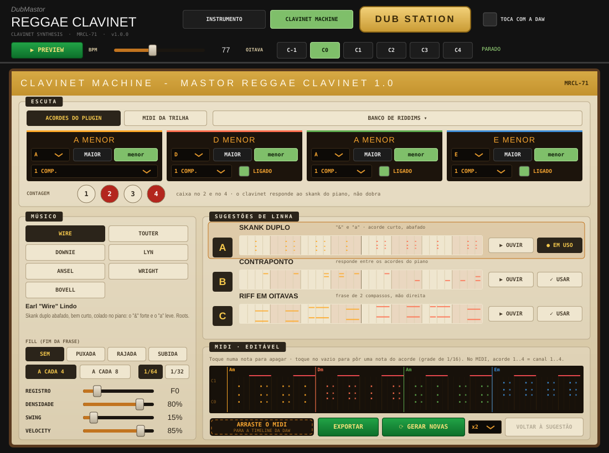
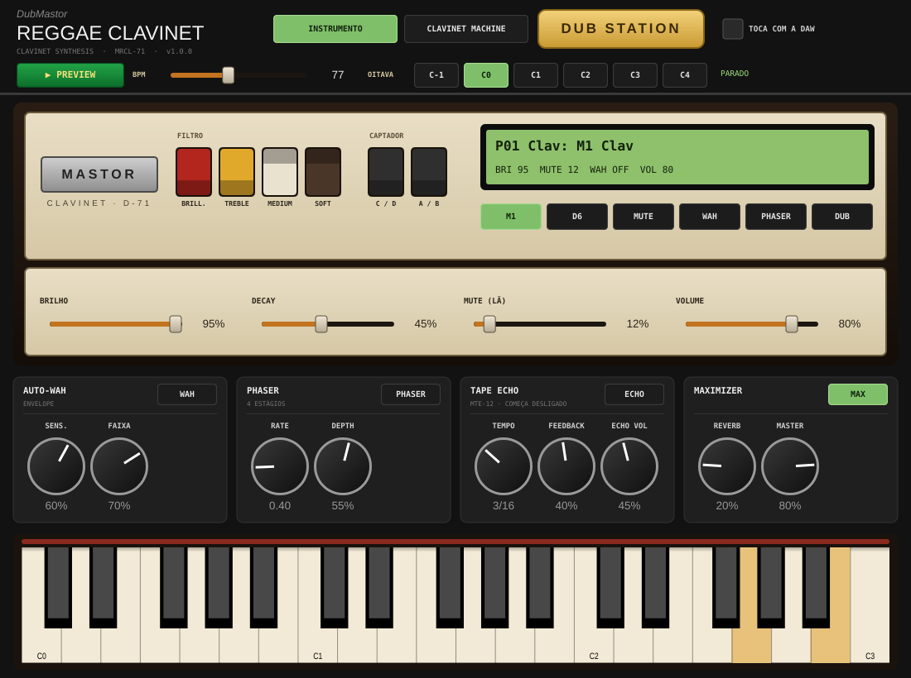

# Mastor Reggae Clavinet MRCL-71 1.0 — o clavinet que segue o riddim 🎹

*Linha Dub Station*

← [Voltar para a página inicial do repositório](../README.md)

**Downloads:** [Windows](https://github.com/dubmastor/DubMastor-DubStation-/releases/download/MRCL-71-1.0/MRCL-71-Windows-Instalador.exe) · [Mac](https://github.com/dubmastor/DubMastor-DubStation-/releases/download/MRCL-71-1.0/MRCL-71-macOS-Instalador.pkg) · 📱 [Testar no navegador](https://dubmastor.github.io/DubMastor-DubStation-/web/reggaeclavinet/)

Clavinet de reggae com a **CLAVINET MACHINE**: ela segue a harmonia do riddim e sugere linhas de clavinet no estilo dos
tecladistas jamaicanos. Formatos: **VST3** (Windows/macOS), **AU** (macOS), **AAX** (Pro Tools, depois da assinatura PACE) e **Standalone**.



## A contagem
Tudo é na contagem da Dub Station: **caixa no 2 e no 4**. Em cada tempo (1 e & a) o skank do piano fica no **&**; o clavinet
responde no **&** e no **a** (skank duplo) ou nas brechas (contraponto), e nunca cai na cabeça do 1 e do 3.

## Como a machine ouve a harmonia
Um plugin não escuta o som de outro plugin, então a CLAVINET MACHINE segue os acordes de dois jeitos:
- **ACORDES DO PLUGIN** — os 4 acordes (tônica, maior/menor, duração) ou o **BANCO DE RIDDIMS** (as músicas com a harmonia da gravação);
- **MIDI DA TRILHA** — mande para a trilha do clavinet o MIDI do Mastor Reggae Piano MRP-80, do MRM-0420 ou de outra trilha
  (arrastando o MIDI do skank para ela ou roteando o MIDI): o acorde que chega vira a harmonia da linha.

Ligue **TOCA COM A DAW** para a linha tocar junto com o play da DAW, ou use o **PREVIEW**.

## Os clavinetistas
| Músico | Época | O que a linha faz |
|---|---|---|
| **WIRE** — Earl "Wire" Lindo | Wailers 1973 · 1978-81 | Skank duplo abafado, bem curto, colado no piano |
| **TOUTER** — Bernard "Touter" Harvey | Wailers 1974 · Inner Circle | Mais funk: semicolcheias com notas fantasma e o wah |
| **DOWNIE** — Tyrone Downie | Wailers 1976-81 | Respostas sincopadas entre os acordes do piano |
| **LYN** — Robbie Lyn | Sessões · Sly & Robbie | Riff melódico em oitavas, com phaser |
| **ANSEL** — Ansel Collins | Early reggae 1969-73 | Chops saltados nas colcheias, shuffle forte |
| **WRIGHT** — Winston Wright | Supersonics · Toots | Stabs secos e uma figurinha em oitava no fim do compasso |
| **BOVELL** — Dennis Bovell | UK dub · lovers rock | Pouca nota e mais longa, deixa o dub respirar |

Os nomes vêm de créditos de clavinet em discos de reggae; as linhas são inspiradas no estilo de cada um, não são transcrições.

## Aba INSTRUMENTO


O som é uma **corda por modelo físico** (Karplus-Strong): a tangente bate seca na corda, a corda curta vibra até a ponte,
os dois captadores perto da ponte filtram em pente — **C/D** mais cheio, **A/B** mais fino — e a **lã** abafa ao soltar a tecla.
Timbres: **M1** (estilo do Clav do Korg M1, o inicial), D6, MUTE, WAH, PHASER e DUB. Efeitos: auto-wah, phaser, tape echo
(começa desligado, como em todo o kit) e maximizer.

## Testes
```
g++ -std=c++17 -O2 -I Source tests/render_test.cpp -o render_test && ./render_test
```
Afinação das cordas, as linhas dos 7 clavinetistas na contagem, a chave de oitava, sem estouro e sem nota presa.
O `tests/snapshot.cpp` (alvo `ReggaeClavinetSnapshot`, opção `-DRCL_SNAPSHOT=ON`) testa o plugin inteiro e gera as imagens de `docs/`.
