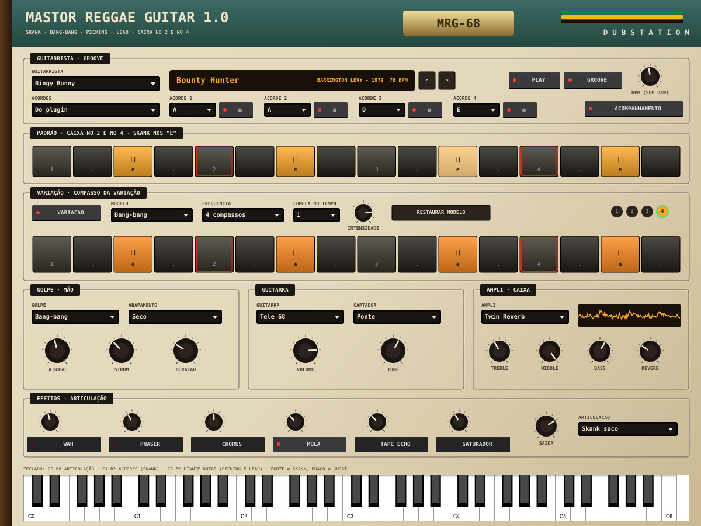

# Mastor Reggae Guitar MRG-68

A guitarra de reggae dos guitarristas jamaicanos (skank, bang-bang, chop, picking e lead), no andamento da DAW, na
contagem da Dub Station: **caixa no 2 e no 4**, skank em todos os "e". Veja as novidades em [RELEASE_NOTES.md](RELEASE_NOTES.md).

- `Source/GuitarEngine.h` — motor de som e de groove em C++ puro (o mesmo da versão para celular em `site/web/reggaeguitar/`:
  ao mudar um, mude o outro)
- `Source/PluginProcessor.*` e `Source/PluginEditor.*` — o plugin (usa o visual de `ReggaeKeys/Source/VintageLookAndFeel.h`)
- `tests/render_test.cpp` — teste offline: contagem, bang-bang, variação, afinação e os 12 guitarristas em WAV
- `tests/snapshot.cpp` — gera `docs/interface.png` (`-DRG_SNAPSHOT=ON`)

Compilar: `cmake -B build -DCMAKE_BUILD_TYPE=Release && cmake --build build --config Release`
