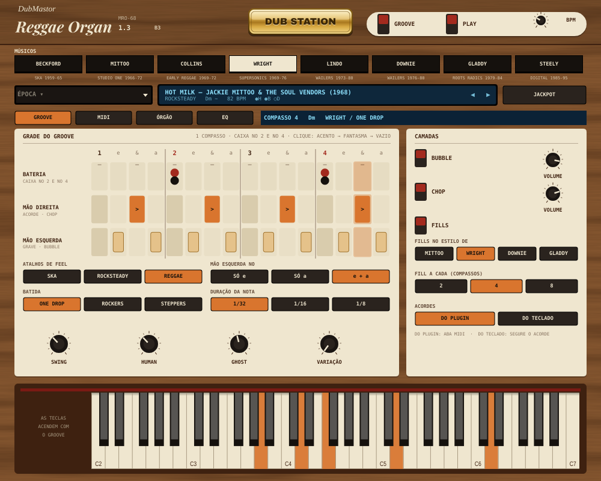
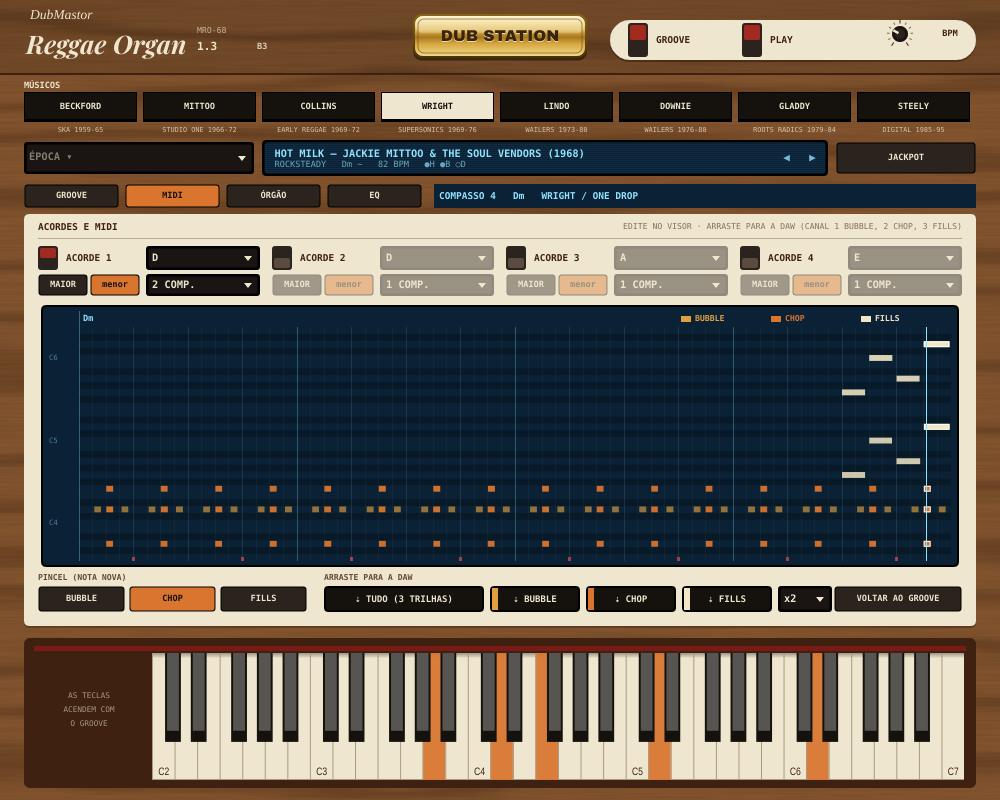
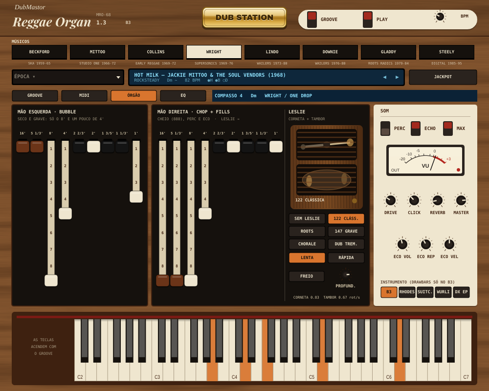
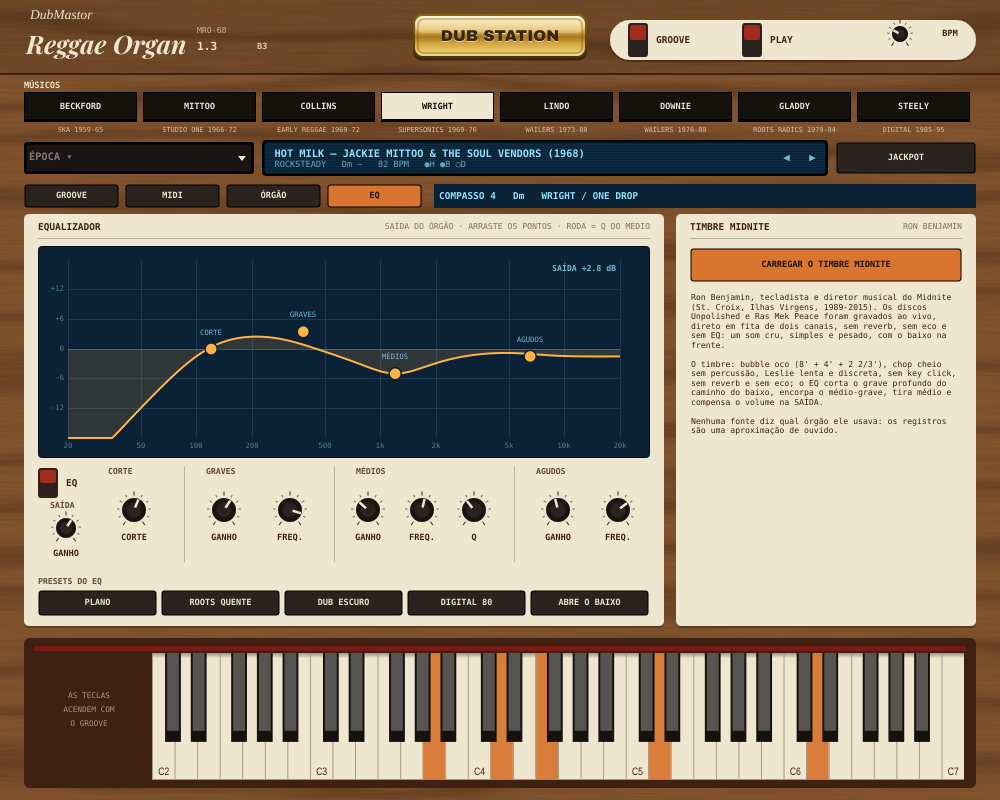

# Mastor Reggae Organ MRO-68 1.3 — o órgão de reggae dos organistas jamaicanos 🎹

*Linha Dub Station*

← [Voltar para a página inicial do repositório](../README.md)

**Downloads:** [Windows](https://github.com/dubmastor/DubMastor-DubStation-/releases/download/MRO-68-1.3/MRO-68-Windows-Instalador.exe) · [Mac](https://github.com/dubmastor/DubMastor-DubStation-/releases/download/MRO-68-1.3/MRO-68-macOS-Instalador.pkg) · 📱 [Testar no navegador](https://dubmastor.github.io/DubMastor-DubStation-/web/reggaeorgan/)

Instrumento que toca **o órgão de reggae pronto** — bubble, chop e fills — no andamento da DAW, com o mesmo Hammond do
**Mastor Reggae Keys MRK-80**. Formatos: **VST3** (Windows/macOS), **AU** (macOS), **AAX** (Pro Tools, depois da assinatura PACE) e **Standalone**.

## A contagem
Tudo no MRO-68 é na contagem da Dub Station, a mesma do MRDM-12, do MRCM-1240 e do banco de riddims: **caixa no 2 e no 4**,
BPM até 100. Em cada tempo (1 e & a): a **mão direita** toca o acorde no contratempo **&** (junto com o skank) e a
**mão esquerda** faz o bubble no **e** e no **a**. As notas duram **1/32**, como o skank e o bubble do MRCM-1240.

## Três caminhos para escolher o groove
**MÚSICOS** — cada organista é uma receita (grade, swing, human, ghost, fills e os dois registros de drawbar):

| Músico | Época | O que a grade e os fills fazem |
|---|---|---|
| **BECKFORD** — Theophilus Beckford | Ska 1959-65 | O contratempo forte do ska; a mão esquerda só pontua, leve |
| **MITTOO** — Jackie Mittoo | Studio One 1966-72 | O bubble clássico, apontado como dele: "e" forte, "a" fantasma; licks curtos no fim da frase |
| **COLLINS** — Ansel Collins | Early reggae 1969-72 | Hammond na frente (skinhead reggae): shuffle cheio e melodia a cada 2 compassos |
| **WRIGHT** — Winston Wright | Supersonics 1969-76 | Mestre do Hammond: esquerda leve, swing de flying cymbals e melodia "grande e gorda" em oitavas |
| **LINDO** — Earl "Wire" Lindo | Wailers 1973-80 | O bubble "difícil de reproduzir": registro de apito (8' + 4' + 1') |
| **DOWNIE** — Tyrone Downie | Wailers 1976-80 | Esquerda só no "e", acordes sincopados respondendo ao canto |
| **GLADDY** — Gladstone Anderson | Roots Radics 1979-84 | Espaço: só o "a", e fragmentos graves e lentos (o estilo de piano que ele criou) |
| **STEELY** — era digital | Digital 1985-95 | Grade presa, sem swing, steppers |

Os grooves são **inspirados** no estilo de cada músico (o que o estudo descreve de cada um), não transcrições de gravações.

**ÉPOCAS** — os 10 estilos do banco de riddims (ROCKSTEADY, EARLY REGGAE, ROOTS, ROCKERS, LOVERS ROCK, RUB A DUB, DIGITAL,
RAGGA, DANCEHALL, NEW ROOTS), cada um com o organista, a batida e o BPM da época.

**RIDDIMS** — o visor azul abre o **banco único da Dub Station** (o mesmo das machines: ESTILOS, RIDDIMS A–Z, MÚSICAS A–Z).
A música carrega a harmonia, o BPM e a batida da gravação, e o organista da época dela.

## Ajustes
| Controle | O que faz |
|---|---|
| **GRADE** | 16 semicolcheias, mão direita e mão esquerda. Clique: acento → fantasma → vazio (arraste pinta). A linha da bateria mostra a caixa no 2 e no 4 e o bumbo da batida |
| **ATALHOS DE FEEL** | Reescrevem a grade: SKA "ki-koo-ki" (o & manda), ROCKSTEADY "koo-ki-koo" (o e e o a mandam), REGGAE (e forte, a fantasma) |
| **MÃO ESQUERDA NO** | Só no "e", só no "a" ou nos dois |
| **BATIDA** | ONE DROP (bumbo com a caixa no 2 e no 4), ROCKERS (bumbo no 1 e no 3), STEPPERS (bumbo em todo tempo): muda o contraste da nota fantasma |
| **DURAÇÃO DA NOTA** | 1/32 (padrão), 1/16 ou 1/8 |
| **SWING / HUMAN / GHOST** | Atraso do "e" e do "a" até o shuffle · variação de tempo e força (sempre igual no mesmo compasso) · volume da nota fantasma (o Hammond não tem velocity: a fantasma toca num órgão com volume próprio) |
| **VARIAÇÃO / JACKPOT** | 64 versões do mesmo groove (humanização e frases dos fills) |
| **FILLS** | MITTOO (licks), WRIGHT (melodia em oitavas), DOWNIE (acordes), GLADDY (fragmentos graves), a cada 2, 4 ou 8 compassos, nos tempos 3 e 4 |
| **ACORDES** | Do plugin (aba MIDI: 4 acordes, maior ou menor, de 1/2 a 8 compassos) ou do teclado (segure o acorde no MIDI) |

## MIDI

O visor mostra o loop inteiro com as três camadas (bubble âmbar, chop laranja, fills marfim). Clique num espaço vazio para pôr
uma nota de 1/32 na camada do **PINCEL**, arraste para mover, puxe a borda para esticar, duplo clique ou botão direito apaga
(grade de 1/16; Shift = 1/32). Editou: o plugin toca o **MIDI EDITADO** e ele fica salvo no projeto, até **VOLTAR AO GROOVE**.
Arraste para a timeline **TUDO** (3 trilhas: bubble no canal 1, chop no 2, fills no 3) ou uma camada só.

## Órgão

Dois organistas: **mão esquerda** (bubble, seco e grave) e **mão direita** (chop e fills, cheio) com registros de drawbar
separados. Leslie de dois rotores (corneta e tambor, com presets, LENTA/RÁPIDA, FREIO e o gabinete animado), percussão e eco de fita só na mão direita.

## EQ e o timbre Midnite (1.3)

- **EQUALIZADOR** de 4 faixas na saída do órgão: **CORTE** de graves (passa-altas; 20 Hz = desligado), **GRAVES** (shelf),
  **MÉDIOS** (sino com Q) e **AGUDOS** (shelf), de −15 a +15 dB, e **SAÍDA** (−12 a +12 dB) para compensar o volume. Arraste os pontos na curva; roda do mouse no MÉDIOS = Q;
  duplo clique zera. Presets: PLANO, ROOTS QUENTE, DUB ESCURO, DIGITAL 80 e ABRE O BAIXO. Começa plano.
- **TIMBRE MIDNITE**: o órgão cru e seco do Ron Benjamin (Midnite, St. Croix). Os discos *Unpolished* e *Ras Mek Peace*
  foram gravados ao vivo direto em fita de dois canais, sem reverb, sem eco e sem EQ. O botão carrega bubble oco (8' + 4' + 2⅔'),
  chop cheio sem percussão, Leslie lenta e discreta, sem key click, sem reverb e sem eco, e o EQ que tira o grave do caminho
  do baixo, encorpa o médio-grave (150–350 Hz) e tira médio (−5 dB em 1,2 kHz), com o volume compensado na SAÍDA. Nenhuma fonte diz qual órgão ele usava: os registros são uma aproximação de ouvido.

## Código
- `Source/GrooveEngine.h` — o motor (C++ puro): grade, músicos, épocas e fills. A versão para celular (`site/web/reggaeorgan/`) usa a mesma lógica e o mesmo gerador aleatório: o mesmo compasso sai igual nos dois.
- `Source/GroovePlayer.h` — toca o groove (ou o MIDI editado) no tempo da DAW, com o sample exato de cada nota.
- `Source/OrganTrio.h` — três motores do órgão do MRK-80 (`ReggaeKeys/Source/RootsKeysEngine.h`): bubble acento, bubble fantasma e mão direita.
- `Source/OrganEQ.h` — o EQUALIZADOR de 4 faixas (filtros RBJ, iguais aos BiquadFilterNode da versão para celular), os presets do EQ e o TIMBRE MIDNITE.
- O banco de riddims vem de `RiddimBank/Source` (o mesmo das machines).
- `tests/render_test.cpp` — teste offline: regras da contagem, notas presas e um WAV de 8 compassos por músico.
  `g++ -std=c++17 -O2 -I Source -I ../ReggaeKeys/Source -I ../RiddimBank/Source tests/render_test.cpp -o render_test && ./render_test`
- `tests/snapshot.cpp` — desenha as três abas em `docs/` e confere o estado salvo (com o MIDI editado) e o MIDI exportado.
