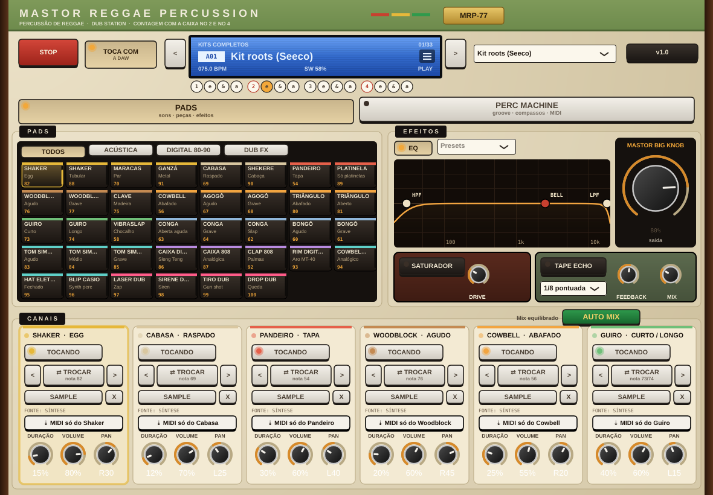
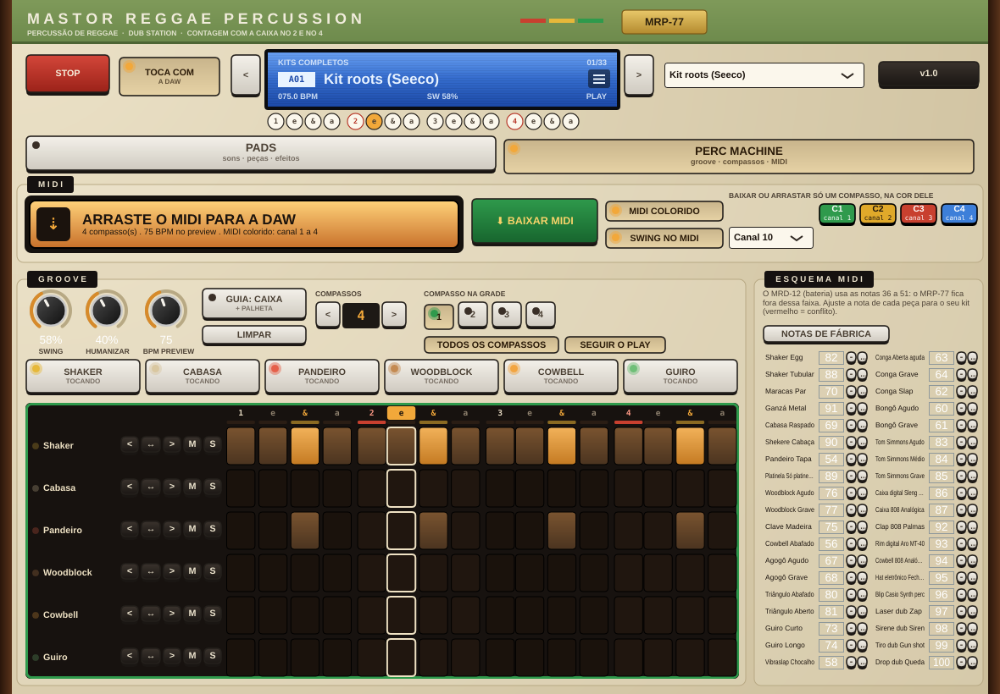

# Mastor Reggae Percussion MRP-77 1.0 — percussão de reggae com a PERC MACHINE 🪇

*Linha Dub Station*

← [Voltar para a página inicial do repositório](../README.md)

**Downloads:** [Windows](https://github.com/dubmastor/DubMastor-DubStation-/releases/download/MRP-77-1.0/MRP-77-Windows-Instalador.exe) · [Mac](https://github.com/dubmastor/DubMastor-DubStation-/releases/download/MRP-77-1.0/MRP-77-macOS-Instalador.pkg) · 📱 [Testar no navegador](https://dubmastor.github.io/DubMastor-DubStation-/web/reggaepercussion/)

Percussão de reggae (shaker, cabasa, pandeiro, woodblock, cowbell, guiro, congas, bongôs e mais) com a **PERC MACHINE**, que
toca os grooves do estudo dos percussionistas jamaicanos junto com a DAW. Formatos: **VST3** (Windows/macOS), **AU** (macOS),
**AAX** (Pro Tools, depois da assinatura PACE) e **Standalone**.

## A contagem
Tudo é na contagem da Dub Station: **caixa no 2 e no 4** e palheta nos "&". Cada passo da grade é uma **semicolcheia**;
16 passos = 1 compasso (1 e & a 2 e & a 3 e & a 4 e & a). O swing atrasa os "e" e os "a".

## As duas abas
- **PADS** — os 38 pads (filtro por categoria: acústica, digital 80-90 e Dub FX), o **AUTO MIX** (peça alta demais fica marcada ALTO até ser corrigida), os efeitos (EQ, Mastor Big Knob, saturador e Tape Echo, os dois em bypass de fábrica) e os 6 canais,
  com mudo, troca de peça (setas ou lista), sample próprio, MIDI só da peça e duração, volume e pan. Os canais piscam no ritmo.
- **PERC MACHINE** — o MIDI (arrastar, baixar, colorido por compasso), o groove (até 8 compassos, uma cor por compasso,
  mudo, solo e troca rápida de peça em cada linha) e o esquema de notas.

## Os presets
Toque no visor azul para abrir a lista por categoria (ou use as setas e a lista ao lado).

| Grupo | Presets |
|---|---|
| Kits completos | Kit roots (Seeco), Kit rockers (Sticky), Kit steppers, Kit ska/rocksteady |
| Shaker | roots (A), Seeco (B), steppers (C), 3+3+2 (D) |
| Pandeiro | roots, shuffle, ska/rocksteady |
| Cabasa | roots/dub, rockers |
| Cowbell | steppers, sincopado (Sticky) |
| Woodblock | ska, clave 3+3+2 |
| Guiro | mento/ska (acento = raspado longo, fraca = curto), roots |
| Kits digitais 80-90 | Sleng Teng (85), 808 dancehall (90), Simmons roots (80), steppers digital (90) |
| Simmons 80 | rockers (82), steppers (84), rub-a-dub (83), virada no 4, Sleng Teng toms (85), dub toms + eco, 808 dancehall (88) |
| Dub FX | laser + drop, sirene + tiro |

Os kits digitais, Simmons e Dub FX trocam as peças das linhas (tom Simmons, caixa digital, clap 808, laser etc.).

São modelos de estilo para programar, inspirados em Alvin "Seeco" Patterson, Uziah "Sticky" Thompson e Noel "Scully" Simms — não são transcrições de faixas.

## MIDI sem conflito com o MRD-12
O Mastor Reggae Drums MRD-12 usa as notas **36 a 51**. O MRP-77 nunca usa essa faixa:

| Peça | Nota | | Peça | Nota |
|---|---|---|---|---|
| Pandeiro | 54 (F#2) | | Guiro curto / longo | 73 / 74 |
| Cowbell | 56 | | Clave | 75 |
| Vibraslap | 58 | | Woodblock agudo / grave | 76 / 77 |
| Bongô agudo / grave | 60 / 61 | | Triângulo abafado / aberto | 80 / 81 |
| Conga slap / aberta / grave | 62 / 63 / 64 | | Shaker egg | 82 (A#4) |
| Agogô agudo / grave | 67 / 68 | | Shaker tubular | 88 |
| Cabasa | 69 | | Platinela | 89 |
| Maracas | 70 | | Shekere / Ganzá | 90 / 91 |
| Tom Simmons agudo / médio / grave | 83 / 84 / 85 | | Clap 808 / Rim MT-40 | 92 / 93 |
| Caixa digital / Caixa 808 | 86 / 87 | | Cowbell 808 / Hat eletrônico / Blip | 94 / 95 / 96 |
| | | | Laser / Sirene / Tiro / Drop (Dub FX) | 97 / 98 / 99 / 100 |

Nomes das notas como no Cubase e no Battery (C3 = 60). Dá para usar os dois plugins no canal 10. Cada nota é ajustável no
ESQUEMA MIDI para casar com o seu kit.

## Código
- `Source/PercEngine.h` — os 37 sons, os presets, o AUTO MIX, os efeitos e o MIDI (sem JUCE). A versão para celular
  (`site/web/reggaepercussion/index.html`) tem a mesma síntese em Web Audio: ao mudar um, mude o outro.
- `tests/render_test.cpp` — teste offline: `g++ -std=c++17 -O2 -I Source tests/render_test.cpp -o /tmp/mrp_test && /tmp/mrp_test`
- `tests/snapshot.cpp` — plugin inteiro (PLAY, MIDI que chega, estado, arquivo MIDI) e as imagens de `docs/`:
  `cmake -B build-snap -DMRP_SNAPSHOT=ON -DMRP_FORMATS=VST3 && cmake --build build-snap --target ReggaePercussionSnapshot`
