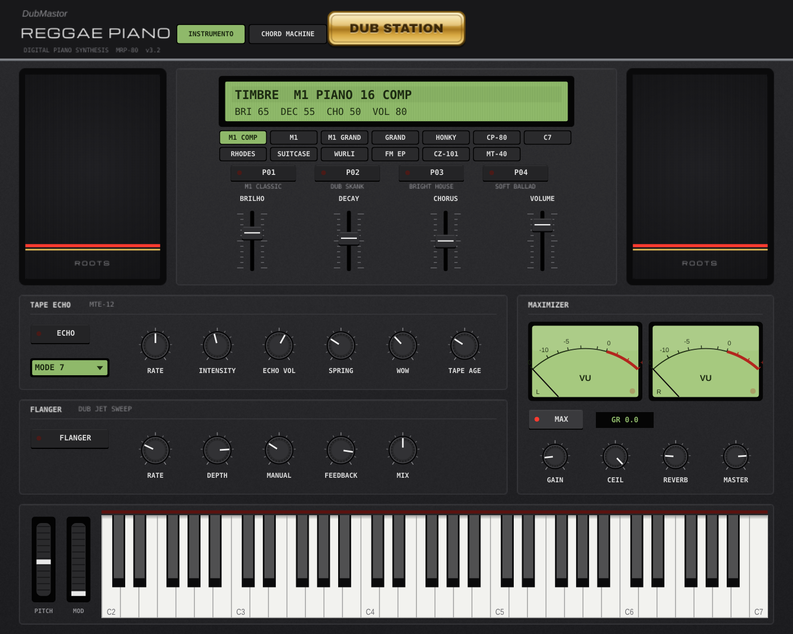
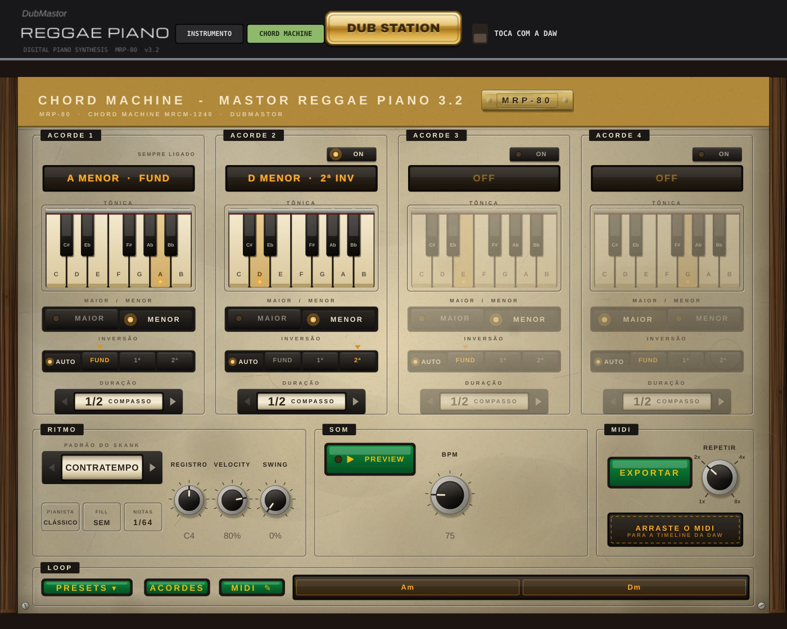

# Mastor Reggae Piano MRP-80 3.2

← [Voltar para a página inicial do repositório](../README.md)

**[⬇️ Windows](https://github.com/dubmastor/DubMastor-DubStation-/releases/download/MRP-80-3.2/MRP-80-Windows-Instalador.exe)** · **[⬇️ macOS](https://github.com/dubmastor/DubMastor-DubStation-/releases/download/MRP-80-3.2/MRP-80-macOS-Instalador.pkg)** · **📱 [Tocar no celular / navegador](https://dubmastor.github.io/DubMastor-DubStation-/piano/)**

(Antes se chamava **DubMastor Roots Keys**, **Mastor Roots Keys MRK-80** e **Mastor Reggae Keys MRK-80**. Na 3.0 absorveu o **Mastor Reggae Chord Machine MRCM-1240** (aba CHORD MACHINE); na 3.1 o órgão saiu e virou o **Mastor Reggae Organ MRO-68**.)





Instrumento VST3 / AU / Standalone de piano para reggae e dub:

- **Piano estilo Korg M1** — o piano brilhante do M1 recriado por síntese aditiva (sem samples da Korg): ataque brilhante, presença em 2–4 kHz, decaimento em dois estágios, ruído de martelo e chorus estéreo.

Cadeia de saída: **Tape Echo Mastor Tape Echo MTE-12** (o mesmo eco do Dub Station 2.1) → reverb → **Flanger dub** (o "avião a jato" no estilo dos dubs do Mad Professor, na mistura inteira) → **Maximizer** → **VUs analógicos L/R**. O teclado de 61 teclas acende com as notas MIDI tocadas (e toca com o mouse).

## Timbres de piano

Treze botões em duas linhas logo abaixo do visor (o visor mostra o timbre escolhido). Em cima o Korg M1, os acústicos e os Yamaha; embaixo os pianos elétricos e os digitais. O gabinete muda com o timbre (Rhodes, Suitcase, Wurlitzer, Yamaha e Casio têm acabamento próprio).

| Timbre | Som |
|---|---|
| **M1 COMP** | o Piano 16 do Korg M1 comprimido, o skank digital do reggae e do dancehall dos anos 90 (cauda alta, quase não muda com o toque) — **timbre inicial** |
| **M1** | o piano brilhante e "vidrado" estilo Korg M1 (o dos presets P01–P04) |
| **M1 GRAND** | o piano de cauda do Korg M1, com a "presença" em 2,8 kHz |
| **GRAND** | piano de cauda: mais harmônicos, cordas mais "duras", ataque de martelo grave e sustentação longa |
| **HONKY** | piano de armário Honky Tonk dos estúdios de Kingston: cordas desafinadas entre si, escuro e curto |
| **CP-80** | piano de cauda elétrico Yamaha CP-80, com o meio "honky" do captador |
| **C7** | cauda de concerto Yamaha C7, brilhante e com ataque rápido |
| **RHODES** | Rhodes Stage: tine redondo, sino curto e o "bark" do captador no toque forte |
| **SUITCASE** | Rhodes Suitcase: mais doce, com o tremolo da maleta |
| **WURLI** | Wurlitzer 200A: nasal, rosna no toque forte |
| **FM EP** | piano elétrico FM estilo Yamaha DX |
| **CZ-101** | Casio CZ-101 (Steely & Clevie): phase distortion, abre brilhante e fecha em senoide |
| **MT-40** | teclado de brinquedo estilo Casio MT-40, bem lo-fi |


BRILHO e DECAY agem em todos os timbres. Os presets P01–P04 voltam para o M1.

## Rodas de pitch e modulação

As duas rodas do lado do teclado funcionam com o mouse e com o MIDI:

- **PITCH**: arraste para cima/baixo — ±2 semitons em todos os timbres; ao soltar, volta ao centro como a roda de verdade.
- **MOD**: arraste para definir — faz **vibrato**. Duplo clique zera.

## Aba CHORD MACHINE — o MRCM-1240 dentro do teclado

Clique em **CHORD MACHINE** no cabeçalho: é o **Mastor Reggae Chord Machine MRCM-1240** inteiro (o código vem direto de `ReggaeChordMachine/`, nada copiado), só com acordes **maior e menor**:

- **4 acordes**: tônica no teclado mecânico, MAIOR / MENOR, inversão (AUTO escolhe a mais próxima do acorde anterior) e duração de 1/2 a 8 compassos. Skank de piano com as duas mãos no **PADRÃO DO SKANK**: CONTRATEMPO (o acorde no "&" de cada tempo) ou BANG BANG (no "&" e de novo no "a"), sempre com a caixa no 2 e no 4 (o bubble de órgão é do Mastor Reggae Organ MRO-68).
- **PIANISTA**, **FILL** (a cada 4 ou 8 compassos) e **NOTAS** (1/64 ou 1/32): plaquetas embaixo do padrão do skank. O pianista CLÁSSICO toca o padrão escolhido; os outros têm o desenho próprio. **MIDI ✎** abre o visor editável, com cada acorde numa cor.
- **PRESETS**: o banco único de riddims (356 músicas, 155 riddims; ESTILOS, RIDDIMS A–Z, MÚSICAS A–Z, luzes D B R) e as 180 harmonias clássicas.
- **Som**: os acordes tocam sempre no piano do instrumento, no timbre escolhido, passando pelo eco, flanger, reverb e maximizer.
- **Tocar**: **PREVIEW** toca sem a DAW (BPM no knob); **TOCA COM A DAW** (no cabeçalho) segue o play, o BPM e o loop da DAW.
- **MIDI**: EXPORTAR ou ARRASTAR para a timeline, com repetição 1x a 8x.

Projetos salvos com a antiga aba DUB CHORDS abrem na CHORD MACHINE com os mesmos acordes (7, maj7, sus2 e sus4 viram maior; m7, m6, dim e m9 viram menor).

## Visual

Teclado preto anos 80 em plástico liso e fosco, caixas de som com tela de tecido e faixa vermelha e dourada, visor de cristal líquido verde com o preset, botões P01–P04 com LED, faders, rodas de pitch/mod e teclas que acendem em verde. As texturas são geradas por código (sem imagens); o emblema dourado **Dub Station** fica no centro do cabeçalho. Título em Michroma.

## Controles

| Seção | Controles |
|---|---|
| Piano | Brilho, Decay, Chorus, Volume · pedal de sustain (CC64) |
| Tape Echo (Mastor Tape Echo MTE-12) | Echo on/off, Mode 1–12 (1–4 só eco, 5–11 eco + mola, 12 só mola), Rate, Intensity (acima de ~0.85 auto-oscila), Echo Vol, Spring, Wow, Tape Age. Ao desligar, a cauda continua tocando. |
| Flanger | Flanger on/off, Rate (0,02–4 Hz), Depth, Manual (posição do "pente"), Feedback (−0,95 a +0,95; negativo dá o timbre oco), Mix. Fica depois do eco e do reverb, então os ecos também "voam". |
| Maximizer / VU | Max on/off, Gain (0 a +18 dB), Ceiling, Reverb, Master, leitura de GR e VUs L/R (0 VU = −18 dBFS RMS) |

## Presets

M1 Classic · M1 Dub Skank · M1 Bright House · M1 Soft Ballad (P01–P04, timbre M1).

## Compilar

O GitHub Actions (`.github/workflows/build-reggaepiano.yml`) testa o DSP, compila para Windows e Mac (universal), valida com **pluginval** e **auval** e anexa os instaladores e os zips à release `MRP-80-x.y` (uma por versão; ela não vira a "latest" do repositório).

Localmente:
```bash
cmake -B build -DCMAKE_BUILD_TYPE=Release        # ou -DJUCE_DIR=/caminho/JUCE
cmake --build build --config Release
```

Teste offline do DSP (sem JUCE): `g++ -std=c++17 -O2 tests/render_demo.cpp -o render_demo && ./render_demo`

Teste do plugin (CHORD MACHINE no som do teclado, projeto antigo da DUB CHORDS, capturas da interface): `cmake -B build -DROOTSKEYS_TESTS=ON && cmake --build build --target RootsKeysTest && ./build/RootsKeysTest_artefacts/Release/RootsKeysTest docs`

## Arquivos
- `Source/RootsKeysEngine.h` — piano, reverb e maximizer (sem dependências); o órgão e a Leslie continuam aqui porque o MRO-68, o MRCM-1240 e o MRM-0420 usam
- `Source/TapeEchoDSP.h` — Mastor Tape Echo MTE-12 (cópia do Dub Station 2.1)
- `Source/PluginProcessor.*` — parâmetros, presets, MIDI, medidores
- `Source/PluginEditor.*` — interface com os dois visuais, abas e a placa Dub Station
- `Source/MachineProcessorUnit.cpp` / `MachineEditorUnit.cpp` — compilam o MRCM-1240 (`ReggaeChordMachine/Source`) na aba CHORD MACHINE
- `Source/VintageLookAndFeel.h` — knobs, faders, chaves e visor de cada visual
- `Source/SkinTextures.h` — texturas procedurais (plástico preto e madeira)
- `Source/VUMeter.h` — VU analógico
- `Resources/` — fontes Archivo Black, Michroma e RootsKeys Display (licenças OFL em `Resources/licenses/`)

"Korg" e "M1" são marcas da Korg Inc.; "Hammond" e "Leslie" são marcas da Hammond Suzuki. Este projeto não é afiliado a elas — os nomes indicam apenas o estilo de timbre emulado.

## Novidades da 3.0
- Nome novo **Mastor Reggae Keys MRK-80**; aba **CHORD MACHINE** com o MRCM-1240 inteiro (só maior e menor) no lugar da DUB CHORDS; banco único de riddims; versão para celular.

## Novidades da 2.4
- Timbres de piano **GRAND**, **MT-40** (estilo Casio), **FM EP** (estilo Yamaha DX), **CP-80** e **C7** (Yamaha) **M1 GRAND** (Grand Piano do Korg M1), **M1 COMP** (o de fábrica), **HONKY** (Honky Tonk) **CZ-101** (Casio), **RHODES**, **SUITCASE** e **WURLI**, além do M1.
- Rodas **PITCH** e **MOD** usáveis com o mouse; pitch bend (±2 semitons) e vibrato agora soam (também pelo MIDI).

## Novidades da 2.3
- Aba Dub Chords: acordes com **6 notas em duas oitavas** (duas mãos).
- Novo controle **TAMANHO DA NOTA** (1/32 a 1/2), começando sempre em **1/32**; substitui o gate.
- Removido o **baixo guia** (da grade, da tela e do MIDI exportado).

## Novidades da 2.2
- Novo nome: **Mastor Roots Keys MRK-80**. O número da versão aparece no cabeçalho do plugin.
- Aba **DUB CHORDS**: progressão de até 4 acordes, riddims prontos, grade piano roll e arrastar MIDI (tudo, skank, baixo ou um acorde) para a DAW, tocando no próprio piano/órgão.

## Novidades da 2.1
- Novo nome: **Dub Station Roots Keys** (antes Mastor Roots Keys), com a placa Dub Station centralizada.
- Visual troca com o instrumento: teclado anos 80 (piano) e madeira com marfim (órgão).
- Drawbars puxadas para baixo, como no Hammond; rodas de pitch/mod que mostram o MIDI recebido.
- **Flanger dub** estilo Mad Professor; emblema dourado; plástico liso; caixas com tela de tecido; novas fontes nos títulos; janela de 1000 × 800.
