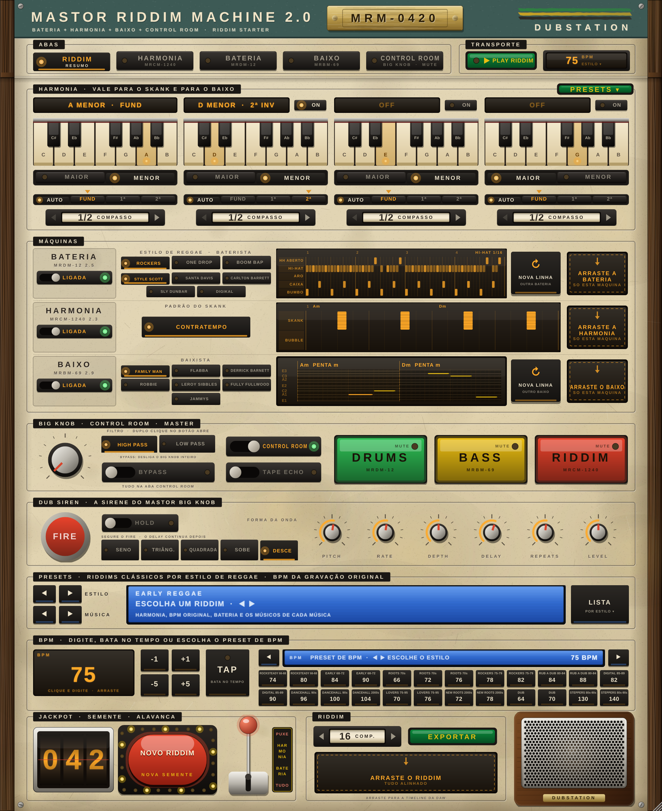
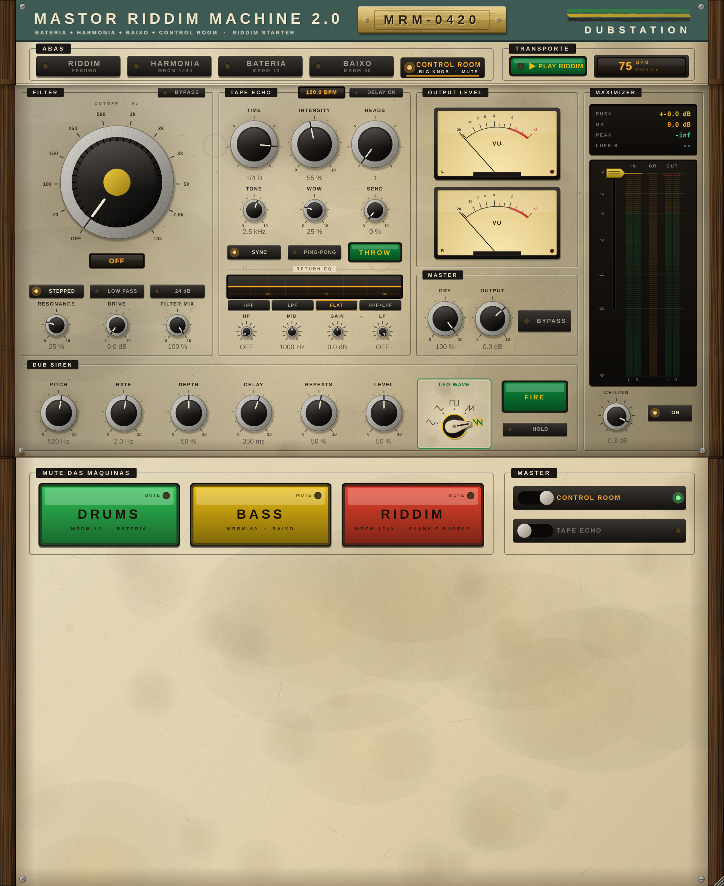

# Mastor Riddim Machine MRM-0420 2.0 — DubStation

← [Voltar para a página inicial do repositório](../README.md)

**[⬇️ Instalador Windows (.exe)](https://github.com/dubmastor/DubMastor-DubStation-/releases/download/MRM-0420-2.0/MRM-0420-Windows-Instalador.exe)** · **[⬇️ Instalador Mac (.pkg)](https://github.com/dubmastor/DubMastor-DubStation-/releases/download/MRM-0420-2.0/MRM-0420-macOS-Instalador.pkg)** · **📱 [Versão para celular](https://dubmastor.github.io/DubMastor-DubStation-/riddim/)**
(sem instalador: [zip Windows](https://github.com/dubmastor/DubMastor-DubStation-/releases/download/MRM-0420-2.0/MRM-0420-Windows.zip) · [zip Mac](https://github.com/dubmastor/DubMastor-DubStation-/releases/download/MRM-0420-2.0/MRM-0420-macOS.zip))



As máquinas da DubStation num instrumento só, para começar um riddim em segundos:

| Máquina | Parte | Aba |
|---|---|---|
| **Mastor Reggae Drum Machine MRDM-12** | bateria, com os samples DM (`ReggaeDrumMachine/Samples`) | BATERIA |
| **Mastor Reggae Chord Machine MRCM-1240** | skank de piano M1 e bubble de órgão | HARMONIA |
| **Mastor Reggae Bass Machine MRBM-69** | linha de baixo, com os timbres do MRDBI-07 | BAIXO |
| **Mastor Big Knob** | filtro, tape echo, sirene e maximizer no master | CONTROL ROOM |

A **harmonia é uma só** para o MRCM-1240 e o MRBM-69 (mexer nos acordes em qualquer aba muda as duas) e o
**BPM é um só** para todas. Formatos: **VST3** (Windows/macOS), **AU** (macOS) e **Standalone**. É um
**instrumento**: no Cubase, carregue numa *Instrument Track*.

## Instalação e DAWs
| Formato | DAWs | Onde o instalador põe |
|---|---|---|
| **VST3** | Cubase, Nuendo, FL Studio, Ableton Live, Reaper, Studio One, Bitwig, Cakewalk... | Windows: `C:\Program Files\Common Files\VST3` · Mac: `/Library/Audio/Plug-Ins/VST3` |
| **AU** (Mac) | Logic Pro, GarageBand, MainStage (e FL Studio / Ableton no Mac, se preferir AU) | `/Library/Audio/Plug-Ins/Components` |
| **AAX** | Pro Tools (quando assinado pela PACE, veja abaixo) | Windows: `C:\Program Files\Common Files\Avid\Audio\Plug-Ins` · Mac: `/Library/Application Support/Avid/Audio/Plug-Ins` |
| **Standalone** | sem DAW | Windows: Menu Iniciar › DubStation · Mac: Aplicativos |

- **Windows:** rode `MRM-0420-Windows-Instalador.exe` (VST3 e programa standalone).
- **Mac:** abra `MRM-0420-macOS-Instalador.pkg`. Se o macOS avisar que o desenvolvedor não foi verificado, clique com o botão direito no `.pkg` › **Abrir**. O instalador já libera os plugins da quarentena e faz o Logic reler os Audio Units. Binário universal (Apple Silicon e Intel).
- É um **instrumento**: no Cubase, *Instrument Track*; no Logic, *Software Instrument* › AU Instruments › DubStation; no FL Studio, *Add › Generators* (ou *Plugin database › Installed › Generators*), com *Manage plugins › Find installed plugins*; no Pro Tools, *Instrument Track* › plug-in › Instrument.
- **Pro Tools:** o MRM-0420 já compila em **AAX** no Windows e no Mac, mas o Pro Tools normal só carrega AAX **assinado pela PACE** (conta de desenvolvedor Avid + iLok). Enquanto a assinatura não existe, o AAX sai só como artefato de teste (`MRM-0420-AAX-nao-assinado-*`, abre no **Pro Tools Developer**) e fica fora do instalador público. Com os secrets da PACE configurados, o instalador completo assina e inclui o AAX sozinho: passo a passo em [PROTOOLS.md](../PROTOOLS.md).
- No CI, cada build instala o `.exe` e o `.pkg` de verdade e confere as pastas, passa o **pluginval**, o **validador da Steinberg** (VST3) e o **auval** da Apple (AU). Guia de cada DAW no site: [instalação](https://dubmastor.github.io/DubMastor-DubStation-/instalacao.html).

## Aba RIDDIM (a principal)
| Parte | O que faz |
|---|---|
| **HARMONIA** | Os 4 acordes no padrão do MRCM-1240: teclado, MAIOR/MENOR, inversão (com a sugestão automática) e duração. Valem para o skank e para o baixo. Ao abrir: **Lá menor e Ré menor, meio compasso cada** |
| **PRESETS** (visor azul) | O banco de riddims clássicos (o mesmo do MRCM-1240): 180 músicas em 8 **estilos de reggae** (EARLY REGGAE, ROOTS, ROCKERS, LOVERS ROCK, RUB A DUB, DIGITAL, DANCEHALL, NEW ROOTS). No **visor azul de MPC** da aba RIDDIM: **ESTILO ◀ ▶** e **MÚSICA ◀ ▶** carregam na hora; clique no visor ou em **LISTA** para escolher por estilo (o botão **PRESETS ▾** no alto da harmonia abre a mesma lista). Escolher um monta o riddim inteiro: harmonia, **BPM original da gravação** (99 músicas medidas; "~" = andamento típico do estilo), ROCKERS ou ONE DROP e os **músicos certos** (baterista do MRDM-12 e baixista do MRBM-69 mais próximos de quem gravou). Lista completa no README do MRCM-1240 |
| **MÁQUINAS** | Cada máquina com a chave **LIGADA/DESLIGADA**, os músicos clicáveis (na bateria, o **ESTILO DE REGGAE** ROCKERS / ONE DROP / BOOM BAP, que carrega o bumbo e a caixa do estilo, e o baterista; os baixistas; o skank é sempre no contratempo), o **MIDI na tela, editável**, e o **ARRASTE** só daquela máquina |
| **JACKPOT** | A semente nos rolos de caça-níquel e o botão vermelho **NOVO RIDDIM**: sorteia outra semente para a bateria e o baixo (os rolos giram e param um a um, como no MRDM-12). Arraste os rolos ou use a rodinha para escolher a semente na mão |
| **NOVA LINHA** | Na bateria e no baixo (aba RIDDIM): outra sugestão só daquela máquina, com semente própria; a outra máquina e o JACKPOT ficam como estão. O NOVO RIDDIM volta as duas para a semente do JACKPOT |
| **ALAVANCA** | Alavanca de caça-níquel com bola vermelha: puxe (ou clique) e ela desce e volta com mola. Sorteia **o riddim inteiro, sempre dentro do reggae**: um dos 180 riddims do banco de PRESETS, com a harmonia, o BPM, o estilo da bateria (ROCKERS ou ONE DROP, caixa só no 2 e no 4, sem ghost nem flam) e os músicos dele (o baixo toca só notas do acorde, sem cromatismo), mais o hi-hat (1/8, 1/16 ou contratempo) e a semente. O skank fica sempre no contratempo. Tudo aparece na tela na hora (o estilo nas teclas ESTILO DE REGGAE, o hi-hat no visor da bateria): é só apertar **PLAY RIDDIM** |
| **BIG KNOB · CONTROL ROOM** | O essencial do Mastor Big Knob no master: o **botão grande do filtro** (arraste, rodinha; duplo clique abre) com **HIGH PASS / LOW PASS**, as chaves **CONTROL ROOM** e **TAPE ECHO** (começa **desligado**) e o **MUTE** de cada máquina (DRUMS verde, BASS amarelo, RIDDIM vermelho). O Big Knob completo fica na aba CONTROL ROOM |
| **RIDDIM** | Tamanho (4 a 64 compassos), **ARRASTE O RIDDIM** (as máquinas ligadas num `.mid` só, alinhadas) e **EXPORTAR** |
| Alto-falante | Caixa de madeira com grade de metal perfurada; o cone mexe com o som |

### MIDI editável na tela
- **Bateria:** clique numa semicolcheia para pôr/tirar bumbo, caixa, aro, hi-hat ou hi-hat aberto; arrastar pinta várias; a rodinha muda a força. São as mesmas edições da grade PADRÃO do MRDM-12.
- **Harmonia:** clique num espaço vazio do SKANK ou do BUBBLE para pôr um ataque do acorde (com as mesmas notas do ataque mais próximo); clique num ataque para tirar; a rodinha muda a força.
- **Baixo:** o visor do MRBM-69: clique põe nota (na pentatônica do acorde), arraste move, borda estica, duplo clique apaga.
- **DESFAZER EDIÇÃO** aparece na máquina editada. A edição fica salva no projeto e vale até um controle do gerador daquela máquina ser mexido (como nas máquinas separadas).
- O que você vê é o que toca e o que é arrastado.

## Cabeçalho (vale para todas as abas)
| Controle | O que faz |
|---|---|
| **ABAS** | RIDDIM, HARMONIA, BATERIA, BAIXO e CONTROL ROOM |
| **PLAY RIDDIM** | Toca todas as máquinas juntas, sem a DAW rodando, começando pela intro |
| **BIG KNOB · BYPASS** | Na seção do Big Knob da aba RIDDIM: desliga o Big Knob inteiro (filtro, eco, sirene e maximizer) para comparar com e sem |
| **DUB SIREN** | Seção própria na aba RIDDIM, logo abaixo do Big Knob: a sirene do Mastor Big Knob. **FIRE** toca enquanto você segura (as repetições continuam no delay), **HOLD** deixa ligada, **FORMA DA ONDA** (seno, triângulo, quadrada, sobe, desce = o "piu-piu" clássico) e os botões PITCH, RATE, DEPTH, DELAY, REPEATS e LEVEL (duplo clique volta ao padrão) |
| **BPM** (seção da aba RIDDIM) | Um BPM para todas. **Clique no visor e digite** (60 a 180), ou arraste e gire a roda do mouse; teclas **−1, +1, −5, +5** e **TAP** (bata no tempo). Embaixo, **24 teclas de BPM por época e estilo**, a escolhida acende. No visor do alto (transporte), arraste, roda do mouse, duplo clique = 75 ou clique em **ESTILO ▾** para o BPM POR ÉPOCA E ESTILO: ROCKSTEADY 66-68 (74/80), EARLY REGGAE 68-72 (84/90), ROOTS 70s (66/72/76), ROCKERS 75-79 (78/82), RUB A DUB 80-84 (84/88), DIGITAL 85-89 (82/90), DANCEHALL 90s (96/100) e 2000s (104), LOVERS ROCK (70/76), NEW ROOTS (72/78), DUB (64/70), STEPPERS UK (130/140). Com a DAW tocando, mostra o BPM da DAW |

## Abas das máquinas
Uma máquina por aba, cada uma com o painel **completo**, igual ao plugin separado (com o mesmo código: o que muda nas
máquinas entra no MRM-0420 no próximo build). Só a primeira aba (RIDDIM) é diferente: ela junta o principal de cada
máquina e do Big Knob. Na aba BAIXO até o acompanhamento interno do MRBM-69 (bateria e teclado) está à mão; ele
começa desligado, porque no MRM-0420 a bateria e o teclado já tocam de verdade.

## Aba CONTROL ROOM


- O **Mastor Big Knob** inteiro no master: filtro big knob, tape echo, sirene de dub, VUs e maximizer.
- **MUTE DAS MÁQUINAS**, na ordem **DRUMS** (verde), **BASS** (amarelo) e **RIDDIM** (vermelho, o skank e o bubble do MRCM-1240). O mute tira só o som: o MIDI continua saindo e a máquina continua no riddim arrastado.
- **CONTROL ROOM** liga/desliga o Big Knob no master; **TAPE ECHO** liga/desliga o eco de fita.

## Como as máquinas andam juntas
- **Intro:** com a VIRADA DE INTRO do MRDM-12 ligada, a bateria toca um compasso sozinha e a harmonia e o baixo entram no compasso seguinte (no PLAY RIDDIM, com a DAW e no MIDI).
- **Loops de tamanhos diferentes** se repetem cada um no seu tamanho até completar o riddim.
- **Cores no MIDI:** harmonia e baixo com um canal por acorde, bateria com um canal por compasso (MIDI COLORIDO). No Cubase: Key Editor, Cores › Canal.
- **MIDI ao vivo** (DAW tocando): skank no canal 1, baixo no 2, bubble no 3 e a bateria no canal do MRDM-12 (10).
- **Projeto salvo:** a aba aberta, o BPM, a semente, as chaves, os mutes, as edições e os ajustes de cada máquina (inclusive o Big Knob).

## No celular
A [versão para celular](https://dubmastor.github.io/DubMastor-DubStation-/riddim/) tem a aba RIDDIM: harmonia,
PRESETS, máquinas com músicos e MIDI editável (toque para pôr/tirar), JACKPOT com a ALAVANCA (e o painel do que foi sorteado), tamanho, mute DRUMS / BASS / RIDDIM,
BIG KNOB (filtro HIGH/LOW PASS), CONTROL ROOM e TAPE ECHO, estilo de reggae na bateria, e baixa o MIDI de cada máquina ou do riddim inteiro. A bateria usa os mesmos samples DM.

## Para desenvolvedores
- `Source/MrmProcessor.*`: roda as quatro máquinas no mesmo relógio, atrasa harmonia e baixo pela intro (dividindo o bloco na amostra exata), liga harmonia/BPM entre as máquinas, aplica chaves e mutes, passa a mistura pelo Big Knob, salva o estado e escreve o MIDI.
- `Source/MrmMain.*`: aba RIDDIM. `Source/MrmEditor.*`: cabeçalho, abas e CONTROL ROOM. `Source/MrmStyle.h`: desenho DubStation.
- `Source/*Unit.cpp` e `*Names.h`: compilam o código das máquinas direto das pastas delas, renomeando as classes com nomes repetidos.
- `tests/render_test.cpp`: PNG das 5 abas, MIDI do riddim e de cada máquina, harmonia/BPM/semente ligados, edições, mute, intro alinhada, samples DM e estado. Roda no CI antes do build.
- **Regra do repositório:** mudou o MRCM-1240, o MRDM-12, o MRBM-69, o MRDBI-07 ou o Big Knob? O workflow do MRM-0420 roda junto (veja `paths` em `.github/workflows/build-riddimmachine.yml`); confira as abas e atualize as notas do MRM-0420.

```bash
cmake -B build -DCMAKE_BUILD_TYPE=Release
cmake --build build --config Release
# teste offline (Linux): -DMRM_FORMATS=VST3 -DMRM_RENDER_TEST=ON e --target mrm_render
```
