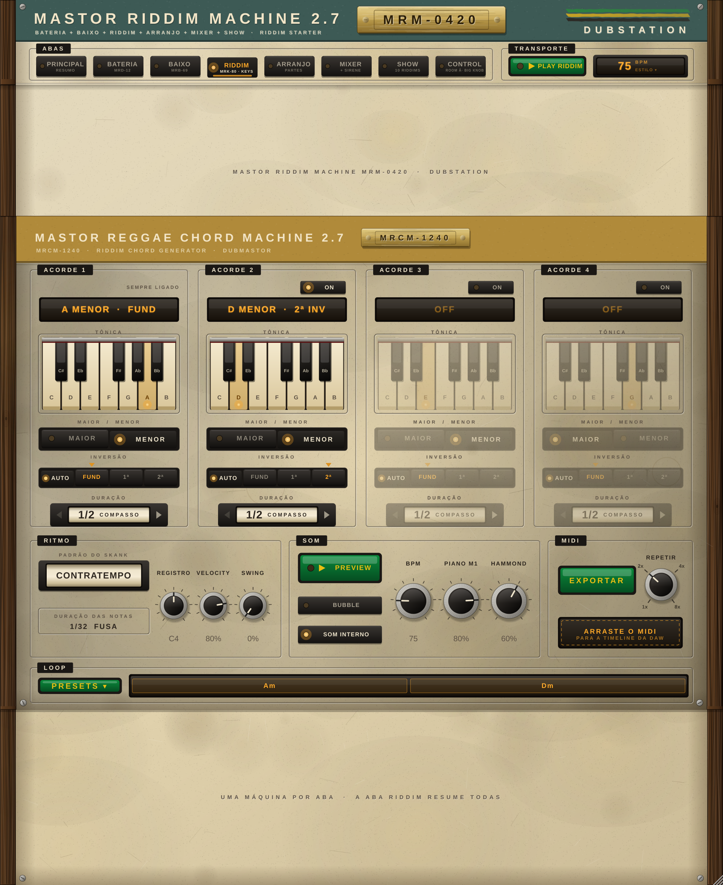
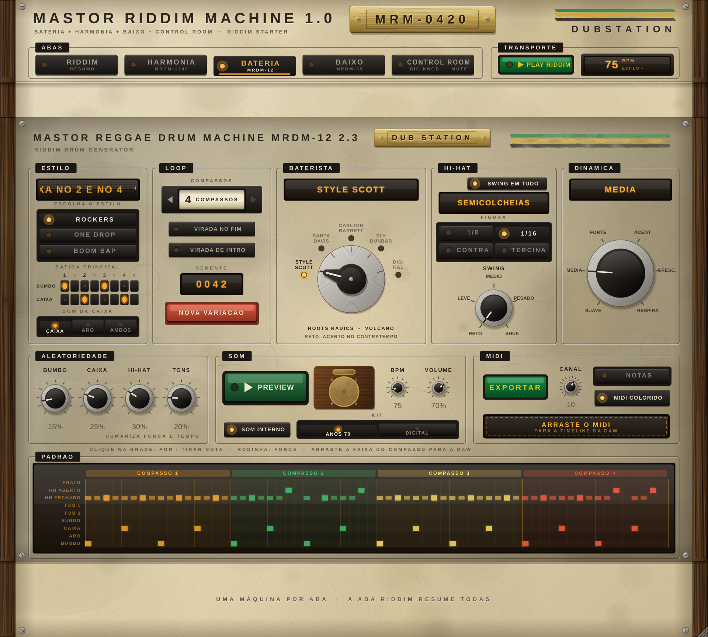

# Mastor Riddim Machine MRM-0420

← [Voltar para a página inicial do repositório](../README.md)

**[⬇️ Windows](https://github.com/dubmastor/DubMastor-DubStation-/releases/download/MRM-0420-1.3/MRM-0420-Windows.zip)** · **[⬇️ macOS](https://github.com/dubmastor/DubMastor-DubStation-/releases/download/MRM-0420-1.3/MRM-0420-macOS.zip)**



O **Dub Chords** e o **Dub Drums** num instrumento só, para começar um riddim em segundos: monte os acordes,
escolha a bateria, aperte **PLAY RIDDIM** para ouvir os dois juntos e **arraste o riddim inteiro** (bateria,
skank e bubble, já alinhados) para a timeline da DAW.
Formatos: **VST3** (Windows/macOS), **AU** (macOS) e **Standalone**. É um **instrumento**: no Cubase,
carregue numa *Instrument Track*.

## Como começar um riddim
1. Na aba **HARMONIA**, escolha até 4 acordes e o padrão do skank.
2. Na aba **BATERIA**, escolha o estilo (Rockers, One Drop ou Boom Bap), ajuste bumbo e caixa na BATIDA PRINCIPAL, o baterista e, se quiser, a **VIRADA DE INTRO**.
3. Aperte **PLAY RIDDIM** e ajuste o **BPM**.
4. Escolha o tamanho (4 a 64 compassos) e **arraste o riddim** para a timeline. No Cubase, o arquivo vira
   uma faixa para cada parte: bateria, skank e bubble.

## Cabeçalho (vale para as duas abas)
| Controle | O que faz |
|---|---|
| **MÓDULO: HARMONIA / BATERIA** | Troca a aba. A outra continua tocando e guardando tudo |
| **PLAY RIDDIM** | Toca harmonia e bateria juntas, sem a DAW rodando, começando pela intro. Aperte de novo para parar |
| **BPM** | Um BPM só para tudo (**LINK**): mexer no BPM de uma aba muda o das outras. Arraste para cima/baixo, use a rodinha, duplo clique volta para 75. Com a DAW tocando, mostra o BPM da DAW |
| **COMP.** | Tamanho do riddim arrastado/exportado: 4, 8, 16, 32 ou 64 compassos (sem contar a intro) |
| **ARRASTE O RIDDIM** | Clique e arraste para a timeline: um `.mid` com a bateria e a harmonia juntas |
| **EXPORTAR** | Salva o mesmo `.mid` (padrão: Documentos/MRM-0420) |

## Aba HARMONIA (Dub Chords)
O painel completo do [Dub Chords](../DubChords/README.md): 4 acordes com teclado, maior/menor, inversão e
duração; padrão do skank, tamanho da nota, registro, velocity e swing; bubble de Hammond e som
interno com o piano M1 e o Hammond. O **ARRASTE O MIDI** desta aba continua mandando só a harmonia.

## Aba BATERIA (Dub Drums)


O painel completo do [Dub Drums](../DubDrums/README.md): estilo, compassos, viradas, semente, hi-hat, os três
bateristas, swing, dinâmica, aleatoriedade, bateria interna, canal, MIDI colorido e mapa de notas. O
**ARRASTE O MIDI** desta aba continua mandando só a bateria.

## Como as duas partes andam juntas
- **Intro:** com a **VIRADA DE INTRO** ligada, a bateria toca um compasso sozinha e os acordes entram no
  compasso seguinte, tanto no PLAY RIDDIM quanto com a DAW tocando do começo, e no MIDI arrastado.
- **Loops de tamanhos diferentes:** a bateria (1 a 4 compassos) e a progressão de acordes se repetem cada
  uma no seu tamanho até completar o riddim; a última nota é cortada no fim.
- **Cores no MIDI:** a harmonia sai com um canal por acorde e a bateria com um canal por compasso (com o
  MIDI COLORIDO ligado), como nos plugins separados. No Cubase: Key Editor, **Cores › Canal**.
- **MIDI ao vivo** (DAW tocando): skank no canal 1, bubble no 3 e a bateria no CANAL do
  Dub Drums (10). No PLAY RIDDIM nada sai, como no PREVIEW.
- **Som interno:** a soma do piano/órgão com a bateria tem um teto suave e nunca estoura. Desligue o
  SOM INTERNO de cada aba quando for usar os seus instrumentos.
- **Projeto salvo:** a aba aberta, o BPM e todos os ajustes das duas abas voltam quando o projeto abre.
  Na DAW, a automação vê o **Play riddim**, o **BPM** e o **Tamanho do riddim**.

## Para desenvolvedores
O MRM-0420 não copia o código: ele compila os arquivos do `DubChords/Source` e do `DubDrums/Source` direto
das pastas deles, então melhorias nos dois plugins entram aqui no próximo build.
- `Source/MrmProcessor.*`: roda os dois geradores no mesmo relógio (DAW ou PLAY RIDDIM), atrasa a
  harmonia pela intro (dividindo o bloco de áudio na amostra exata), soma o áudio, junta o MIDI, liga os
  BPMs, salva o estado e escreve o `.mid` do riddim.
- `Source/MrmEditor.*`: cabeçalho MRM-0420 e as abas; os painéis do Dub Chords e do Dub Drums aparecem
  inteiros abaixo dele.
- `Source/*Unit.cpp`, `DrumsNames.h`: compilam o código original; as classes de interface que têm o mesmo
  nome nos dois plugins ganham outro nome no lado do Dub Drums.
- `tests/render_test.cpp`: PNG de cada aba, MIDI do riddim (faixas, tamanho, acordes depois da intro),
  áudio do PLAY RIDDIM, DAW tocando com intro e estado salvo/recarregado. Roda no CI antes do build.

```bash
cmake -B build -DCMAKE_BUILD_TYPE=Release
cmake --build build --config Release
# teste offline (Linux): -DMRM_FORMATS=VST3 -DMRM_RENDER_TEST=ON e --target mrm_render
```
