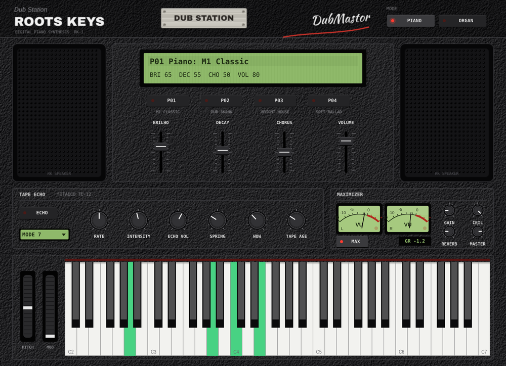

# Dub Station Roots Keys 1.3 — DubMastor

| Modo piano | Modo órgão |
|---|---|
|  |  |

Instrumento VST3 / AU / Standalone com dois timbres para reggae e dub, um de cada vez:

- **Piano estilo Korg M1** — o piano brilhante do M1 recriado por síntese aditiva (sem samples da Korg): ataque brilhante, presença em 2–4 kHz, decaimento em dois estágios, ruído de martelo e chorus estéreo.
- **Órgão tonewheel estilo Hammond B3** — 9 drawbars, percussão single-trigger (2º/3º harmônico, rápida/lenta), key click, overdrive valvulado e caixa Leslie com aceleração realista.

Cadeia de saída: **Tape Echo FitaEco TE-12** (o mesmo eco do Dub Station 2.1) → reverb → **Maximizer** → **VUs analógicos L/R**. O teclado de 61 teclas acende com as notas MIDI tocadas (e toca com o mouse).

## Dois visuais

O visual muda com o instrumento — escolher um preset de piano ou de órgão (ou a chave PIANO / ORGAN) troca a tela:

- **Piano:** teclado preto anos 80 em plástico texturizado, caixas de som com grade, visor de cristal líquido verde com o preset, botões P01–P04 com LED, faders, rodas de pitch/mod e teclas que acendem em verde.
- **Órgão:** gabinete de madeira com detalhes em marfim, drawbars que se puxam **para baixo** (como no B3; duplo clique zera/abre), chave meia-lua da Leslie, tabs de percussão, teclas de preset invertidas e teclas que acendem em laranja.

As texturas são geradas por código (sem imagens), e a assinatura **DubMastor** em pincel é a mesma do Dub Station.

## Controles

| Seção | Controles |
|---|---|
| Piano | Brilho, Decay, Chorus, Volume · pedal de sustain (CC64) |
| Órgão | 9 drawbars (16' 5⅓' 8' 4' 2⅔' 2' 1⅗' 1⅓' 1'), tabs de percussão ON / 3RD / SLOW, chave Leslie SLOW/FAST, Leslie Mix, Drive, Click, Organ Vol · mod wheel (CC1) = Leslie rápido |
| Tape Echo (FitaEco TE-12) | Echo on/off, Mode 1–12 (1–4 só eco, 5–11 eco + mola, 12 só mola), Rate, Intensity (acima de ~0.85 auto-oscila), Echo Vol, Spring, Wow, Tape Age. Ao desligar, a cauda continua tocando. |
| Maximizer / VU | Max on/off, Gain (0 a +18 dB), Ceiling, Reverb, Master, leitura de GR e VUs L/R (0 VU = −18 dBFS RMS) |

## Presets (separados por instrumento)

| Piano | Órgão |
|---|---|
| M1 Classic | Reggae Bubble |
| M1 Dub Skank | Roots Percussion |
| M1 Bright House | Dub Dark |
| M1 Soft Ballad | Gospel Leslie Fast |

Um preset de piano nunca altera o órgão, e vice-versa.

## Compilar

O GitHub Actions (`.github/workflows/build-rootskeys.yml`) testa o DSP, compila para Windows e Mac (universal), valida com **pluginval** e **auval** e anexa `DubStationRootsKeys-Windows.zip` / `DubStationRootsKeys-macOS.zip` à release.

Localmente:
```bash
cmake -B build -DCMAKE_BUILD_TYPE=Release        # ou -DJUCE_DIR=/caminho/JUCE
cmake --build build --config Release
```

Teste offline do DSP (sem JUCE): `g++ -std=c++17 -O2 tests/render_demo.cpp -o render_demo && ./render_demo`

## Arquivos
- `Source/RootsKeysEngine.h` — piano, órgão, Leslie, reverb e maximizer (sem dependências)
- `Source/TapeEchoDSP.h` — FitaEco TE-12 (cópia do Dub Station 2.1)
- `Source/PluginProcessor.*` — parâmetros, presets, MIDI, medidores
- `Source/PluginEditor.*` — interface com os dois visuais, placa Dub Station e assinatura DubMastor
- `Source/VintageLookAndFeel.h` — knobs, faders, chaves e visor de cada visual
- `Source/SkinTextures.h` — texturas procedurais (plástico preto e madeira)
- `Source/VUMeter.h` — VU analógico
- `Resources/` — fontes Archivo Black e Kaushan Script (licença OFL em `Resources/licenses/`)

"Korg" e "M1" são marcas da Korg Inc.; "Hammond" e "Leslie" são marcas da Hammond Suzuki. Este projeto não é afiliado a elas — os nomes indicam apenas o estilo de timbre emulado.

## Novidades da 1.3
- Novo nome: **Dub Station Roots Keys**, com a assinatura **DubMastor**.
- Visual troca com o instrumento: teclado anos 80 (piano) e madeira com marfim (órgão).
- Drawbars puxadas para baixo, como no Hammond; rodas de pitch/mod que mostram o MIDI recebido.
