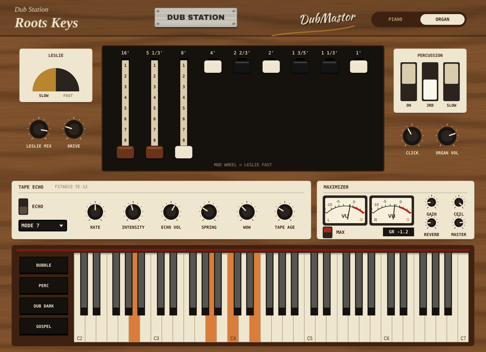
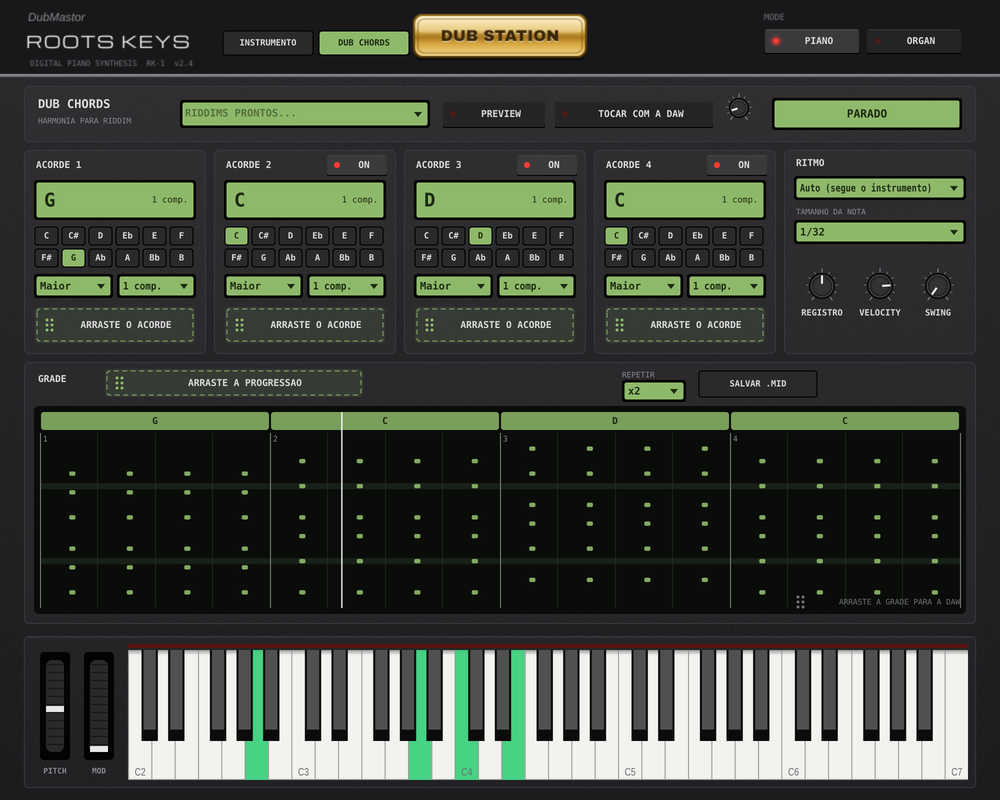
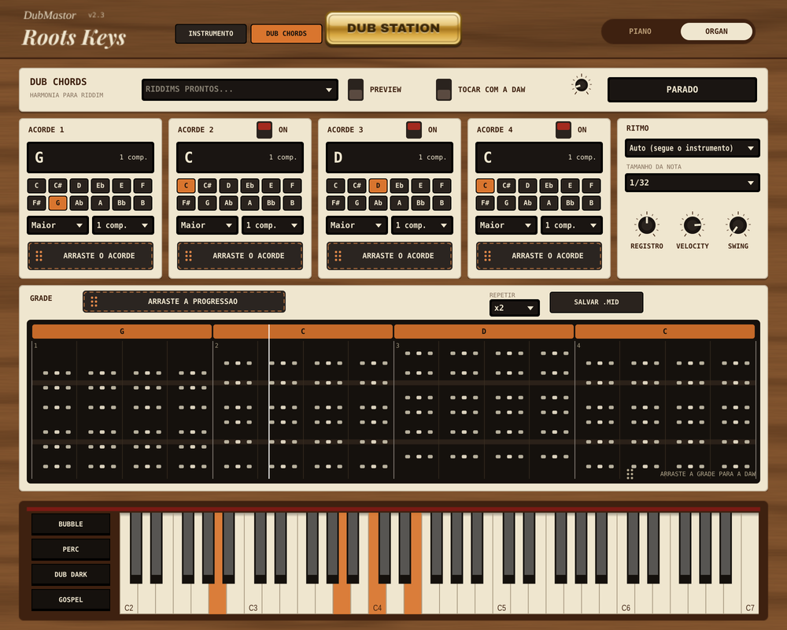

# DubMastor Roots Keys 2.4

← [Voltar para a página inicial do repositório](../README.md)

**[⬇️ Windows](https://github.com/dubmastor/DubMastor-DubStation-/releases/download/RootsKeys-2.4/DubMastorRootsKeys-Windows.zip)** · **[⬇️ macOS](https://github.com/dubmastor/DubMastor-DubStation-/releases/download/RootsKeys-2.4/DubMastorRootsKeys-macOS.zip)**

| Modo piano | Modo órgão |
|---|---|
|  |  |
|  |  |

Instrumento VST3 / AU / Standalone com dois timbres para reggae e dub, um de cada vez:

- **Piano estilo Korg M1** — o piano brilhante do M1 recriado por síntese aditiva (sem samples da Korg): ataque brilhante, presença em 2–4 kHz, decaimento em dois estágios, ruído de martelo e chorus estéreo.
- **Órgão tonewheel estilo Hammond B3** — 9 drawbars, percussão single-trigger (2º/3º harmônico, rápida/lenta), key click, overdrive valvulado e caixa Leslie com aceleração realista.

Cadeia de saída: **Tape Echo Mastor Tape Echo MTE-12** (o mesmo eco do Dub Station 2.1) → reverb → **Flanger dub** (o "avião a jato" no estilo dos dubs do Mad Professor, na mistura inteira) → **Maximizer** → **VUs analógicos L/R**. O teclado de 61 teclas acende com as notas MIDI tocadas (e toca com o mouse).

## Timbres de piano

Quatro botões logo abaixo do visor do modo piano (o visor mostra o timbre escolhido):

| Timbre | Som |
|---|---|
| **M1** | o piano brilhante e "vidrado" estilo Korg M1 (o dos presets P01–P04) |
| **GRAND** | piano de cauda: mais harmônicos, cordas mais "duras", ataque de martelo grave, sustentação longa e o leve batimento entre as cordas de cada nota |
| **MT-40** | teclado digital de brinquedo estilo Casio MT-40: onda de pulso, sem sensibilidade ao toque, ~6 bits a 16 kHz, bem lo-fi |
| **FM EP** | piano elétrico FM estilo Yamaha DX: corpo 1:1 + "tine" metálico 1:14 que some rápido; o toque mais forte abre o brilho |

BRILHO e DECAY agem em todos os timbres. Os presets P01–P04 voltam para o M1.

## Rodas de pitch e modulação

As duas rodas do lado do teclado funcionam com o mouse e com o MIDI:

- **PITCH**: arraste para cima/baixo — ±2 semitons em todos os timbres e no órgão; ao soltar, volta ao centro como a roda de verdade.
- **MOD**: arraste para definir — no piano faz **vibrato**; no órgão, acima da metade, liga a **Leslie rápida**. Duplo clique zera.

## Aba DUB CHORDS — monte o riddim e arraste para a DAW

O gerador de harmonia do **Dub Chords** dentro do Roots Keys. Clique em **DUB CHORDS** no cabeçalho:

- **Riddims prontos**: Roots menor, One drop, Rockers, Lovers, Steppers, Nyabinghi, Dub jazz e outros, para começar rápido.
- **4 cartões de acorde**: tônica (12 notas), tipo (maior, menor, 7, m7, maj7, m6, sus2, sus4, dim, m9), duração (1/2 a 8 compassos) e ON. O plugin escolhe a inversão mais próxima do acorde anterior (condução de vozes).
- **Duas mãos**: cada acorde sai com **6 notas** — a mesma inversão em duas oitavas, como um tecladista tocando com as duas mãos. Nos acordes de 4 notas cada mão toca as 3 que definem o som (sem a quinta; no m9, terça, sétima e nona).
- **Ritmo**: *Auto* segue o instrumento (skank no piano, bubble no órgão) ou escolha skank, one drop, double skank, bubble ou steppers. **Tamanho da nota** (1/32, 1/16, 1/8, 1/4, 1/2 — começa sempre em **1/32**), registro da mão esquerda, velocity e swing.
- **Toca no próprio instrumento**: **PREVIEW** toca sem a DAW (BPM no knob); **TOCAR COM A DAW** segue o play, o BPM e o loop da DAW. O som passa pelo eco, flanger e maximizer, e o teclado acende junto.
- **Grade (piano roll)**: o loop inteiro com as vozes das duas mãos, os nomes dos acordes e o cursor da DAW.
- **Arraste para a DAW**: a **grade inteira** é arrastável, e ainda dá para arrastar **a progressão** ou **um acorde sozinho** (no cartão). Vem com o tempo do projeto e repetição x1, x2, x4 ou x8. **SALVAR .MID** grava em Documentos/Roots Keys.

## Dois visuais

O visual muda com o instrumento — escolher um preset de piano ou de órgão (ou a chave PIANO / ORGAN) troca a tela:

- **Piano:** teclado preto anos 80 em plástico liso e fosco, caixas de som com tela de tecido e faixa vermelha e dourada, visor de cristal líquido verde com o preset, botões P01–P04 com LED, faders, rodas de pitch/mod e teclas que acendem em verde.
- **Órgão:** gabinete de madeira com detalhes em marfim, drawbars que se puxam **para baixo** (como no B3; duplo clique zera/abre), chave meia-lua da Leslie, tabs de percussão, teclas de preset invertidas e teclas que acendem em laranja.

As texturas são geradas por código (sem imagens). O emblema dourado **Dub Station** fica no centro do cabeçalho nos dois visuais. Títulos em Michroma (piano) e RootsKeys Display, derivada da Playfair Display (órgão).

## Controles

| Seção | Controles |
|---|---|
| Piano | Brilho, Decay, Chorus, Volume · pedal de sustain (CC64) |
| Órgão | 9 drawbars (16' 5⅓' 8' 4' 2⅔' 2' 1⅗' 1⅓' 1'), tabs de percussão ON / 3RD / SLOW, chave Leslie SLOW/FAST, Leslie Mix, Drive, Click, Organ Vol · mod wheel (CC1) = Leslie rápido |
| Tape Echo (Mastor Tape Echo MTE-12) | Echo on/off, Mode 1–12 (1–4 só eco, 5–11 eco + mola, 12 só mola), Rate, Intensity (acima de ~0.85 auto-oscila), Echo Vol, Spring, Wow, Tape Age. Ao desligar, a cauda continua tocando. |
| Flanger | Flanger on/off, Rate (0,02–4 Hz), Depth, Manual (posição do "pente"), Feedback (−0,95 a +0,95; negativo dá o timbre oco), Mix. Fica depois do eco e do reverb, então os ecos também "voam". |
| Maximizer / VU | Max on/off, Gain (0 a +18 dB), Ceiling, Reverb, Master, leitura de GR e VUs L/R (0 VU = −18 dBFS RMS) |

## Presets (separados por instrumento)

| Piano | Órgão |
|---|---|
| M1 Classic | Reggae Bubble |
| M1 Dub Skank | Roots Percussion |
| M1 Bright House | Dub Dark |
| M1 Soft Ballad | Gospel Leslie Fast |

Um preset de piano nunca altera o órgão, e vice-versa.

## Compilar

O GitHub Actions (`.github/workflows/build-rootskeys.yml`) testa o DSP, compila para Windows e Mac (universal), valida com **pluginval** e **auval** e anexa `MRK-80-Windows.zip` / `MRK-80-macOS.zip` à release `RootsKeys-x.y` (uma por versão; ela não vira a "latest" do repositório).

Localmente:
```bash
cmake -B build -DCMAKE_BUILD_TYPE=Release        # ou -DJUCE_DIR=/caminho/JUCE
cmake --build build --config Release
```

Teste offline do DSP (sem JUCE): `g++ -std=c++17 -O2 tests/render_demo.cpp -o render_demo && ./render_demo`

## Arquivos
- `Source/RootsKeysEngine.h` — piano, órgão, Leslie, reverb e maximizer (sem dependências)
- `Source/TapeEchoDSP.h` — Mastor Tape Echo MTE-12 (cópia do Dub Station 2.1)
- `Source/PluginProcessor.*` — parâmetros, presets, MIDI, medidores
- `Source/PluginEditor.*` — interface com os dois visuais, abas e a placa Dub Station
- `Source/DubChordsPage.*` — aba DUB CHORDS (cartões, ritmo, grade e arrastar MIDI)
- `Source/DubChordsEngine.h` — motor de harmonia (cópia do `ReggaeChordMachine/Source/DubEngine.h`) + riddims prontos
- `Source/VintageLookAndFeel.h` — knobs, faders, chaves e visor de cada visual
- `Source/SkinTextures.h` — texturas procedurais (plástico preto e madeira)
- `Source/VUMeter.h` — VU analógico
- `Resources/` — fontes Archivo Black, Michroma e RootsKeys Display (licenças OFL em `Resources/licenses/`)

"Korg" e "M1" são marcas da Korg Inc.; "Hammond" e "Leslie" são marcas da Hammond Suzuki. Este projeto não é afiliado a elas — os nomes indicam apenas o estilo de timbre emulado.

## Novidades da 2.4
- Timbres de piano **GRAND**, **MT-40** (estilo Casio) e **FM EP** (estilo Yamaha DX), além do M1.
- Rodas **PITCH** e **MOD** usáveis com o mouse; pitch bend (±2 semitons) e vibrato agora soam (também pelo MIDI).

## Novidades da 2.3
- Aba Dub Chords: acordes com **6 notas em duas oitavas** (duas mãos).
- Novo controle **TAMANHO DA NOTA** (1/32 a 1/2), começando sempre em **1/32**; substitui o gate.
- Removido o **baixo guia** (da grade, da tela e do MIDI exportado).

## Novidades da 2.2
- Novo nome: **Mastor Roots Keys MRK-80**. O número da versão aparece no cabeçalho do plugin.
- Aba **DUB CHORDS**: progressão de até 4 acordes, riddims prontos, grade piano roll e arrastar MIDI (tudo, skank, baixo ou um acorde) para a DAW, tocando no próprio piano/órgão.

## Novidades da 2.1
- Novo nome: **Dub Station Roots Keys** (antes Mastor Roots Keys), com a placa Dub Station centralizada.
- Visual troca com o instrumento: teclado anos 80 (piano) e madeira com marfim (órgão).
- Drawbars puxadas para baixo, como no Hammond; rodas de pitch/mod que mostram o MIDI recebido.
- **Flanger dub** estilo Mad Professor; emblema dourado; plástico liso; caixas com tela de tecido; novas fontes nos títulos; janela de 1000 × 800.
