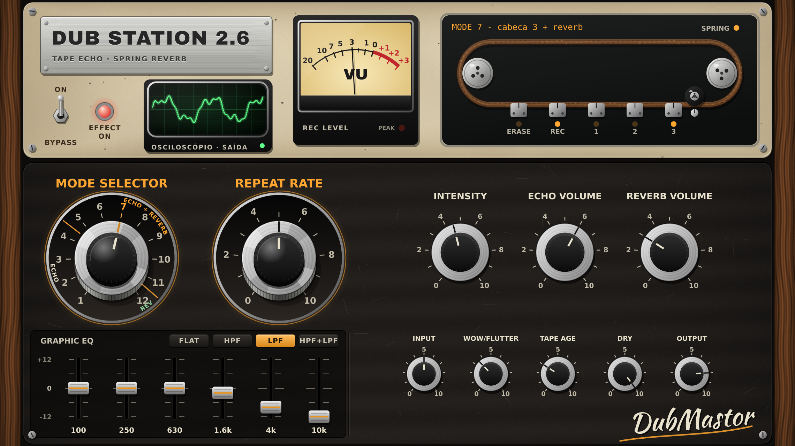
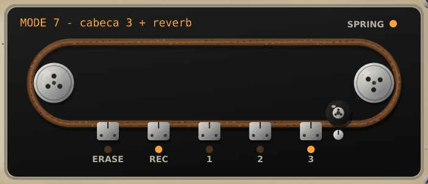

# Mastor Tape Echo MTE-12 2.6 (antigo Dub Station 2.6 / FitaEco TE-12) — Tape Echo + Spring Reverb (VST3 / AU / Standalone)

Por DubMastor.

← [Voltar para a página inicial do repositório](../README.md)





Plugin de delay de fita inspirado nos ecos de fita clássicos de 3 cabeças dos anos 70
(estilo RE-201). Código em C++17 com JUCE 8.

## Controles

| Knob | Função |
|---|---|
| INPUT | Ganho do pré-amplificador (satura a entrada). Ajuste olhando o **VU**: ponteiro perto do 0 = fita no ponto; no vermelho = saturação |
| MODE | Seletor de 12 posições, marcado em três grupos: **ECHO** (1–4), **ECHO + REVERB** (5–11) e **REV** (12) |
| REPEAT RATE | Velocidade da fita. Mudar durante a execução dobra o pitch, como fita de verdade |
| INTENSITY | Realimentação. Acima de ~0,8 (1 cabeça) ou ~0,7 (várias) entra em auto-oscilação |
| ECHO VOL / REVERB VOL | Volume dos ecos e da mola |
| GRAPHIC EQ | 6 faders (100, 250, 630, 1,6k, 4k, 10 kHz), ±12 dB, no eco + reverb. Duplo clique zera. Presets: **FLAT**, **HPF** (corta graves), **LPF** (corta agudos) e **HPF+LPF** (som de rádio) |
| BYPASS | Chave de alavanca: para cima = efeito ligado (lâmpada **EFFECT ON** acesa), para baixo = bypass sem estalo. Também responde ao bypass da DAW |
| WOW/FLUTTER | Instabilidade da fita (wow lento ~0,6 Hz + flutter ~7 Hz + deriva aleatória) |
| TAPE AGE | Fita gasta: mais chiado, mais saturação, cabeças mais escuras |
| DRY / OUTPUT | Nível do sinal seco e saída geral |

### Seletor de modo
| Modo | Cabeças | Reverb |
|---|---|---|
| 1 / 2 / 3 | 1 / 2 / 3 | não |
| 4 | 2+3 | não |
| 5 / 6 / 7 | 1 / 2 / 3 | sim |
| 8 | 1+2 | sim |
| 9 | 2+3 | sim |
| 10 | 1+3 | sim |
| 11 | 1+2+3 | sim |
| 12 | — (só reverb) | sim |

Tempos: cabeça 1 de 175 ms (lento) a 55 ms (rápido); cabeças 2 e 3 em 2× e 3×.

## Modelo de DSP (`Source/TapeEchoDSP.h`)
- Pré-amp com saturação `tanh` → cabeça de gravação com saturação assimétrica
- Loop de fita com interpolação Hermite; velocidade com inércia de motor (0,25 s)
- Perda de agudos nas cabeças dependente da velocidade e do desgaste da fita
- HPF no caminho de realimentação (evita acúmulo de grave, como no original)
- Reverb de mola: cascatas de all-pass dispersivas (o "drip") + duas molas acopladas com amortecimento e modulação
- Chiado de fita, wow & flutter modulando a velocidade de todas as cabeças juntas

## Download

O GitHub Actions compila sozinho a cada push nesta pasta (`.github/workflows/build-tapeecho.yml`):
- **Actions → "Build Mastor Tape Echo MTE-12" → última execução → Artifacts**: `MTE-12-Windows` e `MTE-12-macOS`.
- Quando uma release é publicada na página de **Releases** do repositório, os zips (`MTE-12-macOS.zip` e `MTE-12-Windows.zip`) são anexados a ela automaticamente.

Instalação: copie `Mastor Tape Echo MTE-12.vst3` para `C:\Program Files\Common Files\VST3` (Windows) ou
`~/Library/Audio/Plug-Ins/VST3` (Mac; o AU vai em `~/Library/Audio/Plug-Ins/Components`).

## Como compilar localmente

Requisitos: CMake ≥ 3.22, Git e um compilador C++17
(Windows: Visual Studio 2022 · macOS: Xcode · Linux: g++ + pacotes de dev do JUCE).

```bash
cd TapeEcho
cmake -B build -DCMAKE_BUILD_TYPE=Release
cmake --build build --config Release
```

O CMake baixa o JUCE sozinho (ou use `-DJUCE_DIR=/caminho/JUCE`). O VST3 fica em
`build/FitaEco_artefacts/Release/VST3/`.

Linux — dependências:
```bash
sudo apt install libasound2-dev libx11-dev libxrandr-dev libxinerama-dev libxcursor-dev \
  libfreetype-dev libfontconfig1-dev libgl1-mesa-dev libxext-dev
```

## Teste offline do DSP
```bash
cd tests && g++ -std=c++17 -O2 render_test.cpp -o render_test && ./render_test
```
Roda todos os modos em 44,1/48/96 kHz, auto-oscilação e varredura de velocidade,
verifica estabilidade e grava WAVs.

---
Projeto independente; não é afiliado à Roland. "Space Echo" e "RE-201" são marcas da Roland Corporation,
citadas apenas como referência histórica.

## Fontes embutidas
- **Archivo Black** (placa metálica) — SIL Open Font License, ver `Resources/licenses/ArchivoBlack-OFL.txt`
- **Kaushan Script** (assinatura DubMastor) — SIL Open Font License, ver `Resources/licenses/KaushanScript-OFL.txt`

As fontes são compiladas dentro do plugin (`juce_add_binary_data`), então a interface fica igual em qualquer sistema.
