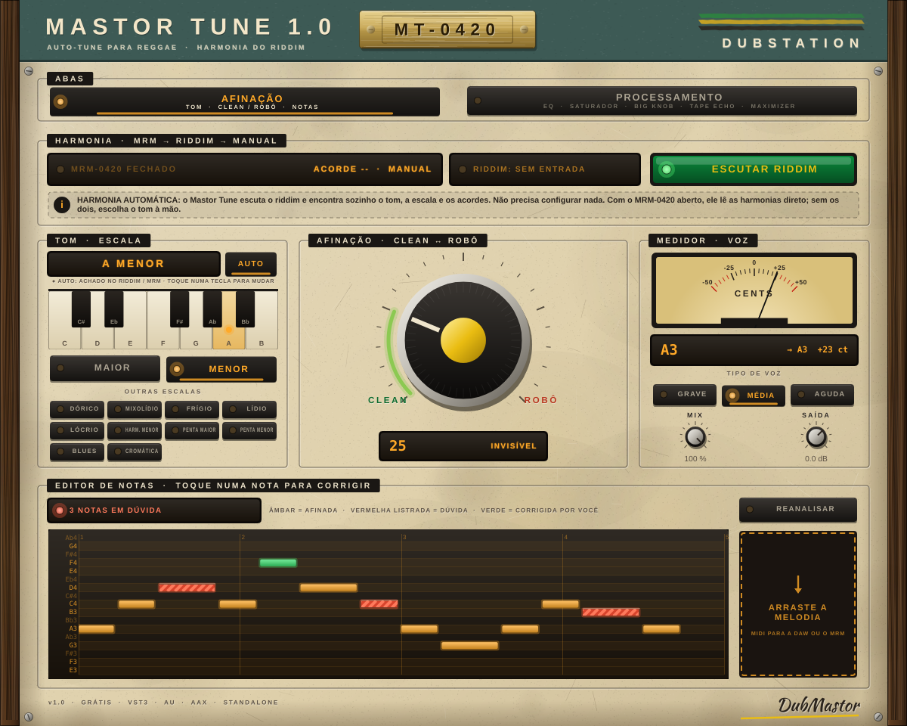
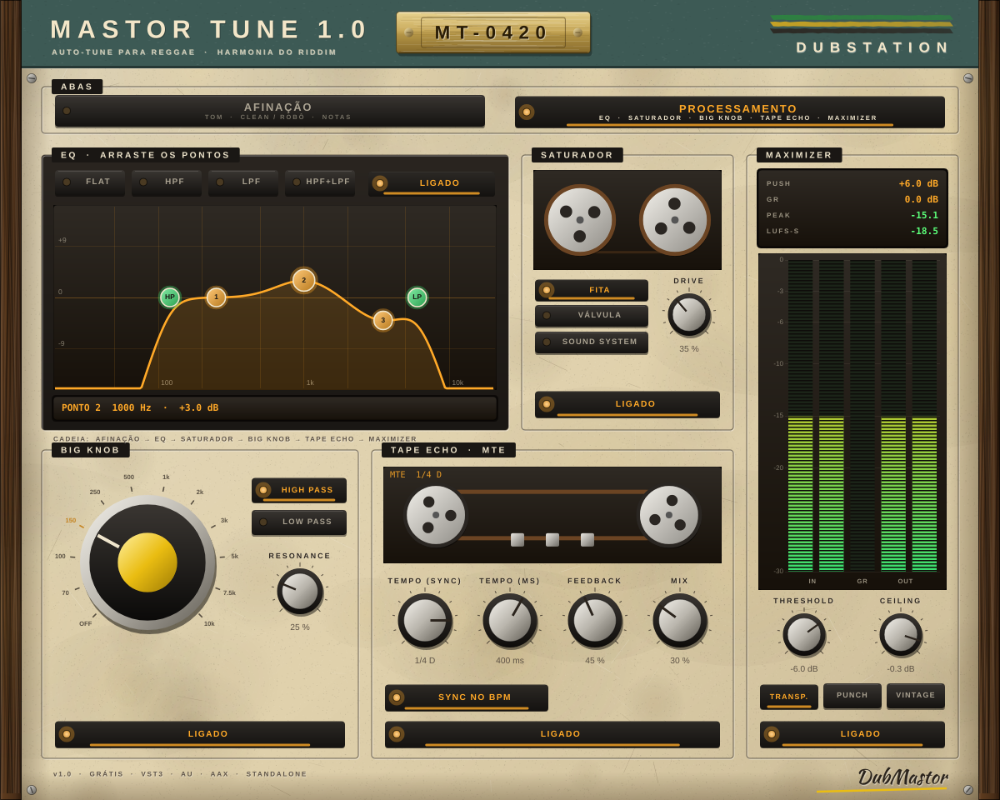

# Mastor Tune MT-0420 1.0 — auto-tune para reggae 🎤

*Linha DubStation*

← [Voltar para a página inicial do repositório](../README.md)

**Downloads:** [Windows](https://github.com/dubmastor/DubMastor-DubStation-/releases/download/MT-0420-1.0/MT-0420-Windows-Instalador.exe) · [Mac](https://github.com/dubmastor/DubMastor-DubStation-/releases/download/MT-0420-1.0/MT-0420-macOS-Instalador.pkg) · [📱 Versão celular / navegador](https://dubmastor.github.io/DubMastor-DubStation-/web/tune/)

Afinador de voz com poucos controles: afina **sem mudar o timbre**, do **clean** (invisível) ao **robô** (hard-tune), e acha a harmonia **sozinho** escutando o riddim ou lendo o **Mastor Riddim Machine MRM-0420**.
Formatos: **VST3** (Windows/macOS), **AU** (macOS), **AAX** (Pro Tools) e **Standalone**.



## AFINAÇÃO

| Parte | O que faz |
|---|---|
| **HARMONIA** | De onde vem o tom e o acorde: **MRM-0420** aberto (link direto) → **MIDI** de outra máquina de harmonia → **riddim** escutado → **manual** |
| **ESCUTAR RIDDIM** | Liga a escuta do riddim pela entrada lateral (sidechain). O plugin acha o tom, maior/menor e o acorde do momento |
| **TOM · ESCALA** | Teclado para o tom, MAIOR / MENOR e as outras escalas. **AUTO** deixa o tom seguir o riddim / MRM; tocar numa tecla passa para o manual |
| **CLEAN ↔ ROBÔ** | Knob grande. Clean: correção lenta que segue o centro da nota e deixa o vibrato; robô: hard-tune instantâneo |
| **MEDIDOR · VOZ** | VU de cents, nota cantada → nota escolhida, tipo de voz (grave, média, aguda), MIX e SAÍDA |
| **EDITOR DE NOTAS** | As notas cantadas aparecem presas à timeline. **Vermelha listrada** = dúvida (entre duas notas ou fora do acorde). Toque numa nota e escolha a certa ou AUTO: a nota fica **verde** e já toca corrigida. REANALISAR limpa tudo |
| **ARRASTE A MELODIA** | Arraste para a DAW ou para o MRM: o MIDI da melodia afinada |

Como ligar a escuta do riddim: no canal da voz, abra o Mastor Tune e mande o riddim (ou o grupo da base) para a **entrada lateral / side-chain** dele (Cubase: botão de side-chain no plugin; Ableton: "Sidechain" no topo do plugin; Logic: menu Side Chain; Reaper: canais 3/4; Pro Tools: Key Input).

Link com o MRM-0420: abra o **Mastor Riddim Machine MRM-0420 2.3** (ou mais novo) na mesma DAW. Não precisa rotear nada: o MRM publica a harmonia e o Mastor Tune lê.

Editor de notas: funciona em todas as DAWs (inclusive o Ableton Live), preso à posição da timeline. Se mover o clipe da voz na DAW, use **REANALISAR** e toque de novo.

## PROCESSAMENTO



Tudo começa **desligado**. Cadeia: afinação → EQ → saturador → Big Knob → Tape Echo → Maximizer.

| Módulo | Controles |
|---|---|
| **EQ** | Gráfico com 5 pontos para arrastar com o mouse: HP e LP (24 dB/oit) e 3 sinos. Duplo clique volta o ponto ao padrão. Presets FLAT, HPF, LPF e HPF+LPF |
| **SATURADOR** | Fita, Válvula e Sound System, com DRIVE |
| **BIG KNOB** | O filtro por degraus do Mastor Big Knob (High Pass / Low Pass) com ressonância |
| **TAPE ECHO** | O eco de fita do kit: tempo no BPM ou livre, feedback e mix |
| **MAXIMIZER** | Threshold, Ceiling, modos Transparente / Punch / Vintage, medidores IN / GR / OUT, PEAK e LUFS |

## Para compilar

```
cmake -B build -DCMAKE_BUILD_TYPE=Release
cmake --build build --config Release
```

Teste do DSP (sem JUCE): `g++ -std=c++17 -O2 tests/render_test.cpp -o render_test && ./render_test`
Imagens da interface: `cmake -B build -DMT_RENDER_TEST=ON && cmake --build build --target mt_render`
